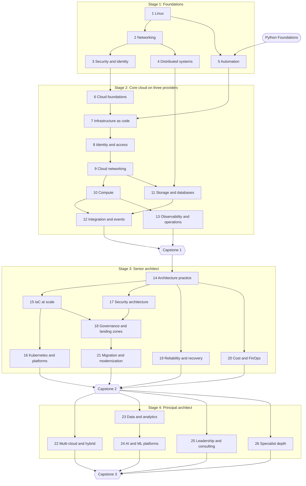

# Cloud Solutions Architect track (multi-cloud)

This track takes a learner to the work of a senior, then principal, cloud solutions architect on AWS, Microsoft Azure and Google Cloud. It aims at the top of the pay band: an architect who can design an enterprise's cloud estate, build the hard parts themselves, keep it secure, reliable and affordable, and win executives' support.

**Status: specified, not built.** It's the second track, after Python Foundations. Building it needs two things first: the app has to support more than one track, and the lab checker from [ADR-0014](../decisions/0014-cloud-labs.md) (proposed) has to exist. See [Building it](#building-it).

- **Size:** 26 modules in 4 stages, about 210 topics, plus a specialty. Every module ends with a checkpoint, and stages 2–4 each end with a capstone.
- **Proven by doing.** Every topic gets the platform's four proofs ([ADR-0002](../decisions/0002-mastery-and-gating.md)), done in the learner's own cloud accounts:
  - build it from a blank file;
  - explain it;
  - fix a broken version;
  - still do it weeks later.

  The senior stages add design reviews, game days, and defending a design to skeptical stakeholders.
- **Multi-cloud by default.** Core topics are built on all three clouds, and their explain checks ask how the clouds differ. Multi-cloud designs usually go wrong at those differences.
- **Time:** roughly 1,500–1,800 hours of focused work including reviews. That's about 18–24 months at 15–20 hours a week. A learner with IT experience can skip much of Stage 1 with "prove it now".
- **Practice environments:** it assumes access to AWS, Azure and Google Cloud accounts. Cost control counts as part of the job (see [Lab safety and cost](#lab-safety-and-cost)).

| Stage | Modules | Topics | Ends with | Rough hours |
|---|---|---|---|---|
| 1. Foundations | 1–5 | 45 | Level 1 | 150–200 |
| 2. Core cloud on three providers | 6–13 | 64 | Capstone 1 | 400–450 |
| 3. Senior architect | 14–21 | 69 | Capstone 2 | 450–550 |
| 4. Principal architect | 22–26 | 32, plus a specialty | Capstone 3 | 350–450 |

## What senior architects at the top of the pay band do

They're paid for judgment backed by hands-on depth. The track is built around what they do that others don't:

1. **Design across clouds, and say why.** They choose services, regions and patterns on three clouds, and write the trade-offs down so others can review them.
2. **Go deep where systems break.** Outages and breaches start in networking, identity, data and security. They debug at the level of packets, policies and queries.
3. **Build the hard parts themselves.** They write a reference implementation or proof of concept as code, in days.
4. **Run it, not just draw it.** They define SLOs, plan for failure, and lead the response when it comes.
5. **Treat cost as a design input.** They know what a design will cost before it's built. They know how to cut a bill without hurting reliability.
6. **Govern at scale.** With hundreds of accounts, many teams and auditors, they set guardrails that keep everyone safe without slowing them down.
7. **Move estates.** They plan and lead migrations with little downtime and a way back.
8. **Influence.** They find the real problem in a discovery conversation, write for executives, build business cases, and defend designs under pressure.
9. **Go deep in one or two areas,** such as networking, security, data and AI, platforms, migration, or FinOps.

## Levels

| Level | Reached at | You can… |
|---|---|---|
| 1. Cloud-ready engineer | End of Stage 1 | work confidently with Linux, networks, security and distributed-systems ideas; automate with Python and Git |
| 2. Associate architect on three clouds | Capstone 1 | build and explain standard architectures on AWS, Azure and Google Cloud, all as code |
| 3. Senior architect | Capstone 2 | design, secure, govern and cost enterprise systems; lead migrations; run game days |
| 4. Principal architect | Capstone 3 | set multi-cloud strategy, design data and AI platforms, and win executive support, with a deep specialty |

## Words used here

- **Infrastructure as code (IaC):** describing cloud resources in files, which a tool then creates and updates for you. This track uses Terraform's language, HCL, run with OpenTofu or Terraform.
- **Landing zone:** the ready-made foundation that every team's workloads land in: accounts, networks, identity and guardrails.
- **SLO (service level objective):** a target for how well a service works, such as "99.9% of requests succeed".
- **RPO and RTO:** after a disaster, the recovery point objective is how much recent data you can afford to lose. The recovery time objective is how long you can afford to be down.
- **FinOps:** managing cloud cost as an ongoing, shared job of engineering and finance.
- **Lab checker:** the platform's tool that inspects what you built in your cloud account and checks that it works ([ADR-0014](../decisions/0014-cloud-labs.md)).
- **Fault module:** code that deliberately breaks something in your sandbox, for a debugging proof or a game day.
- **Game day:** a real failure, caused on purpose, that you have to recover from against the clock.

## How competency is proven

Every topic and checkpoint gets the platform's four proofs, adapted for cloud work:

| Proof | In this track | How it's checked |
|---|---|---|
| **Build from blank** | From a written brief, build the topic's thing in your sandbox. There's no starter code and no AI. From Module 7 on, everything is built as code, and most topics are built on all three clouds. | The lab checker inspects the result through each cloud's APIs, with read-only access, and probes how it behaves. It sends requests, looks up names, and asks each cloud's policy simulator whether forbidden actions are denied. |
| **Explain it back** | Explain why it works, how the three clouds differ, and the trade-offs. | Graded by AI against a rubric ([ADR-0013](../decisions/0013-explain-grading.md)). |
| **Debug unfamiliar work** | A fault module deploys a broken environment into your sandbox. Find and fix the faults. | The checker confirms the symptoms are gone *and* that the fix is right. For example, you didn't open a port to the whole internet or grant admin rights to make it work. |
| **Survives spaced review** | Short reviews: drills and code katas checked offline, and now and then a timed rebuild of a key lab. | Drills run as Python in the browser, code katas are tested offline, and the checker covers rebuilds. |

From Stage 3, three more proofs test senior judgment:

| Proof | What you do | How it's checked |
|---|---|---|
| **Design review** | Turn a messy brief into a design document, diagrams, decision records and a cost estimate. | AI grades the reasoning against a rubric. Code checks the numbers (cost, availability, capacity) within a tolerance. |
| **Game day** | Something in your environment really fails. Restore service, then write the postmortem. | The checker measures time to detect, time to recover, and data lost, against the stated RTO and RPO. AI grades the postmortem. |
| **Defend it** | AI plays stakeholders, such as a CISO, a CFO and an SRE lead, and questions your design. | Graded against a rubric: did you answer the real concern, with evidence, and own the trade-offs? |

**Standards, not just correctness.** Checkpoints have time limits and accuracy targets, because fluency is part of competency. A senior architect plans a subnet layout in minutes and restores a service within its RTO.

**AI rules don't change** ([ADR-0003](../decisions/0003-ai-roles-and-guardrails.md)). The tutor gives hints, never answers, and is off during proofs. AI help for writing infrastructure code unlocks only after the skill is proven without it. In "Defend it", AI is the examiner: it asks questions and never helps.

## Drills: practice that builds speed

Drills are short, repeatable exercises for skills that need to be fast. Most of the review pool is drills, because they're quick and cost nothing to run.

| Drill | Example | Runs in | Target |
|---|---|---|---|
| Subnetting | Split a /14 across 4 regions × 3 zones × 3 tiers, with room to double | The browser (Python) | Under 5 minutes, no overlaps |
| Policy evaluation | Given an SCP, a permission boundary, an identity policy and a bucket policy, is this request allowed? | The browser | Right 9 times in 10, about a minute each |
| Route prediction | Which route wins, and where does this packet go? | The browser | Right 9 times in 10 |
| Name resolution | From this spoke network, what does this storage account's name resolve to? | The browser | Right 9 times in 10 |
| Availability and recovery math | The availability of this design; the cheapest recovery strategy that meets an RPO of 5 minutes and an RTO of 1 hour | The browser | Within 0.01% |
| Cost estimation | This design's monthly cost; a commitment's break-even point | The browser | Within 15% |
| Capacity | How many partitions, shards or instances for this load? | The browser | Within 20% |
| Code katas | A private, zone-redundant web tier from a blank file | Your machine, checked offline | 45 minutes |
| Break-fix | Three faults in an unfamiliar environment | Your sandbox, with the checker | 30 minutes |
| Whiteboard | A design prompt, answered out loud and in a diagram | The browser, graded by AI | 45 minutes |
| Executive brief | One page: the answer, the reasons, the risks, the ask | The browser, graded by AI | 30 minutes |

## Lab safety and cost

Labs run in your own cloud accounts and cost real money. Controlling that is part of the job, so it's part of the track ([ADR-0014](../decisions/0014-cloud-labs.md)):

- **Sandboxes only.** Labs run in accounts, subscriptions and projects made for practice, never in production or an employer's.
- **Guardrails first.** Module 6 starts by setting budgets and alerts, restricting regions, and blocking the most expensive services. Nothing else gets built before that.
- **Every lab states its expected cost and how long it runs.** It tags everything it creates with its topic ID. Tearing down is part of the proof: the checker confirms nothing tagged is still running.
- **Your credentials stay on your machine.** The checker runs locally with a read-only identity. The platform receives only which checks passed.
- **You can read everything that changes your sandbox.** Fault modules and game days are code you apply yourself. To keep the test fair, each picks its faults at random from a published list.
- **Stand-ins for what one person can't buy.** Physical circuits (Direct Connect, ExpressRoute, Cloud Interconnect) and large GPU clusters are designed and reviewed. You practise with a stand-in: a VPN with BGP, or a single GPU.

## Module map

Within a module, most topics can be done in more than one order.

## Stage 1: Foundations

These are the fundamentals every later module stands on. Most of the practice runs locally, in containers on your own machine, so it costs nothing. Python Foundations is needed from Module 5.

### Module 1: Linux and the command line

| # | Topic | ID | You'll be able to… |
|---|---|---|---|
| 1 | Shell essentials | `csa.linux.shell` | find files and answer questions about logs with pipes, `grep`, `sed`, `awk` and `jq` |
| 2 | Users, permissions and SSH | `csa.linux.permissions` | set ownership and permissions; manage users, groups and `sudo`; use SSH keys safely |
| 3 | Services and logs | `csa.linux.services` | run and supervise services with systemd, and read their logs with `journalctl` |
| 4 | Disks and filesystems | `csa.linux.storage` | attach, format, mount and grow a disk; fix "disk full", including running out of inodes and deleted files held open |
| 5 | Networking from the host | `csa.linux.net-tools` | inspect interfaces, routes and sockets with `ip` and `ss`; test with `curl`, `dig`, `nc` and `traceroute`; capture traffic with `tcpdump` |
| 6 | Shell scripting | `csa.linux.scripting` | write Bash scripts that stop safely on errors (`set -euo pipefail`, traps) and are safe to run twice |
| 7 | Performance triage | `csa.linux.triage` | find out why a server is slow with the USE method: utilization, saturation and errors |
| 8 | Hardening | `csa.linux.hardening` | apply a security baseline, then prove it with a benchmark scan |

**Checkpoint 1: the broken server** (`csa.m1.checkpoint`). You get a container with five planted faults:
- a full disk;
- a service failing on a bad config;
- a key with the wrong permissions;
- a blocked port;
- a runaway process.

Restore service within 45 minutes without weakening security. Turning the firewall off fails the check.

### Module 2: Networking

Networking and DNS sit under every cloud service, and they're behind many outages. This module goes deep. Its labs run in local containers with real routing software (FRRouting), VPN software (strongSwan) and DNS servers.

| # | Topic | ID | You'll be able to… |
|---|---|---|---|
| 9 | Layers and packets | `csa.net.layers` | follow a request down and up the network layers; explain encapsulation and MTU, and spot MTU problems |
| 10 | IPv4 and CIDR | `csa.net.cidr` | split and summarize address blocks and check them for overlaps, by hand and in code |
| 11 | IPv6 | `csa.net.ipv6` | plan IPv6 addressing; run dual stack; explain why IPv6 egress doesn't use NAT |
| 12 | Routing | `csa.net.routing` | predict the next hop with longest-prefix match; spot asymmetric routes and black holes |
| 13 | NAT | `csa.net.nat` | explain source and destination NAT; size NAT for connection counts; diagnose port exhaustion |
| 14 | TCP and UDP | `csa.net.transport` | read a TCP handshake in a capture; explain timeouts and keepalives, and why idle connections get cut |
| 15 | DNS | `csa.net.dns` | trace a lookup end to end; use record types, TTLs and split-horizon DNS; lower TTLs ahead of a move |
| 16 | HTTP and TLS | `csa.net.http-tls` | explain HTTP/1.1, 2 and 3; read a TLS handshake; issue, chain and rotate certificates; set up mutual TLS |
| 17 | Load balancing | `csa.net.load-balancing` | choose between layer 4 and layer 7; design health checks, draining and stickiness; explain how a bad health check takes down a fleet |
| 18 | BGP | `csa.net.bgp` | bring up BGP sessions; advertise and filter prefixes; steer traffic with local preference, AS-path prepending and MED |
| 19 | VPNs and IPsec | `csa.net.ipsec` | build a route-based IPsec tunnel with BGP over it; debug phase 1 and phase 2 failures |
| 20 | Network troubleshooting | `csa.net.troubleshooting` | find a fault from its symptoms with a repeatable method, using captures, traceroute, DNS lookups and logs |

**Checkpoint 2: the address plan and the outage** (`csa.m2.checkpoint`).
1. Build an IPv4 and IPv6 address plan for three clouds, four regions and two data centers, with room for five years' growth. Code checks it for overlaps, block sizes and summarization.
2. Fix a local network of routers, a DNS server and an app. It has an intermittent outage caused by three faults.

### Module 3: Security and identity foundations

| # | Topic | ID | You'll be able to… |
|---|---|---|---|
| 21 | Threat modeling | `csa.sec.threat-modeling` | threat-model a system with data-flow diagrams and STRIDE, and rank the risks |
| 22 | Authentication and authorization | `csa.sec.authn-authz` | tell authentication from authorization; apply MFA, least privilege and separation of duties; compare role-based and attribute-based access |
| 23 | Applied cryptography | `csa.sec.crypto` | choose symmetric or asymmetric encryption; explain hashes, MACs and signatures; design envelope encryption |
| 24 | Certificates and PKI | `csa.sec.pki` | run a private certificate authority; issue, revoke and rotate certificates; fix chain errors |
| 25 | SAML, OAuth 2.0 and OIDC | `csa.sec.federation` | trace a single sign-on and an OAuth flow; validate a token; choose the right flow for an app |
| 26 | Secrets | `csa.sec.secrets` | keep secrets out of code, images and logs; rotate them; catch leaks with scanners |
| 27 | Audit logging | `csa.sec.audit` | decide what to log and how long to keep it; make logs tamper-evident |
| 28 | Zero trust | `csa.sec.zero-trust` | apply zero-trust principles (NIST SP 800-207): identity-aware access, device posture, micro-segmentation |
| 29 | Compliance basics | `csa.sec.compliance` | read a control framework (SOC 2, ISO 27001, PCI DSS) and map a control to technical evidence |

**Checkpoint 3: the threat model and the broken sign-in** (`csa.m3.checkpoint`).
1. Threat-model a web app that takes payments, and design its controls.
2. Fix a single sign-on, run locally with an open-source identity provider, that fails in three ways: the wrong audience, the wrong redirect, and clock skew.

### Module 4: Distributed systems for architects

| # | Topic | ID | You'll be able to… |
|---|---|---|---|
| 30 | Estimation | `csa.ds.estimation` | estimate requests per second, storage, bandwidth and cost from a one-paragraph brief, within a factor of 2 |
| 31 | Latency | `csa.ds.latency` | budget latency end to end; know the orders of magnitude, from memory to another continent |
| 32 | Availability math | `csa.ds.availability` | compute the availability of components in series, in parallel and with failover; turn an SLA into allowed downtime |
| 33 | Consistency | `csa.ds.consistency` | explain strong, eventual, read-your-writes and causal consistency, and the CAP and PACELC theorems; choose per use case |
| 34 | Replication | `csa.ds.replication` | compare synchronous and asynchronous, leader-follower, multi-leader and quorum replication; predict data loss on failover |
| 35 | Partitioning | `csa.ds.partitioning` | choose partition keys; spot hot partitions; plan resharding |
| 36 | Caching | `csa.ds.caching` | choose a caching pattern; set TTLs; prevent cache stampedes |
| 37 | Queues and streams | `csa.ds.messaging` | explain delivery guarantees, ordering, idempotency, backpressure and dead-letter queues |
| 38 | Handling failure | `csa.ds.failure` | design timeouts, retries with jittered backoff, circuit breakers and bulkheads; prevent retry storms |
| 39 | Capacity | `csa.ds.capacity` | apply Little's law and utilization limits; plan capacity with headroom |

**Checkpoint 4: the napkin design** (`csa.m4.checkpoint`).
1. From a short brief, estimate the load, storage and cost. The estimates are checked within a tolerance.
2. Design for the availability target, with the math shown.
3. Find the flaws in someone else's design: a retry storm, a hot partition and a single point of failure.

### Module 5: Automation foundations

This module needs Python Foundations.

| # | Topic | ID | You'll be able to… |
|---|---|---|---|
| 40 | Git for infrastructure | `csa.auto.git` | branch, review and merge infrastructure changes; resolve conflicts |
| 41 | Cloud command lines | `csa.auto.cli` | drive `aws`, `az` and `gcloud` with profiles, and filter their output |
| 42 | Cloud SDKs in Python | `csa.auto.sdk` | call all three clouds' Python SDKs; page through results; retry when throttled |
| 43 | APIs and data formats | `csa.auto.apis` | read and write JSON and YAML; call REST APIs with authentication; respect rate limits |
| 44 | Containers | `csa.auto.containers` | build small, secure images (multi-stage, not running as root); push them to a registry; scan them |
| 45 | Continuous integration | `csa.auto.ci` | run tests, linters and scanners on every pull request |

**Checkpoint 5: the estate inventory** (`csa.m5.checkpoint`). Build a read-only Python tool that lists compute, storage and public endpoints across all three clouds, and flags resources that are untagged or public.
- It's tested offline against recorded API responses.
- Once Module 6 has built your sandbox, it's run against that too.

## Stage 2: Core cloud on three providers

This is associate level, on all three clouds. Most topics are taught once as a concept, then built on AWS, Azure and Google Cloud, and their explain checks ask how the clouds differ. A few topics cover one cloud's own model; Module 8 has one for each cloud. The [appendix](#same-idea-three-clouds) maps the equivalent services.

### Module 6: Cloud foundations

| # | Topic | ID | You'll be able to… |
|---|---|---|---|
| 46 | Cloud models and shared responsibility | `csa.cloud.models` | place IaaS, PaaS, SaaS and serverless on the shared-responsibility line; say who patches what |
| 47 | Regions and zones | `csa.cloud.regions` | choose regions and zones by latency, data residency, available services and price; explain how zones differ between the clouds |
| 48 | Resource hierarchies | `csa.cloud.hierarchy` | set up AWS Organizations, Azure management groups and subscriptions, and Google Cloud folders and projects; explain what each level inherits |
| 49 | Billing guardrails | `csa.cloud.billing` | set budgets, alerts and anomaly detection on all three clouds, before building anything else |
| 50 | Pricing models | `csa.cloud.pricing` | compare on-demand prices, commitments, spot capacity and free tiers; estimate a bill; find the hidden costs: egress, NAT, cross-zone traffic and logs |
| 51 | Quotas and limits | `csa.cloud.quotas` | find and raise quotas; design around the limits that can't be raised |
| 52 | Control plane and data plane | `csa.cloud.planes` | explain why control-plane and data-plane failures differ; design for static stability |

**Checkpoint 6: the safe sandbox** (`csa.m6.checkpoint`). Build this on all three clouds:
- a practice hierarchy;
- admin access protected by MFA;
- budgets that alert at 50, 80 and 100%;
- allowed regions only;
- a read-only identity for the checker.

The checker confirms that the budgets and alerts are in place, that a test deployment to a forbidden region is refused, and that its own identity can't change anything.

### Module 7: Infrastructure as code

From here on, everything is built as code.

| # | Topic | ID | You'll be able to… |
|---|---|---|---|
| 53 | Why infrastructure as code | `csa.iac.concepts` | explain declarative code, idempotency and drift, and why infrastructure built by clicking can't be trusted |
| 54 | Terraform and OpenTofu basics | `csa.iac.basics` | write providers, resources, variables and outputs; plan and apply on all three clouds |
| 55 | State | `csa.iac.state` | keep state remotely, with locking, on each cloud; explain what state holds and why it's sensitive |
| 56 | Expressions and iteration | `csa.iac.expressions` | use `for_each`, `count`, locals and data sources without making the code unreadable |
| 57 | Modules | `csa.iac.modules` | wrap a pattern in a module and reuse it with different inputs |
| 58 | Importing and refactoring | `csa.iac.refactoring` | bring resources built by hand under code; rename and move resources without destroying them |
| 59 | Each cloud's own tools | `csa.iac.native` | read and write small CloudFormation or CDK, Bicep, and Infrastructure Manager deployments; know when the native tool wins |

**Checkpoint 7: storage from a blank file** (`csa.m7.checkpoint`). In 45 minutes, starting from an empty file, build a storage bucket on each cloud with versioning, encryption, a lifecycle policy and no public access, keeping its state remotely. It's checked offline first, with tests against mocked providers and policy checks, then live.

### Module 8: Identity and access on three clouds

| # | Topic | ID | You'll be able to… |
|---|---|---|---|
| 60 | AWS IAM policies | `csa.iam.aws-policies` | write identity and resource policies; predict how a request is evaluated against SCPs, RCPs, permission boundaries and session policies |
| 61 | AWS roles and federation | `csa.iam.aws-roles` | use roles and temporary credentials; set up access across accounts and IAM Identity Center |
| 62 | Azure identity and RBAC | `csa.iam.azure-rbac` | use Entra ID groups, service principals and managed identities; assign roles at the right scope; use Privileged Identity Management for just-in-time admin |
| 63 | Google Cloud IAM | `csa.iam.gcp-iam` | grant roles at the organization, folder, project and resource levels; use service accounts by impersonation, without keys; use IAM conditions and deny policies |
| 64 | One sign-in for people | `csa.iam.sso` | connect one identity provider to all three clouds; map groups to roles; keep a break-glass account |
| 65 | Keyless workloads | `csa.iam.workload-identity` | let CI and workloads reach all three clouds through workload identity federation, with no long-lived keys, including one cloud calling another |
| 66 | Least privilege at scale | `csa.iam.least-privilege` | find unused and excessive permissions with each cloud's analyzers, and remove them without breaking anything |
| 67 | Fixing "access denied" | `csa.iam.troubleshooting` | debug access failures on each cloud with policy simulators, troubleshooters and audit logs |

**Checkpoint 8: one identity, three clouds** (`csa.m8.checkpoint`). Build:
- single sign-on for two people: an admin who gets access just in time, and a developer who's read-only in production;
- keyless CI that deploys to all three clouds;
- a function on one cloud that reads data on another, with no stored key.

The checker asks each cloud's policy simulator about 30 actions: 20 must be denied and 10 allowed. It also confirms that no long-lived keys exist.

### Module 9: Networking on three clouds

| # | Topic | ID | You'll be able to… |
|---|---|---|---|
| 68 | Virtual networks | `csa.cnet.vnet` | build AWS VPCs, Azure VNets and Google Cloud VPCs; explain why Google's networks are global and the others regional |
| 69 | Routing and egress | `csa.cnet.egress` | route public, private and isolated subnets; use each cloud's NAT; control egress for IPv6 |
| 70 | Firewalls and segmentation | `csa.cnet.firewalls` | segment networks with security groups and network ACLs, network security groups, and Google Cloud firewall policies; deny by default |
| 71 | Cloud DNS | `csa.cnet.dns` | run private zones and hybrid name resolution with Route 53 Resolver, Azure DNS Private Resolver, and Cloud DNS forwarding and peering |
| 72 | Private access to services | `csa.cnet.private-access` | reach storage and databases without crossing the internet, through PrivateLink, private endpoints and Private Service Connect, and prove nothing else can reach them ([in full below](#one-topic-in-full)) |
| 73 | Load balancers | `csa.cnet.load-balancers` | choose among each cloud's layer 4, layer 7, regional and global load balancers |
| 74 | Hub and spoke | `csa.cnet.hub-spoke` | connect many networks through Transit Gateway or Cloud WAN, Azure hub-and-spoke or Virtual WAN, and Shared VPC or Network Connectivity Center; explain why peering doesn't chain |
| 75 | Hybrid connectivity | `csa.cnet.hybrid` | connect a simulated data center by site-to-site VPN with BGP; design redundant Direct Connect, ExpressRoute and Cloud Interconnect links |
| 76 | Cross-cloud connectivity | `csa.cnet.cross-cloud` | connect AWS, Azure and Google Cloud with BGP over IPsec; plan for managed cross-cloud interconnects; control routes and costs |
| 77 | The edge: CDN, WAF and DDoS | `csa.cnet.edge` | put an app behind CloudFront, Front Door or Cloud CDN, with WAF rules and DDoS protection; cache correctly |
| 78 | Network visibility | `csa.cnet.visibility` | prove or disprove a network path with flow logs and reachability tools (Reachability Analyzer, Network Watcher, Connectivity Tests) |
| 79 | Cloud network troubleshooting | `csa.cnet.troubleshooting` | fix the classics: overlapping address ranges, missing routes, private-endpoint DNS, NAT exhaustion, MTU over VPN, asymmetric routing through firewalls |

**Checkpoint 9: three clouds, one network** (`csa.m9.checkpoint`).
1. Build a hub and spokes on each cloud, joined to each other and to a simulated data center by BGP over IPsec. Private names resolve across all four, and no workload has a public address.
2. The checker tests a matrix of allowed and denied paths, and name resolution from every spoke.
3. A fault module drops one tunnel. Traffic must fail over within 60 seconds.
4. Then a break-fix with four faults.

### Module 10: Compute

| # | Topic | ID | You'll be able to… |
|---|---|---|---|
| 80 | Virtual machines | `csa.compute.vms` | choose instance families and sizes; use images and startup scripts; connect without public addresses (Session Manager, Azure Bastion, Identity-Aware Proxy) |
| 81 | Images and patching | `csa.compute.images` | build golden images; patch fleets by replacing instances, not by hand |
| 82 | Autoscaling | `csa.compute.autoscaling` | build Auto Scaling groups, scale sets and managed instance groups with health checks and the right scaling signals |
| 83 | Functions | `csa.compute.functions` | build on Lambda, Azure Functions and Cloud Run functions; handle cold starts, concurrency, timeouts and limits |
| 84 | Serverless containers | `csa.compute.containers` | run containers on Fargate, Azure Container Apps and Cloud Run; scale to zero; split traffic between revisions |
| 85 | Spot capacity | `csa.compute.spot` | run work that can be interrupted on spot capacity on all three clouds, and handle the interruption notice |
| 86 | Batch, HPC and GPUs | `csa.compute.batch-gpu` | run batch jobs; reserve GPU capacity; place instances close together for performance |
| 87 | Choosing compute | `csa.compute.choosing` | choose between VMs, containers and functions by cost, latency, operational load and lock-in, with numbers |

**Checkpoint 10: one API, three platforms** (`csa.m10.checkpoint`).
1. Run the same API on each cloud's serverless container platform, and load-test it to 1,000 requests a second.
2. Report the p99 latency and the cost per million requests for each cloud. The checker confirms from the metrics that scaling happened, and that nothing is reachable by SSH.
3. Fix an autoscaler that never scales and a function that times out on cold starts.

### Module 11: Storage and databases

| # | Topic | ID | You'll be able to… |
|---|---|---|---|
| 88 | Object storage | `csa.data.object` | use S3, Blob Storage and Cloud Storage: storage classes, lifecycle, versioning, replication, immutability, and access only through private paths |
| 89 | Block and file storage | `csa.data.block-file` | choose disks by IOPS and throughput; take snapshots; choose a shared file service |
| 90 | Managed relational databases | `csa.data.relational` | run RDS or Aurora, Azure SQL or Azure Database for PostgreSQL, and Cloud SQL or AlloyDB with high availability, replicas, backups and private access |
| 91 | Global databases | `csa.data.global` | compare Spanner, Cosmos DB, DynamoDB global tables and Aurora DSQL on consistency, latency and cost |
| 92 | NoSQL data modeling | `csa.data.nosql` | model DynamoDB, Cosmos DB and Firestore or Bigtable from access patterns; choose partition keys |
| 93 | Managed caches | `csa.data.cache` | use each cloud's managed Redis or Valkey cache with cache-aside and TTLs; know how it fails over |
| 94 | Backup and restore | `csa.data.backup` | back up to immutable vaults, copy across regions and accounts, and measure a real restore |
| 95 | Database migration | `csa.data.db-migration` | migrate a database with change data capture, using each cloud's database migration service, and cut over in minutes |
| 96 | Choosing data stores | `csa.data.choosing` | choose a data store from access patterns, consistency, scale and cost, and defend the choice |

**Checkpoint 11: the order data tier** (`csa.m11.checkpoint`).
1. Model an order system's data from its access patterns.
2. Run it with high availability, backed up to an immutable vault.
3. Restore it against the clock. The checker measures the RPO and RTO you actually achieved.
4. Fix a hot partition and a lagging replica.

### Module 12: Integration and events

| # | Topic | ID | You'll be able to… |
|---|---|---|---|
| 97 | Queues | `csa.int.queues` | use SQS, Service Bus queues and Pub/Sub, with visibility timeouts, dead-letter queues and ordering |
| 98 | Events and pub/sub | `csa.int.events` | fan out and filter events with SNS and EventBridge, Event Grid, and Pub/Sub and Eventarc |
| 99 | Streaming | `csa.int.streaming` | use Kinesis or MSK, Event Hubs, and Pub/Sub or managed Kafka: partitions, ordering, retention, consumer groups |
| 100 | Workflows and sagas | `csa.int.workflows` | orchestrate with Step Functions, Durable Functions or Logic Apps, and Workflows; undo finished steps with compensating actions |
| 101 | API gateways | `csa.int.api-gateways` | publish APIs through API Gateway, API Management and Apigee, with authentication, throttling and versions |
| 102 | Reliable messaging patterns | `csa.int.patterns` | build the outbox pattern and idempotent consumers; handle poison messages; explain why "exactly once" usually means "effectively once" |

**Checkpoint 12: the order pipeline** (`csa.m12.checkpoint`). Build an event-driven order pipeline on one cloud, then rebuild it on a second. A fault module injects a poison message, a consumer outage and duplicate deliveries. The checker then audits the ledger: no order may be lost, and none charged twice.

### Module 13: Observability and operations

| # | Topic | ID | You'll be able to… |
|---|---|---|---|
| 103 | Metrics, logs and traces | `csa.ops.telemetry` | use each cloud's monitoring, logging and tracing |
| 104 | OpenTelemetry | `csa.ops.otel` | instrument code once with OpenTelemetry and send the data anywhere; keep cardinality and cost under control |
| 105 | SLOs and error budgets | `csa.ops.slos` | define SLIs and SLOs; alert on burn rate; decide what happens when the error budget runs out |
| 106 | Alerts and runbooks | `csa.ops.alerting` | page people only when users are hurting, with a runbook for every alert |
| 107 | Incident management | `csa.ops.incidents` | run an incident (command, communication, a timeline) and write a blameless postmortem |
| 108 | Audit logs | `csa.ops.audit-logs` | collect CloudTrail, Azure activity and Entra logs, and Cloud Audit Logs in one place; keep and query them |
| 109 | Operating three clouds | `csa.ops.multi-cloud` | get one view across clouds with shared collectors, central logs and consistent tags, at a known cost for the telemetry |

**Checkpoint 13: the first game day** (`csa.m13.checkpoint`).
1. Set up SLO alerts for Module 10's API on all three clouds, with traces that follow a call across two clouds.
2. A game-day module breaks something at a random time. Your alert must fire within 5 minutes, and you must find the cause from the traces.
3. Write the postmortem; it's graded.

### Capstone 1: one product, three clouds

`csa.capstone-1`, about 35 hours. Build a small software-as-a-service product on all three clouds, from one repository. It has:
- a web front end, an API, a database and background jobs;
- keyless CI;
- a private data tier;
- an edge with a WAF;
- SLOs and alerts.

It must stay within a daily cost cap. The checker runs its full suite on each cloud, then confirms the teardown. The explain compares the three builds: cost, effort, and what each cloud made harder.

## Stage 3: Senior architect

This stage adds depth, judgment and scale. Design reviews, game days and "Defend it" join the proofs.

### Module 14: The architecture practice

| # | Topic | ID | You'll be able to… |
|---|---|---|---|
| 110 | Requirements and constraints | `csa.arch.requirements` | turn a vague brief into requirements, constraints and assumptions; ask the questions that change the design |
| 111 | Trade-offs | `csa.arch.tradeoffs` | make trade-offs explicit with quality-attribute scenarios; find the decisions everything else depends on |
| 112 | Decision records | `csa.arch.adrs` | write ADRs that state the context, the options and the consequences |
| 113 | Diagrams | `csa.arch.diagrams` | draw C4 and network diagrams as code, with one message per diagram |
| 114 | Design documents | `csa.arch.design-docs` | write a design document that a review board can approve, and handle its review |
| 115 | Well-Architected reviews | `csa.arch.well-architected` | run a review with the AWS, Azure and Google Cloud Well-Architected Frameworks; turn the findings into a prioritized plan |
| 116 | Patterns and reference architectures | `csa.arch.patterns` | apply the clouds' design-pattern catalogs, and know when a pattern doesn't fit |
| 117 | Total cost of ownership | `csa.arch.tco` | model the total cost of ownership of competing options, and test how sensitive it is to the assumptions |
| 118 | Risk and technical debt | `csa.arch.risk` | keep a risk register; size and prioritize technical debt |

**Checkpoint 14: the review board** (`csa.m14.checkpoint`). From a messy brief, produce requirements, a design document, three ADRs, diagrams and a total-cost model. Then defend them to AI reviewers playing a CISO, a CFO and an SRE lead.

### Module 15: Infrastructure as code at scale

| # | Topic | ID | You'll be able to… |
|---|---|---|---|
| 119 | Module design | `csa.iac.module-design` | design versioned modules that combine well and have small interfaces, and publish them |
| 120 | Testing infrastructure | `csa.iac.testing` | test with mocked providers, integration tests in sandboxes, linters and security scanners |
| 121 | Policy as code | `csa.iac.policy` | write policies that check plans before they're applied (OPA and Conftest), and map them to each cloud's own guardrails |
| 122 | Delivery pipelines | `csa.iac.pipelines` | plan on every pull request and apply on merge, with keyless access, approvals and promotion between environments |
| 123 | State at scale | `csa.iac.state-at-scale` | split state by blast radius; manage dependencies between stacks; recover from a broken state file |
| 124 | Drift | `csa.iac.drift` | detect and fix drift; decide what, if anything, may change outside code |
| 125 | Other tools | `csa.iac.alternatives` | compare Pulumi, CDK, Crossplane and the native tools, and choose one for a team |

**Checkpoint 15: the platform pipeline** (`csa.m15.checkpoint`). Build a module library and a pipeline that deploy Module 9's network to all three clouds from pull requests. A policy must block an insecure change before it's applied, and a drift event must be detected and fixed.

### Module 16: Kubernetes and platform engineering

| # | Topic | ID | You'll be able to… |
|---|---|---|---|
| 126 | Kubernetes essentials | `csa.k8s.core` | run workloads with Deployments, Services, ConfigMaps, Secrets, probes and resource limits |
| 127 | Managed Kubernetes | `csa.k8s.managed` | run EKS, AKS and GKE; manage node pools and upgrades; compare their control planes and costs |
| 128 | Cluster networking | `csa.k8s.networking` | explain network plugins (CNIs), Services, the Gateway API, network policies and cluster DNS; plan address space for pods |
| 129 | Workload identity | `csa.k8s.identity` | give pods cloud access with EKS Pod Identity, AKS Workload Identity and GKE Workload Identity Federation |
| 130 | State in clusters | `csa.k8s.state` | use persistent volumes and StatefulSets, and decide when state belongs outside the cluster |
| 131 | Autoscaling | `csa.k8s.autoscaling` | scale pods and nodes on the right metrics, with the pod autoscalers, the cluster autoscaler and Karpenter |
| 132 | Cluster security | `csa.k8s.security` | enforce RBAC, Pod Security Standards and admission policies; allow only signed images; detect threats at runtime |
| 133 | GitOps and progressive delivery | `csa.k8s.gitops` | deliver with Argo CD or Flux; roll out canaries that roll back automatically |
| 134 | Many clusters and service meshes | `csa.k8s.multi-cluster` | run fleets of clusters and connect them; use a service mesh for mutual TLS and traffic policy, knowing what it costs |
| 135 | Platform engineering | `csa.k8s.platform` | build an internal developer platform with golden paths, templates and self-service behind guardrails, and run it as a product |
| 136 | Kubernetes troubleshooting | `csa.k8s.troubleshooting` | fix crash loops, pending pods, DNS failures, out-of-memory kills, blocked traffic and failed upgrades |

**Checkpoint 16: one app, three clusters** (`csa.m16.checkpoint`).
1. Run one app on EKS, AKS and GKE from one GitOps repository, with:
   - workload identity;
   - network policies that deny by default;
   - only signed images;
   - a canary that rolls itself back when the SLO starts burning.
2. Then a timed break-fix: a cluster with five faults.

### Module 17: Security architecture

| # | Topic | ID | You'll be able to… |
|---|---|---|---|
| 137 | Security posture | `csa.secarch.posture` | apply CIS and provider security baselines; measure posture with Security Hub, Defender for Cloud and Security Command Center |
| 138 | Key management | `csa.secarch.keys` | design key hierarchies with each cloud's key services and HSMs: key policies, rotation, customer-supplied and external keys, crypto-shredding |
| 139 | Secrets at scale | `csa.secarch.secrets` | run secrets managers with rotation and short-lived credentials |
| 140 | Data protection | `csa.secarch.data-protection` | find and classify sensitive data (Macie, Purview, Sensitive Data Protection); mask and tokenize it |
| 141 | Network security architecture | `csa.secarch.network` | design egress control, traffic inspection and private-only architectures; know what each cloud's firewalls can do |
| 142 | Threat detection | `csa.secarch.detection` | enable and tune GuardDuty, Defender for Cloud and Security Command Center; send their findings to one SIEM |
| 143 | Incident response in the cloud | `csa.secarch.response` | contain an incident (isolate, revoke sessions, take snapshots), investigate from the logs, and preserve evidence |
| 144 | Software supply chain | `csa.secarch.supply-chain` | produce SBOMs; sign and verify artifacts with Sigstore; reach SLSA levels in pipelines |
| 145 | Compliance architecture | `csa.secarch.compliance` | map SOC 2, ISO 27001, PCI DSS, HIPAA and GDPR controls to cloud services, and collect the evidence automatically |
| 146 | Sovereignty and residency | `csa.secarch.sovereignty` | design for data residency, sovereign-cloud offerings, customer-held keys and access transparency |

**Checkpoint 17: purple team** (`csa.m17.checkpoint`).
1. An attack chain is planted in your sandbox: a leaked key, an over-privileged role, and data copied out of a bucket.
2. Detect it from your own tooling and contain it within 30 minutes.
3. Find the root cause and add guardrails.
4. A replay module runs the attack again. It must fail, and the checker confirms that from the logs.

### Module 18: Governance and landing zones

| # | Topic | ID | You'll be able to… |
|---|---|---|---|
| 147 | Landing zones | `csa.gov.landing-zones` | compare and customize AWS Control Tower and Landing Zone Accelerator, Azure landing zones, and Google Cloud's enterprise foundations blueprint |
| 148 | Vending environments | `csa.gov.vending` | create accounts, subscriptions and projects automatically, with baselines, budgets, networks and access built in |
| 149 | Guardrails | `csa.gov.guardrails` | write preventive guardrails (SCPs and RCPs, Azure Policy, organization policies) and detective ones; run an exception process |
| 150 | Tagging | `csa.gov.tagging` | design a tagging strategy, enforce it, and use it for cost and automation |
| 151 | Enterprise network topology | `csa.gov.network` | design central egress and inspection, shared services, address management and DNS at scale |
| 152 | Central logging and security tooling | `csa.gov.logging` | design log archives and security tooling environments, with retention and access rules |
| 153 | Operating model | `csa.gov.operating-model` | set up a cloud center of excellence: roles, the paved road, and how exceptions are decided |
| 154 | Governing three clouds | `csa.gov.multi-cloud` | state a policy once, enforce it three ways, and report compliance across clouds |

**Checkpoint 18: the landing zone** (`csa.m18.checkpoint`).
1. Build a landing zone on all three clouds from code: a hierarchy, guardrails, central logging, a network hub and environment vending.
2. A test deployment attempts 12 forbidden actions, such as a public bucket, an unapproved region, turning off audit logs and an untagged resource. Each must be blocked or flagged, which the checker confirms from the audit logs and findings.
3. Vend a new team's environment in under 30 minutes.

### Module 19: Reliability and disaster recovery

| # | Topic | ID | You'll be able to… |
|---|---|---|---|
| 155 | High-availability patterns | `csa.rel.ha` | use zonal, regional and global services well; design for static stability, with cells and shuffle sharding |
| 156 | Disaster recovery strategies | `csa.rel.dr` | choose between backup and restore, pilot light, warm standby and active-active by RPO, RTO and cost |
| 157 | Multi-region data | `csa.rel.multi-region-data` | replicate data across regions; handle conflicts; fail back without losing writes |
| 158 | Global traffic management | `csa.rel.traffic` | steer traffic and fail over with Route 53 and Application Recovery Controller, Front Door and Traffic Manager, and Google Cloud's global load balancing |
| 159 | Chaos engineering | `csa.rel.chaos` | run fault-injection experiments (AWS Fault Injection Service, Azure Chaos Studio, open-source tools) with a hypothesis, a limited blast radius and stop conditions |
| 160 | Load testing | `csa.rel.load-testing` | find a system's limits with load, spike and soak tests |
| 161 | Resilience reviews | `csa.rel.reviews` | find single points of failure and hidden dependencies with failure-mode analysis |
| 162 | Recovery into another cloud | `csa.rel.cross-cloud-dr` | design recovery into a second cloud; say what it really costs, and why data, identity and DNS are the hard parts |

**Checkpoint 19: lose a region** (`csa.m19.checkpoint`), a game day.
1. Build a two-region version of the order system.
2. A game-day module cuts off the primary region at a random time. Fail over within the stated RTO, losing no more data than the RPO allows.
3. Fail back cleanly.
4. Write the postmortem.

### Module 20: Cost engineering and FinOps

| # | Topic | ID | You'll be able to… |
|---|---|---|---|
| 163 | The FinOps practice | `csa.finops.practice` | explain FinOps principles, phases and roles; run a regular cost review |
| 164 | Cost data | `csa.finops.data` | export each cloud's billing data, normalize it to the FOCUS format, and query it |
| 165 | Allocation | `csa.finops.allocation` | allocate costs by tags and rules for shared costs; produce showback and chargeback reports |
| 166 | Commitments | `csa.finops.commitments` | plan savings plans, reservations and committed-use discounts by coverage, utilization, break-even point and risk |
| 167 | Rightsizing and scheduling | `csa.finops.rightsizing` | rightsize from utilization data, schedule non-production environments, move work to spot capacity, and measure the savings |
| 168 | Cost by design | `csa.finops.unit-cost` | design for cost (egress, NAT, cross-zone traffic, logs, storage tiers), and compute the cost per transaction or per customer |
| 169 | Forecasts and anomalies | `csa.finops.forecasting` | forecast spend, set budgets, and catch anomalies early |
| 170 | Licensing and contracts | `csa.finops.licensing` | handle bring-your-own and license-included software, marketplace purchases, and committed-spend agreements |

**Checkpoint 20: find the savings** (`csa.m20.checkpoint`). You get a year of realistic billing data from three clouds, in FOCUS format.
1. Find at least 25% in savings without breaking the stated SLOs.
2. Build the allocation report and a commitment plan.
3. Write the business case for the CFO.

Code checks the numbers; AI grades the reasoning.

### Module 21: Migration and modernization

| # | Topic | ID | You'll be able to… |
|---|---|---|---|
| 171 | Discovery and assessment | `csa.mig.assessment` | discover servers and their dependencies with each cloud's assessment tools, and build the business case |
| 172 | Migration strategies | `csa.mig.strategies` | apply the "7 Rs" (retire, retain, rehost, relocate, replatform, repurchase, refactor) to a portfolio; plan waves by dependency and risk |
| 173 | Rehosting | `csa.mig.rehost` | move servers with each cloud's replication tools, following a cutover and rollback runbook |
| 174 | Moving data | `csa.mig.data` | move large data online, or offline with each cloud's shipped-device services, and estimate how long it takes |
| 175 | Cutover | `csa.mig.cutover` | plan near-zero-downtime cutovers with DNS TTLs, change data capture, dual writes, feature flags and rollback criteria |
| 176 | Modernization patterns | `csa.mig.modernize` | use the strangler fig pattern and anti-corruption layers; break up a monolith only where it pays; judge AI-assisted modernization tools critically |
| 177 | Legacy and mainframe | `csa.mig.legacy` | weigh the options for mainframe and legacy systems, and their risks |
| 178 | Running a migration program | `csa.mig.program` | run a migration factory: governance, wave metrics, communication and change management |

**Checkpoint 21: the move** (`csa.m21.checkpoint`).
1. Migrate a three-tier app from the simulated data center to a cloud. A probe measures the downtime, which must stay under 5 minutes, and the rollback must be tested.
2. Then move one of the app's components into a managed service with the strangler fig pattern.

### Capstone 2: the regulated move

`csa.capstone-2`, about 70 hours. The client is a fictional fintech company:
1. Build a landing zone on all three clouds.
2. Migrate a regulated workload into it.
3. Meet a set of compliance controls, with the evidence collected automatically.
4. Pass a game day that takes out a region.
5. Present a FinOps review.

It's proven by the checker, a design review, the game day and an executive brief.

## Stage 4: Principal architect

This stage covers strategy, breadth at the top, influence, and one deep specialty.

### Module 22: Multi-cloud and hybrid architecture

| # | Topic | ID | You'll be able to… |
|---|---|---|---|
| 179 | Multi-cloud strategy | `csa.mc.strategy` | argue for or against multi-cloud for a given business, with evidence: regulation, mergers, resilience and negotiating leverage, against complexity and skills |
| 180 | Multi-cloud patterns | `csa.mc.patterns` | choose between a cloud per workload, a portable platform, active-active, recovery into another cloud, and bursting |
| 181 | Identity across clouds | `csa.mc.identity` | design one identity plane for people and workloads across clouds and on-premises |
| 182 | Networks across clouds | `csa.mc.networking` | design cross-cloud connectivity at scale (VPNs, managed interconnects, cloud WANs), with address plans, DNS and egress costs |
| 183 | Data across clouds | `csa.mc.data` | handle data gravity and egress costs; replicate or query in place; keep one source of truth |
| 184 | Portability and lock-in | `csa.mc.portability` | measure lock-in; use Kubernetes, Terraform, OpenTelemetry and open formats where they pay off; know when abstraction costs more than it saves |
| 185 | Hybrid and edge | `csa.mc.hybrid` | run cloud services on premises and at the edge with Azure Arc and Azure Local, Google Distributed Cloud and GKE attached clusters, and EKS Anywhere and Outposts |
| 186 | Security and operations across clouds | `csa.mc.secops` | run one security posture, one SIEM and one incident process across clouds |
| 187 | Exit strategies | `csa.mc.exit` | write an exit plan a regulator would accept (for example, under the EU's DORA regulation), and test parts of it |

**Checkpoint 22: lose a cloud** (`csa.m22.checkpoint`).
1. Run one workload active-active on two clouds, with shared identity, data replicated between them, and global traffic steering.
2. A game-day module cuts one cloud off. The service must stay within its SLO.
3. Write a decision memo: the cost of this design compared with multi-region on a single cloud, and whether the business should pay it.

### Module 23: Data and analytics architecture

| # | Topic | ID | You'll be able to… |
|---|---|---|---|
| 188 | Lakes and lakehouses | `csa.da.lakehouse` | design a lakehouse on object storage with open table formats (Apache Iceberg, Delta Lake) |
| 189 | Warehouses and query engines | `csa.da.warehouses` | compare Redshift, Microsoft Fabric and BigQuery, and Snowflake and Databricks as cross-cloud platforms |
| 190 | Pipelines and orchestration | `csa.da.pipelines` | build ELT pipelines with managed Airflow or each cloud's data-integration service, and dbt |
| 191 | Streaming analytics | `csa.da.streaming` | analyze data in real time with managed Flink or Spark streaming |
| 192 | Data governance | `csa.da.governance` | run a catalog with lineage and fine-grained access (Lake Formation, Purview, Dataplex); use data contracts |
| 193 | Data for machine learning | `csa.da.ml-data` | build feature pipelines that are correct at every point in time |

**Checkpoint 23: the governed lakehouse** (`csa.m23.checkpoint`). Build streaming ingestion into an open-format lakehouse with row- and column-level security. Query it from engines on two clouds, and measure the egress cost.

### Module 24: AI and ML platform architecture

| # | Topic | ID | You'll be able to… |
|---|---|---|---|
| 194 | The AI platform landscape | `csa.ai.landscape` | choose between Amazon Bedrock, Microsoft Foundry, Vertex AI, open models and self-hosting by quality, cost, latency and data controls |
| 195 | Retrieval-augmented generation | `csa.ai.rag` | build retrieval-augmented generation (RAG): chunking, embeddings, vector search and reranking; measure retrieval quality |
| 196 | Agents | `csa.ai.agents` | design agentic systems: tools, permissions, memory and human approval |
| 197 | GPUs and model serving | `csa.ai.serving` | size and reserve GPUs; serve open models on Kubernetes; trade off batching and quantization |
| 198 | MLOps | `csa.ai.mlops` | run training pipelines, model registries, deployment and monitoring on SageMaker AI, Azure Machine Learning and Vertex AI |
| 199 | AI security and governance | `csa.ai.security` | defend against prompt injection and data leaks; keep model endpoints private; meet responsible-AI and legal duties such as the EU AI Act |
| 200 | AI cost engineering | `csa.ai.cost` | model token costs; cache, batch and route requests between models; compute the cost per task |
| 201 | Evaluating AI systems | `csa.ai.evals` | build evaluation sets and automated grading, and catch regressions before release |

**Checkpoint 24: the private assistant** (`csa.m24.checkpoint`). Build a RAG assistant on two clouds' AI platforms, reachable only through private networks. It must:
- meet a quality target on an evaluation set;
- stay under a cost per query;
- pass a prompt-injection test suite;
- fall back to the other cloud when one model is unavailable.

### Module 25: Leadership and consulting

| # | Topic | ID | You'll be able to… |
|---|---|---|---|
| 202 | Discovery | `csa.lead.discovery` | run a discovery conversation that uncovers the goals, the constraints and the real problem |
| 203 | Whiteboarding | `csa.lead.whiteboarding` | design live and out loud in 45 minutes while taking questions |
| 204 | Writing for executives | `csa.lead.exec-writing` | write a one-page brief: the answer first, then the reasons, the risks and the ask |
| 205 | Business cases | `csa.lead.business-case` | build a business case with total cost of ownership, ROI and NPV, risk and strategic value, and defend its assumptions |
| 206 | Proofs of concept | `csa.lead.poc` | scope a proof of concept with success criteria agreed up front, and report the result honestly |
| 207 | Proposals | `csa.lead.proposals` | write a solution proposal and a statement of work; answer an RFP |
| 208 | Influence and negotiation | `csa.lead.influence` | influence without authority; handle objections; negotiate scope, price and commitments with vendors |
| 209 | Leading major incidents | `csa.lead.incidents` | lead a major incident and the customer communication around it |
| 210 | Raising others | `csa.lead.mentoring` | review designs constructively, mentor others, and build a community of practice |

**Checkpoint 25: the discovery and the readout** (`csa.m25.checkpoint`).
1. A 45-minute discovery conversation, with AI playing the customer's CTO.
2. A whiteboard design.
3. A one-page brief, and a 10-minute readout to AI executives.

### Module 26: Specialist depth

Senior architects are usually broad across everything above and deep in one or two areas. Choose one or two of these specialties. Each is a module of 5–6 advanced topics with its own checkpoint, written once the learner chooses it.

| Specialty | ID | Goes deep on | Checkpoint |
|---|---|---|---|
| Networking | `csa.deep.networking` | BGP traffic engineering, cloud WANs, SD-WAN integration, IPv6-only networks, network automation | Redesign a global network and prove its failover |
| Security | `csa.deep.security` | detection engineering, identity threat detection, forensics, compliance automation at scale | A red-team and blue-team exercise across a whole organization |
| Data and AI | `csa.deep.data-ai` | large-scale RAG and agents, GPU fleets, model governance, streaming at scale | An AI platform shared by many teams, with quotas and cost controls |
| Platforms | `csa.deep.platforms` | fleets of clusters, platform APIs (Crossplane), developer-experience metrics | A self-service platform that other teams use |
| Migration | `csa.deep.migration` | portfolios of hundreds of apps, mainframes, data center exits | A data center exit plan, with its first waves done |
| FinOps | `csa.deep.finops` | portfolios of enterprise commitments, unit-economics programs, negotiating enterprise agreements | A measured cost program that saves real money |

### Capstone 3: the merger

`csa.capstone-3`, about 100 hours. Company A runs on AWS and has bought Company B, which runs on Azure. The board wants AI features built on Google Cloud's models.
1. Run discovery with AI stakeholders.
2. Write the target architecture and the multi-cloud strategy, using several clouds only where it's justified.
3. Build the identity and network integration.
4. Migrate one critical workload.
5. Set up recovery across clouds, a FinOps model and a governed AI platform.
6. Give the executive readout, and defend it to the CFO, the CISO and the CTO.

It's proven by the checker, a game day and rubrics.

## One topic in full

This is what every topic looks like once it's written, using topic 72, *Private access to services* (`csa.cnet.private-access`).

**Prerequisites:** `csa.cnet.vnet`, `csa.cnet.firewalls` and `csa.cnet.dns`.

**Skills.** A question missed on a skill comes back later as a fresh question on the same skill ([ADR-0011](../decisions/0011-mistakes-come-back.md)).

| Skill | What it covers |
|---|---|
| `endpoint-types` | Choose the right private path: gateway or interface endpoints on AWS, private endpoints or service endpoints on Azure, Private Service Connect or Private Google Access on Google Cloud |
| `private-dns` | Make the service's usual name resolve to the private address, from the cloud and from on-premises |
| `lock-down` | Refuse every other path on the service's side: a bucket policy that requires the endpoint, a storage firewall that denies public access, a VPC Service Controls perimeter |
| `prove-path` | Prove which path the traffic takes, with flow logs and reachability tools |
| `cost` | Compare endpoint charges with NAT processing charges for a given volume |

**Practice ladder.**
1. A worked example: an S3 interface endpoint with private DNS and a bucket policy, in labeled steps.
2. A fill-in exercise: an Azure private endpoint in Terraform whose DNS zone link is missing.
3. A write exercise: Private Service Connect for Google APIs, from a blank file.

**Proof.**
- **Build.** On all three clouds, in 60 minutes, from a blank file: a private subnet with a function that reads an object from storage, and public access to that storage refused. The checker confirms that:
  1. from inside the network, the storage name resolves to a private address;
  2. the read works;
  3. from outside, the same request is denied;
  4. the subnet has no route to the internet;
  5. the storage's policy requires the private path.
- **Explain.** Why DNS is the part that usually breaks; how the three clouds differ; what risk of data being copied out remains, and what closes it.
- **Debug.** A fault module deploys three faults:
  - an Azure private DNS zone that isn't linked to the spoke network;
  - an S3 bucket policy that rejects the endpoint;
  - a Google Cloud egress firewall rule that blocks the endpoint's address.

  Fix all three. The checker confirms they're fixed and that public access is still refused.

**Review pool.**
- A predict-the-answer question: "From network B, what does `myaccount.blob.core.windows.net` resolve to?"
- A code kata: add an endpoint and its DNS to a given module, checked offline.
- A cost drill: NAT or endpoints, for 5 TB a month?

**Cost:** a few dollars across all three clouds, if it's torn down the same day.

## Certifications

Certifications are optional evidence for employers. They test knowledge, while this track's proofs test skill, so the track goes further. Exam guides change, so check the current version before booking.

| Certification | Covered by |
|---|---|
| AWS Certified Solutions Architect – Associate | Stage 2 |
| AWS Certified Solutions Architect – Professional | Stages 2–3 |
| Microsoft Certified: Azure Administrator Associate | Stage 2 |
| Microsoft Certified: Azure Solutions Architect Expert | Stages 2–3 |
| Google Cloud Associate Cloud Engineer | Stage 2 |
| Google Cloud Professional Cloud Architect | Stages 2–3 |
| Networking: AWS Advanced Networking, Azure Network Engineer Associate, Google Professional Cloud Network Engineer | Modules 2 and 9, and the networking specialty |
| Security: AWS Security, Azure Security Engineer Associate, Google Professional Cloud Security Engineer | Modules 3, 8 and 17 |
| Kubernetes: CKA, CKAD, CKS | Module 16 |
| HashiCorp Terraform Associate | Modules 7 and 15 |
| FinOps Certified Practitioner | Module 20 |

## Same idea, three clouds

A map of equivalent services, for orientation. Service names change often, so each lesson checks the provider's current documentation, and this table is updated when names change. It reflects names as of November 2026.

| Idea | AWS | Azure | Google Cloud |
|---|---|---|---|
| Resource hierarchy | Organizations: OUs and accounts | Management groups, subscriptions, resource groups | Organization, folders, projects |
| Organization guardrails | SCPs, RCPs | Azure Policy | Organization Policy |
| Sign-in for people | IAM Identity Center | Entra ID | Cloud Identity, Workforce Identity Federation |
| Keyless access for workloads | IAM roles with OIDC federation | Managed identities, workload identity federation | Service accounts, Workload Identity Federation |
| Virtual network | VPC (regional) | VNet (regional) | VPC (global, with regional subnets) |
| Network hub | Transit Gateway, Cloud WAN | Virtual WAN, hub-and-spoke | Network Connectivity Center, Shared VPC |
| Private access to services | PrivateLink, VPC endpoints | Private Link, private endpoints | Private Service Connect, Private Google Access |
| Dedicated connectivity | Direct Connect | ExpressRoute | Cloud Interconnect |
| Cross-cloud interconnect | AWS Interconnect – multicloud | ExpressRoute through a partner or colocation | Cross-Cloud Interconnect |
| DNS | Route 53, Route 53 Resolver | Azure DNS, DNS Private Resolver | Cloud DNS |
| Global entry point and CDN | CloudFront, Global Accelerator | Front Door | Global external Application Load Balancer, Cloud CDN |
| WAF and DDoS protection | AWS WAF, Shield | Azure WAF, DDoS Protection | Cloud Armor |
| Virtual machines | EC2 | Virtual Machines | Compute Engine |
| Groups of VMs | Auto Scaling groups | Virtual Machine Scale Sets | Managed instance groups |
| Kubernetes | EKS | AKS | GKE |
| Serverless containers | Fargate (with ECS) | Container Apps | Cloud Run |
| Functions | Lambda | Azure Functions | Cloud Run functions |
| Object storage | S3 | Blob Storage | Cloud Storage |
| Relational databases | RDS, Aurora | Azure SQL Database, Azure Database for PostgreSQL | Cloud SQL, AlloyDB |
| Global databases | DynamoDB global tables, Aurora DSQL | Cosmos DB | Spanner |
| NoSQL | DynamoDB | Cosmos DB | Firestore, Bigtable |
| Queues | SQS | Service Bus | Pub/Sub |
| Event routing | EventBridge, SNS | Event Grid | Eventarc, Pub/Sub |
| Streaming | Kinesis Data Streams, MSK | Event Hubs | Pub/Sub, Managed Service for Apache Kafka |
| Workflows | Step Functions | Logic Apps, Durable Functions | Workflows |
| Monitoring | CloudWatch, X-Ray | Azure Monitor, Application Insights | Cloud Monitoring, Cloud Logging, Cloud Trace |
| Audit logs | CloudTrail | Activity log, Entra audit logs | Cloud Audit Logs |
| Keys | KMS, CloudHSM | Key Vault, Managed HSM | Cloud KMS, Cloud HSM |
| Secrets | Secrets Manager | Key Vault | Secret Manager |
| Posture and threat detection | Security Hub, GuardDuty | Defender for Cloud | Security Command Center |
| SIEM | Security Lake, with partner tools | Microsoft Sentinel | Google Security Operations |
| Landing zone | Control Tower, Landing Zone Accelerator | Azure landing zones | Enterprise foundations blueprint |
| Native infrastructure as code | CloudFormation, CDK | Bicep, ARM templates | Infrastructure Manager (runs Terraform) |
| Billing data | Data Exports (including FOCUS) | Cost Management exports (including FOCUS) | Cloud Billing export to BigQuery (with a FOCUS view) |
| Commitments | Savings Plans, Reserved Instances | Reservations, savings plan | Committed use discounts |
| Spare capacity | Spot Instances | Spot VMs | Spot VMs |
| Server migration | Application Migration Service | Azure Migrate | Migrate to Virtual Machines |
| Database migration | Database Migration Service | Azure Database Migration Service | Database Migration Service |
| Fault injection | Fault Injection Service | Chaos Studio | Open-source tools |
| Managed AI models | Bedrock | Microsoft Foundry | Vertex AI |
| ML platform | SageMaker AI | Azure Machine Learning | Vertex AI |
| Hybrid and edge | Outposts, EKS Anywhere | Azure Arc, Azure Local | Google Distributed Cloud, GKE attached clusters |
| Data warehouse | Redshift | Microsoft Fabric | BigQuery |
| Data governance | Lake Formation | Purview | Dataplex |

## How it connects to the rest of the map

- **Python Foundations** is a prerequisite from Module 5 on.
- **The future CS track** shares Stage 1's networking, distributed-systems and security topics. A shared topic is proven once and counts in both tracks.
- **The ML path** meets this track in Modules 23 and 24.

## Building it

The app can't show this track yet, and some proofs need tools that don't exist. In order:

1. **More than one track in the app.** Today the app shows only the first track file (`mainTrack()` in `web/src/content/content.ts`). The map, topic pages and Today page need to know which track each topic belongs to.
2. **The map as outlines.** Every topic and checkpoint goes into `content/` as a `planned` outline, so the track appears on the map.
3. **Stage 1 content.** Much of it uses the exercise kinds that exist today: recall items, and Python drills run in the browser (subnetting, availability math, cost). Local labs in containers need the first version of the lab checker.
4. **The lab checker** ([ADR-0014](../decisions/0014-cloud-labs.md)). First offline checks for infrastructure code, then live checks on the three clouds, and fault modules for break-fix proofs.
5. **Design reviews, game days and "Defend it".** These need AI grading with longer rubrics (the approach from ADR-0013) and the game-day modules.

As with Python Foundations, content stays a module or so ahead of the learner.

## Before authoring

- Confirm each resource's license before using it ([ADR-0004](../decisions/0004-content-model.md)). Most main resources are the providers' own documentation and architecture centers, which are linked, never copied. Google Cloud's documentation and the Kubernetes documentation are CC BY 4.0, and NIST's publications are US government works.
- Check every service name and limit against current documentation, because cloud services change monthly.
- Price every lab before it's published, and run it once in a sandbox. That costs money, so the owner approves each run.
- Have a senior practitioner review advanced content before any public launch, as the [vision's](../vision.md#risks) risk table says.

## Open questions

- **When to build it,** relative to the rest of v1 and the ML path ([roadmap](../roadmap.md)).
- **The identity provider for the sign-in labs.** Entra ID is the default, because it comes with Azure. Okta is the alternative.
- **A fourth cloud?** Oracle Cloud is left out. The three covered here make up most of the market.
- **How lab results reach the platform.** The learner could paste them from the checker, or the checker could send them while the learner is signed in ([ADR-0014](../decisions/0014-cloud-labs.md)).
