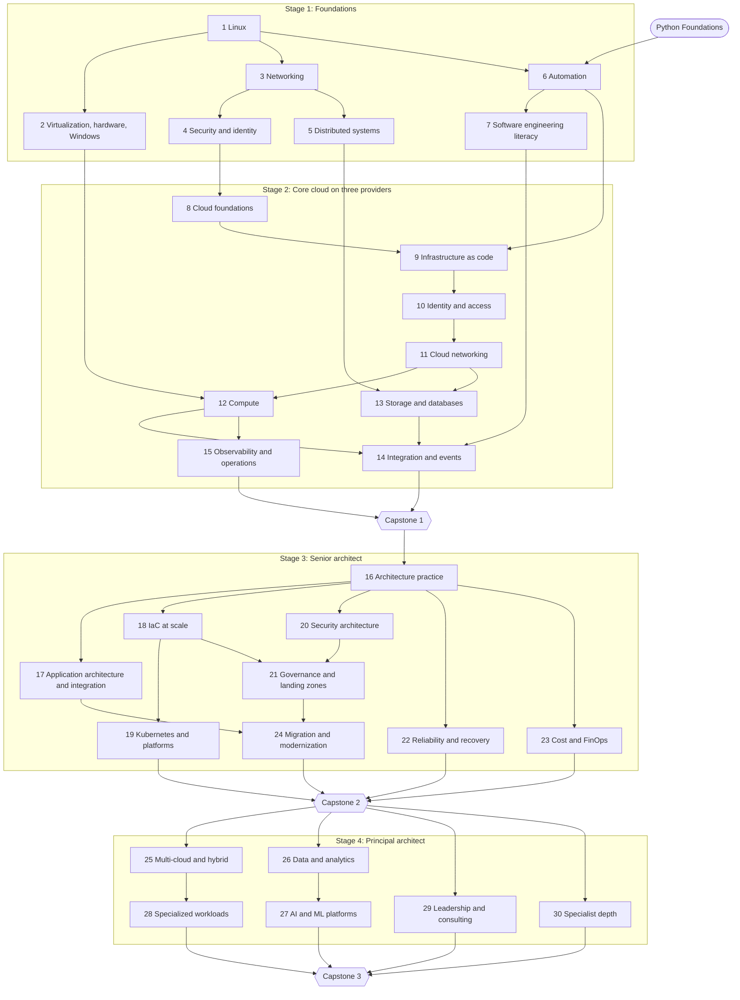

# Cloud Solutions Architect track (multi-cloud)

This track takes a learner to the work of a senior, then principal, cloud solutions architect on AWS, Microsoft Azure and Google Cloud. It aims at the top of the pay band: an architect who can design an enterprise's cloud estate, build the hard parts themselves, keep it secure, reliable and affordable, and win executives' support.

**Status: specified, not built.** It's the second track, after Python Foundations. Building it needs two things first: the app has to support more than one track, and the lab checker from [ADR-0014](../decisions/0014-cloud-labs.md) (accepted 2026-11-09) has to exist. See [Building it](#building-it).

**Two sources.** The track was first designed from the platform's own rules, then cross-referenced on 2026-11-08 against the owner's _Senior Cloud Architect Knowledge Map & Learning Roadmap_ (twelve domains, a certification order, a 24-month plan and a self-assessment), so that everything in that map is in the track. The map's [24-month example path](#a-faster-path-for-an-experienced-learner) and [self-assessment](#self-assessment-youre-senior-when-you-can) are part of this spec, and the map itself is kept at [docs/research/senior-cloud-architect-knowledge-map.md](../research/senior-cloud-architect-knowledge-map.md).

**It assumes nothing about the learner.** The track starts from zero and teaches every topic in full, so it can serve an absolute beginner. Someone who arrives with experience doesn't declare it: they skip a topic by proving it, through "prove it now" or the placement test ([ADR-0002](../decisions/0002-mastery-and-gating.md)).

- **Size:** 30 modules in 4 stages, about 320 topics, plus a specialty. Every module ends with a checkpoint, and stages 2–4 each end with a capstone.
- **Proven by doing.** Every topic gets the platform's four proofs ([ADR-0002](../decisions/0002-mastery-and-gating.md)), done in the learner's own cloud accounts:
  - build it from a blank file;
  - explain it;
  - fix a broken version;
  - still do it weeks later.

  The senior stages add design reviews, game days, and defending a design to skeptical stakeholders.

- **Multi-cloud by default.** Core topics are built on all three clouds, and their explain checks ask how the clouds differ. Multi-cloud designs usually go wrong at those differences.
- **Time:** roughly 2,200–2,600 hours of focused work including reviews, which is 2–3 years at 15–20 hours a week, for someone starting from zero. A learner who can already prove some of it skips those topics with "prove it now"; the [24-month example](#a-faster-path-for-an-experienced-learner) shows what that can look like.
- **Practice environments:** it assumes access to AWS, Azure and Google Cloud accounts. Cost control counts as part of the job (see [Lab safety and cost](#lab-safety-and-cost)).

| Stage                            | Modules | Topics               | Ends with  | Rough hours |
| -------------------------------- | ------- | -------------------- | ---------- | ----------- |
| 1. Foundations                   | 1–7     | 83                   | Level 1    | 300–350     |
| 2. Core cloud on three providers | 8–15    | 84                   | Capstone 1 | 550–600     |
| 3. Senior architect              | 16–24   | 99                   | Capstone 2 | 700–800     |
| 4. Principal architect           | 25–30   | 51, plus a specialty | Capstone 3 | 500–600     |

## What senior architects at the top of the pay band do

They're paid for judgment backed by hands-on depth. The track is built around what they do that others don't:

1. **Design across clouds, and say why.** They choose services, regions and patterns on three clouds, and write the trade-offs down so others can review them.
2. **Go deep where systems break.** Outages and breaches start in networking, identity, data and security. They debug at the level of packets, policies and queries.
3. **Build the hard parts themselves.** They write a reference implementation or proof of concept as code, in days.
4. **Run it, not just draw it.** They define SLOs, plan for failure, and lead the response when it comes.
5. **Treat cost as a design input.** They know what a design will cost before it's built. They know how to cut a bill without hurting reliability.
6. **Govern at scale.** With hundreds of accounts, many teams and auditors, they set guardrails that keep everyone safe without slowing them down.
7. **Move estates.** They plan and lead migrations with little downtime and a way back.
8. **Influence.** They find the real problem in a discovery conversation, write for executives, build business cases, and defend designs under pressure.
9. **Go deep in one or two areas,** such as networking, security, data and AI, platforms, migration, application modernization, or FinOps.
10. **Work with developers as a peer.** They read code in several languages, write their own automation, and review application designs credibly. An architect who can't express a design in code will see it implemented wrong.
11. **Stay current.** Services change monthly. They read release notes and post-incident reviews, and know what changed in their clouds in the last 90 days.

The owner's map puts it in one sentence: a senior cloud architect is not someone who knows every service, but someone who can take a vague business problem and turn it into a system that is secure, resilient, observable and affordable, then defend every trade-off to a CFO and a kernel engineer in the same meeting.

## Levels

| Level                                  | Reached at     | You can…                                                                                                                                                                         |
| -------------------------------------- | -------------- | -------------------------------------------------------------------------------------------------------------------------------------------------------------------------------- |
| 1. Cloud-ready engineer                | End of Stage 1 | work confidently with Linux, hardware, networks, security and distributed-systems ideas; automate with Python, Bash and PowerShell; read code and review designs with developers |
| 2. Associate architect on three clouds | Capstone 1     | build and explain standard architectures on AWS, Azure and Google Cloud, all as code                                                                                             |
| 3. Senior architect                    | Capstone 2     | design, secure, govern and cost enterprise systems; lead migrations; run game days                                                                                               |
| 4. Principal architect                 | Capstone 3     | set multi-cloud strategy, design data and AI platforms, and win executive support, with a deep specialty                                                                         |

## Two rules from the map

1. **Every concept gets a build.** If you can't deploy it, break it and fix it in a sandbox, you haven't learned it, whatever you've read. That's the platform's own rule ([ADR-0002](../decisions/0002-mastery-and-gating.md)), and the map arrives at it independently.
2. **Write as you go.** Decision records and one-page design documents are both the job and the best way to study, so from Stage 3 on they're part of the proofs.

## Words used here

- **Infrastructure as code (IaC):** describing cloud resources in files, which a tool then creates and updates for you. This track uses Terraform's language, HCL, run with OpenTofu or Terraform.
- **Landing zone:** the ready-made foundation that every team's workloads land in: accounts, networks, identity and guardrails.
- **SLO (service level objective):** a target for how well a service works, such as "99.9% of requests succeed".
- **RPO and RTO:** after a disaster, the recovery point objective is how much recent data you can afford to lose. The recovery time objective is how long you can afford to be down. **RLO**, the recovery level objective, is how much of the service has to be back.
- **FinOps:** managing cloud cost as an ongoing, shared job of engineering and finance.
- **Lab checker:** the platform's tool that inspects what you built in your cloud account and checks that it works ([ADR-0014](../decisions/0014-cloud-labs.md)).
- **Fault module:** code that deliberately breaks something in your sandbox, for a debugging proof or a game day.
- **Game day:** a real failure, caused on purpose, that you have to recover from against the clock.
- **IdP (identity provider):** the system people sign in to, such as Entra ID or Okta, which then vouches for them to everything else.
- **DDD (domain-driven design):** a way of drawing the boundaries between parts of a system from the business's own language.
- **CQRS and event sourcing:** keeping separate models for writing and reading (CQRS), and storing every change as an event instead of overwriting state (event sourcing).
- **ZTNA (zero trust network access):** giving access to one application at a time based on identity and device health, instead of putting a device on the network with a VPN.
- **CNAPP:** a cloud-native application protection platform, a product category that combines posture management, workload protection and more.
- **Post-incident review:** the write-up after an outage: what happened, why, and what changes. Providers publish theirs.

## How competency is proven

Every topic and checkpoint gets the platform's four proofs, adapted for cloud work:

| Proof                      | In this track                                                                                                                                                                                   | How it's checked                                                                                                                                                                                                                 |
| -------------------------- | ----------------------------------------------------------------------------------------------------------------------------------------------------------------------------------------------- | -------------------------------------------------------------------------------------------------------------------------------------------------------------------------------------------------------------------------------- |
| **Build from blank**       | From a written brief, build the topic's thing in your sandbox. There's no starter code and no AI. From Module 9 on, everything is built as code, and most topics are built on all three clouds. | The lab checker inspects the result through each cloud's APIs, with read-only access, and probes how it behaves. It sends requests, looks up names, and asks each cloud's policy simulator whether forbidden actions are denied. |
| **Explain it back**        | Explain why it works, how the three clouds differ, and the trade-offs.                                                                                                                          | Graded by AI against a rubric ([ADR-0013](../decisions/0013-explain-grading.md)).                                                                                                                                                |
| **Debug unfamiliar work**  | A fault module deploys a broken environment into your sandbox. Find and fix the faults.                                                                                                         | The checker confirms the symptoms are gone _and_ that the fix is right. For example, you didn't open a port to the whole internet or grant admin rights to make it work.                                                         |
| **Survives spaced review** | Short reviews: drills and code katas checked offline, and now and then a timed rebuild of a key lab.                                                                                            | Drills run as Python in the browser, code katas are tested offline, and the checker covers rebuilds.                                                                                                                             |

From Stage 3, three more proofs test senior judgment:

| Proof             | What you do                                                                                | How it's checked                                                                                                               |
| ----------------- | ------------------------------------------------------------------------------------------ | ------------------------------------------------------------------------------------------------------------------------------ |
| **Design review** | Turn a messy brief into a design document, diagrams, decision records and a cost estimate. | AI grades the reasoning against a rubric. Code checks the numbers (cost, availability, capacity) within a tolerance.           |
| **Game day**      | Something in your environment really fails. Restore service, then write the postmortem.    | The checker measures time to detect, time to recover, and data lost, against the stated RTO and RPO. AI grades the postmortem. |
| **Defend it**     | AI plays stakeholders, such as a CISO, a CFO and an SRE lead, and questions your design.   | Graded against a rubric: did you answer the real concern, with evidence, and own the trade-offs?                               |

**Standards, not just correctness.** Checkpoints have time limits and accuracy targets, because fluency is part of competency. A senior architect plans a subnet layout in minutes and restores a service within its RTO.

**Writing is a proof.** From Module 16 on, most checkpoints include a written piece: a decision record, a one-page design, a postmortem or an executive brief. Each is graded, and each is kept, because the collection becomes the portfolio a senior architect is hired on.

**AI rules don't change** ([ADR-0003](../decisions/0003-ai-roles-and-guardrails.md)). The tutor gives hints, never answers, and is off during proofs. AI help for writing infrastructure code unlocks only after the skill is proven without it. In "Defend it", AI is the examiner: it asks questions and never helps.

## Drills: practice that builds speed

Drills are short, repeatable exercises for skills that need to be fast. Most of the review pool is drills, because they're quick and cost nothing to run.

| Drill                          | Example                                                                                                                                                                                       | Runs in                        | Target                                                     |
| ------------------------------ | --------------------------------------------------------------------------------------------------------------------------------------------------------------------------------------------- | ------------------------------ | ---------------------------------------------------------- |
| Subnetting                     | Split a /14 across 4 regions × 3 zones × 3 tiers, with room to double                                                                                                                         | The browser (Python)           | Under 5 minutes, no overlaps                               |
| Policy evaluation              | Given an SCP, a permission boundary, an identity policy and a bucket policy, is this request allowed?                                                                                         | The browser                    | Right 9 times in 10, about a minute each                   |
| Route prediction               | Which route wins, and where does this packet go?                                                                                                                                              | The browser                    | Right 9 times in 10                                        |
| Name resolution                | From this spoke network, what does this storage account's name resolve to?                                                                                                                    | The browser                    | Right 9 times in 10                                        |
| Availability and recovery math | The availability of this design; the cheapest recovery strategy that meets an RPO of 5 minutes and an RTO of 1 hour; the composite SLA of five dependent services, and which to replace first | The browser                    | Within 0.01%                                               |
| Cost estimation                | This design's monthly cost; a commitment's break-even point                                                                                                                                   | The browser                    | Within 15%; within 30% before opening a pricing calculator |
| Pricing dimensions             | What is this service billed on: hours, requests, GB stored, GB moved, IOPS, provisioned capacity, or data scanned?                                                                            | The browser                    | Right 9 times in 10                                        |
| Capacity                       | How many partitions, shards or instances for this load?                                                                                                                                       | The browser                    | Within 20%                                                 |
| Right-sizing                   | From a week of metrics, which instance family and size, and what does the change save?                                                                                                        | The browser                    | Within one size                                            |
| Code katas                     | A private, zone-redundant web tier from a blank file                                                                                                                                          | Your machine, checked offline  | 45 minutes                                                 |
| Break-fix                      | Three faults in an unfamiliar environment                                                                                                                                                     | Your sandbox, with the checker | 30 minutes                                                 |
| Kubernetes triage              | A pod in CrashLoopBackOff, an OOMKilled container, and a Pending pod with no scheduler explanation, from the command line                                                                     | Your sandbox, with the checker | 20 minutes                                                 |
| Whiteboard                     | A design prompt, answered out loud and in a diagram                                                                                                                                           | The browser, graded by AI      | 45 minutes                                                 |
| Threat model                   | STRIDE on a given design; find at least one issue the team missed                                                                                                                             | The browser, graded by AI      | 30 minutes                                                 |
| Decision record                | An ADR a new hire could read in two years and understand                                                                                                                                      | The browser, graded by AI      | 30 minutes                                                 |
| Executive brief                | One page: the answer, the reasons, the risks, the ask; or three options and a recommendation on one slide                                                                                     | The browser, graded by AI      | 30 minutes; 5 minutes to present                           |

## Lab safety and cost

Labs run in your own cloud accounts and cost real money. Controlling that is part of the job, so it's part of the track ([ADR-0014](../decisions/0014-cloud-labs.md)):

- **Sandboxes only.** Labs run in accounts, subscriptions and projects made for practice, never in production or an employer's.
- **Guardrails first.** Module 8 starts by setting budgets and alerts, restricting regions, and blocking the most expensive services. Nothing else gets built before that.
- **Every lab states its expected cost and how long it runs.** It tags everything it creates with its topic ID. Tearing down is part of the proof: the checker confirms nothing tagged is still running. The map's habit is the same: hard budget caps, and destroy everything weekly.
- **Your credentials stay on your machine.** The checker runs locally with a read-only identity. The platform receives only which checks passed.
- **You can read everything that changes your sandbox.** Fault modules and game days are code you apply yourself. To keep the test fair, each picks its faults at random from a published list.
- **Stand-ins for what one person can't buy.** Physical circuits (Direct Connect, ExpressRoute, Cloud Interconnect) and large GPU clusters are designed and reviewed. You practise with a stand-in: a VPN with BGP, or a single GPU.

## Module map

Within a module, most topics can be done in more than one order.

## Stage 1: Foundations

These are the fundamentals every later module stands on. Most of the practice runs locally, in containers on your own machine, so it costs nothing. Python Foundations is needed from Module 6. Everything in the cloud is a Linux box, a hypervisor, or an abstraction hiding one; architects who skip this layer design systems they can't debug.

### Module 1: Linux and the command line

| #   | Topic                                  | ID                      | You'll be able to…                                                                                                                                                                                                                                                         |
| --- | -------------------------------------- | ----------------------- | -------------------------------------------------------------------------------------------------------------------------------------------------------------------------------------------------------------------------------------------------------------------------- |
| 1   | Shell essentials                       | `csa.linux.shell`       | find files and answer questions about logs with pipes, `grep`, `sed`, `awk` and `jq`; reach for `strace`, `lsof`, `iostat` and `vmstat` when a program misbehaves                                                                                                          |
| 2   | Processes and signals                  | `csa.linux.processes`   | explain fork and exec, process IDs and signals; find and clear zombie processes; explain what the init system does (systemd units and targets)                                                                                                                             |
| 3   | Users, permissions and SSH             | `csa.linux.permissions` | set ownership and permissions; manage users, groups and `sudo`; use SSH keys safely                                                                                                                                                                                        |
| 4   | Services and logs                      | `csa.linux.services`    | run and supervise services with systemd, and read their logs with `journalctl`                                                                                                                                                                                             |
| 5   | Package management and patching        | `csa.linux.packages`    | install and pin packages with `apt` and `dnf`; patch a server safely; explain mutable and immutable servers, and why fleets are replaced rather than patched in place                                                                                                      |
| 6   | Disks and filesystems                  | `csa.linux.storage`     | attach, format, mount and grow a disk; choose between ext4 and XFS; use LVM; fix "disk full", including running out of inodes and deleted files held open; explain `fsync`, queue depth, and what durability costs                                                         |
| 7   | Memory and the OOM killer              | `csa.linux.memory`      | explain virtual memory, paging, swap and huge pages; read the OOM killer's log; say why a container is killed before its node runs out of memory                                                                                                                           |
| 8   | CPU scheduling and cgroups             | `csa.linux.cpu`         | explain the scheduler (CFS) and nice values; set cgroups v2 CPU shares and quotas; find CPU throttling in a container and fix it                                                                                                                                           |
| 9   | How containers work                    | `csa.linux.containers`  | build a container by hand from namespaces, cgroups and an overlay filesystem; explain image layers and why a container is not a VM                                                                                                                                         |
| 10  | Networking from the host               | `csa.linux.net-tools`   | inspect interfaces, routes and sockets with `ip` and `ss`; test with `curl`, `dig`, `nc` and `traceroute`; capture traffic with `tcpdump`; read the TCP state machine and ephemeral ports; follow a packet through nftables or iptables, conntrack and a network namespace |
| 11  | Boot, cloud-init and instance metadata | `csa.linux.boot`        | follow a VM from boot to ready; configure it with cloud-init and user data; read the instance metadata service, and explain why session-based access to it (IMDSv2 and its equivalents) matters for security                                                               |
| 12  | Shell scripting                        | `csa.linux.scripting`   | write Bash scripts that stop safely on errors (`set -euo pipefail`, traps) and are safe to run twice                                                                                                                                                                       |
| 13  | Performance triage                     | `csa.linux.triage`      | find out why a server is slow with the USE method: utilization, saturation and errors; use `perf`, `strace`, `iostat` and `vmstat` to see where the time goes                                                                                                              |
| 14  | Hardening                              | `csa.linux.hardening`   | apply a security baseline, then prove it with a benchmark scan                                                                                                                                                                                                             |

**Checkpoint 1: the broken server** (`csa.m1.checkpoint`). You get a container with five planted faults:

- a full disk;
- a service failing on a bad config;
- a key with the wrong permissions;
- a blocked port;
- a runaway process.

Restore service within 45 minutes without weakening security. Turning the firewall off fails the check. A second part: a container that keeps getting killed and throttled. Find out why from its cgroup metrics and fix its limits.

### Module 2: Virtualization, hardware and Windows

Every cloud instance is a slice of a physical machine. Knowing what the slice is made of explains prices, performance surprises and a whole class of outages. Windows is here because most enterprise estates have it.

| #   | Topic                               | ID                         | You'll be able to…                                                                                                                                                             |
| --- | ----------------------------------- | -------------------------- | ------------------------------------------------------------------------------------------------------------------------------------------------------------------------------ |
| 15  | Hypervisors                         | `csa.hw.hypervisors`       | tell type 1 from type 2 hypervisors; explain KVM/QEMU, Hyper-V and AWS Nitro, paravirtualization and SR-IOV; say what a hypervisor can and can't isolate                       |
| 16  | CPU architectures                   | `csa.hw.cpu-architectures` | compare x86 and Arm (Graviton, Ampere, Cobalt); explain instruction sets; say when Arm saves 20–40% and what has to be rebuilt to get it                                       |
| 17  | Cores, memory and noisy neighbours  | `csa.hw.cores-memory`      | explain vCPU versus physical core, hyperthreading, NUMA, burstable credits and noisy neighbours; explain memory tiers, NVMe, and local ephemeral versus network-attached disks |
| 18  | GPU basics                          | `csa.hw.gpus`              | explain CUDA cores versus tensor cores, VRAM as the constraint, NVLink and MIG partitioning; read a GPU's utilization and say what's starving it                               |
| 19  | Windows Server and Active Directory | `csa.hw.windows-ad`        | explain Active Directory Domain Services, Group Policy, Kerberos and domain trusts; join a cloud VM to a domain; say how Entra ID differs from AD DS                           |
| 20  | Windows licensing in the cloud      | `csa.hw.windows-licensing` | price a Windows and SQL Server estate with bring-your-own licences, hybrid benefit and dedicated hosts; say when a dedicated host is cheaper                                   |

**Checkpoint 2: the right machine** (`csa.m2.checkpoint`).

1. Right-size five described workloads across the three clouds, including a move to Arm and a GPU job. Code checks the estimates.
2. Diagnose a slow VM: CPU steal, throttling and memory pressure.
3. Stand up a small Active Directory domain, join a Windows and a Linux VM to it, and explain how Entra ID would differ.

### Module 3: Networking

Networking and DNS sit under every cloud service, and they're behind many outages and most breaches. This module goes deep. Its labs run in local containers with real routing software (FRRouting), VPN software (strongSwan) and DNS servers.

| #   | Topic                       | ID                        | You'll be able to…                                                                                                                                                                                                                   |
| --- | --------------------------- | ------------------------- | ------------------------------------------------------------------------------------------------------------------------------------------------------------------------------------------------------------------------------------ |
| 21  | Layers and packets          | `csa.net.layers`          | follow a request down and up the network layers, using the OSI and TCP/IP models as debugging tools; explain ARP and ICMP; explain encapsulation and MTU, and spot MTU problems                                                      |
| 22  | IPv4 and CIDR               | `csa.net.cidr`            | split and summarize address blocks and check them for overlaps, by hand and in code; do CIDR math on sight; use variable-length masks and the RFC 1918 private ranges                                                                |
| 23  | IPv6                        | `csa.net.ipv6`            | plan IPv6 addressing; run dual stack; explain why IPv6 egress doesn't use NAT                                                                                                                                                        |
| 24  | Routing                     | `csa.net.routing`         | predict the next hop with longest-prefix match; compare static and dynamic routing; spot asymmetric routes and black holes                                                                                                           |
| 25  | NAT                         | `csa.net.nat`             | explain source and destination NAT; size NAT for connection counts; diagnose port exhaustion; say when to avoid NAT entirely                                                                                                         |
| 26  | TCP and UDP                 | `csa.net.transport`       | read a TCP handshake and teardown in a capture; explain window scaling, timeouts and keepalives, and why idle connections get cut                                                                                                    |
| 27  | Congestion control and QUIC | `csa.net.congestion`      | explain CUBIC and BBR, and how loss and latency interact; explain what QUIC and HTTP/3 change, and when they help                                                                                                                    |
| 28  | DNS                         | `csa.net.dns`             | trace a lookup end to end, from recursion to authority; use record types, TTLs, negative caching and split-horizon DNS; explain DNSSEC; lower TTLs ahead of a move                                                                   |
| 29  | HTTP and TLS                | `csa.net.http-tls`        | explain HTTP/1.1, 2 and 3; read a TLS 1.2 and 1.3 handshake, including SNI and OCSP stapling; issue, chain and rotate certificates, automated with ACME; set up mutual TLS                                                           |
| 30  | HTTP semantics              | `csa.net.http-semantics`  | use caching headers correctly; explain CORS; choose between REST, WebSockets and gRPC over HTTP/2 for a given flow                                                                                                                   |
| 31  | Load balancing              | `csa.net.load-balancing`  | choose between layer 4 and layer 7; design health checks, draining and stickiness; explain how a bad health check takes down a fleet, and how failover flapping happens                                                              |
| 32  | BGP                         | `csa.net.bgp`             | bring up BGP sessions; advertise and filter prefixes; steer traffic with local preference, AS-path prepending, MED and communities; explain route reflection, and how BGP drives Direct Connect, ExpressRoute and Cloud Interconnect |
| 33  | VPNs and IPsec              | `csa.net.ipsec`           | build a route-based IPsec tunnel with BGP over it; debug phase 1 and phase 2 failures                                                                                                                                                |
| 34  | Network troubleshooting     | `csa.net.troubleshooting` | find a fault from its symptoms with a repeatable method, using captures, traceroute, DNS lookups and logs                                                                                                                            |

**Checkpoint 3: the address plan and the outage** (`csa.m3.checkpoint`).

1. Build an IPv4 and IPv6 address plan for three clouds, four regions and two data centers, with room for five years' growth. Code checks it for overlaps, block sizes and summarization.
2. Fix a local network of routers, a DNS server and an app. It has an intermittent outage caused by three faults.

### Module 4: Security and identity foundations

Security isn't a domain of its own; it's a property of every other domain. But the architect owns the identity model, the encryption posture and the compliance story end to end.

| #   | Topic                                        | ID                        | You'll be able to…                                                                                                                                                                                                                               |
| --- | -------------------------------------------- | ------------------------- | ------------------------------------------------------------------------------------------------------------------------------------------------------------------------------------------------------------------------------------------------ |
| 35  | Threat modeling                              | `csa.sec.threat-modeling` | threat-model a system with data-flow diagrams, STRIDE and attack trees, and rank the risks; use MITRE ATT&CK for cloud; bring abuse cases into design reviews                                                                                    |
| 36  | Authentication and authorization             | `csa.sec.authn-authz`     | tell authentication from authorization; apply MFA, least privilege and separation of duties; compare role-based, attribute-based and policy-as-code access; treat least privilege as an iterative process with access analyzers and custom roles |
| 37  | Strong authentication and conditional access | `csa.sec.strong-auth`     | require phishing-resistant MFA (FIDO2, passkeys); write conditional-access policies on device compliance and sign-in risk; keep a break-glass path that doesn't weaken them                                                                      |
| 38  | Applied cryptography                         | `csa.sec.crypto`          | choose symmetric or asymmetric encryption; explain hashes, MACs and signatures; design envelope encryption                                                                                                                                       |
| 39  | Certificates and PKI                         | `csa.sec.pki`             | run a private certificate authority; issue, revoke and rotate certificates; fix chain errors                                                                                                                                                     |
| 40  | SAML, OAuth 2.0 and OIDC                     | `csa.sec.federation`      | trace a single sign-on and an OAuth flow; choose the right flow for an app: authorization code with PKCE, client credentials, or device code; validate a token; provision accounts with SCIM                                                     |
| 41  | Secrets                                      | `csa.sec.secrets`         | keep secrets out of code, images and logs; rotate them; catch leaks with scanners; explain the secret-zero problem and dynamic secrets (as in Vault)                                                                                             |
| 42  | Audit logging                                | `csa.sec.audit`           | decide what to log and how long to keep it; make logs tamper-evident                                                                                                                                                                             |
| 43  | Zero trust                                   | `csa.sec.zero-trust`      | apply zero-trust principles (NIST SP 800-207): identity as the perimeter, device posture, micro-segmentation, continuous verification; explain how zero trust network access replaces a VPN                                                      |
| 44  | Vulnerability management                     | `csa.sec.vulnerabilities` | run a vulnerability-management loop: scan, prioritize by exploitability (CVSS against EPSS and the KEV catalog), set patch SLAs, and track remediation                                                                                           |
| 45  | Compliance basics                            | `csa.sec.compliance`      | read a control framework (SOC 2, ISO 27001, PCI DSS 4, HIPAA, FedRAMP, CMMC, GDPR, CIS Benchmarks, NIST CSF 2.0 and SP 800-53) and map a control to technical evidence                                                                           |

**Checkpoint 4: the threat model and the broken sign-in** (`csa.m4.checkpoint`).

1. Threat-model a web app that takes payments, and design its controls.
2. Fix a single sign-on, run locally with an open-source identity provider, that fails in three ways: the wrong audience, the wrong redirect, and clock skew.

### Module 5: Distributed systems for architects

Services change every year; these ideas haven't changed in twenty. This is the module that separates a senior engineer from an architect.

| #   | Topic                                  | ID                    | You'll be able to…                                                                                                                                                                                                                                                                                                            |
| --- | -------------------------------------- | --------------------- | ----------------------------------------------------------------------------------------------------------------------------------------------------------------------------------------------------------------------------------------------------------------------------------------------------------------------------- |
| 46  | Estimation                             | `csa.ds.estimation`   | estimate requests per second, storage, bandwidth and cost from a one-paragraph brief, within a factor of 2                                                                                                                                                                                                                    |
| 47  | Latency                                | `csa.ds.latency`      | budget latency end to end; know the orders of magnitude, from a cache hit to another continent                                                                                                                                                                                                                                |
| 48  | Concurrency and queues                 | `csa.ds.concurrency`  | apply Amdahl's law; tell concurrency from parallelism; explain async I/O, thread pools and connection pools; draw the utilization-versus-latency curve from queueing theory                                                                                                                                                   |
| 49  | Availability math                      | `csa.ds.availability` | compute the availability of components in series, in parallel and with failover; turn an SLA into allowed downtime; give the composite SLA of five dependent services and say which to replace first                                                                                                                          |
| 50  | The fallacies of distributed computing | `csa.ds.fallacies`    | name all eight fallacies, each with a real outage it caused, and spot them in a design                                                                                                                                                                                                                                        |
| 51  | Consistency                            | `csa.ds.consistency`  | explain strong, eventual, read-your-writes and causal consistency, and the CAP and PACELC theorems; choose per use case                                                                                                                                                                                                       |
| 52  | Replication                            | `csa.ds.replication`  | compare synchronous and asynchronous, leader-follower, multi-leader, leaderless and quorum replication; predict data loss on failover; resolve conflicts with last-writer-wins or CRDTs, and say what each loses                                                                                                              |
| 53  | Consensus                              | `csa.ds.consensus`    | explain leader election, quorums and split brain; explain Paxos and Raft in outline; say how etcd, ZooKeeper and DynamoDB use them                                                                                                                                                                                            |
| 54  | Time                                   | `csa.ds.time`         | explain clock skew and NTP; use logical clocks (Lamport, vector) and explain TrueTime; say why "the latest write" is ambiguous                                                                                                                                                                                                |
| 55  | Partitioning                           | `csa.ds.partitioning` | choose partition keys and a strategy (hash, range, directory, consistent hashing); spot hot partitions; plan resharding                                                                                                                                                                                                       |
| 56  | Caching                                | `csa.ds.caching`      | choose a caching pattern; set TTLs; prevent cache stampedes                                                                                                                                                                                                                                                                   |
| 57  | Queues and streams                     | `csa.ds.messaging`    | explain delivery guarantees, ordering, idempotency, backpressure and dead-letter queues; explain why exactly-once delivery is usually a myth and how idempotency keys and deduplication windows fix it                                                                                                                        |
| 58  | Handling failure                       | `csa.ds.failure`      | design timeouts, retries with jittered backoff and retry budgets, circuit breakers and bulkheads; prevent retry storms; shed load with admission control and bounded queues; design liveness, readiness and startup checks, and explain how a deep health check causes a cascading failure; choose two-phase commit or a saga |
| 59  | Graceful degradation and feature flags | `csa.ds.degradation`  | design degraded modes and fallbacks; use feature flags as a resilience tool; choose fail-fast or fail-safe per component                                                                                                                                                                                                      |
| 60  | Capacity                               | `csa.ds.capacity`     | apply Little's law and utilization limits; plan capacity with headroom                                                                                                                                                                                                                                                        |

**Checkpoint 5: the napkin design** (`csa.m5.checkpoint`).

1. From a short brief, estimate the load, storage and cost. The estimates are checked within a tolerance.
2. Design for the availability target, with the math shown.
3. Find the flaws in someone else's design: a retry storm, a hot partition and a single point of failure.

### Module 6: Automation foundations

This module needs Python Foundations.

| #   | Topic                     | ID                           | You'll be able to…                                                                                                                                                                                                               |
| --- | ------------------------- | ---------------------------- | -------------------------------------------------------------------------------------------------------------------------------------------------------------------------------------------------------------------------------- |
| 61  | Git for infrastructure    | `csa.auto.git`               | branch, review and merge infrastructure changes; resolve conflicts                                                                                                                                                               |
| 62  | Cloud command lines       | `csa.auto.cli`               | drive `aws`, `az` and `gcloud` with profiles, and filter their output                                                                                                                                                            |
| 63  | PowerShell for operations | `csa.auto.powershell`        | write PowerShell for Azure and Windows estates, with the Az module; say when PowerShell beats Bash, and the reverse                                                                                                              |
| 64  | Cloud SDKs in Python      | `csa.auto.sdk`               | call all three clouds' Python SDKs; page through results; retry when throttled                                                                                                                                                   |
| 65  | APIs and data formats     | `csa.auto.apis`              | read and write JSON and YAML; call REST APIs with authentication; respect rate limits                                                                                                                                            |
| 66  | Containers                | `csa.auto.containers`        | build small, secure images (multi-stage, distroless, rootless); explain OCI images and runtimes (containerd, CRI-O) and layer caching; push images to a registry; scan them; use Compose locally and say why it isn't production |
| 67  | Configuration management  | `csa.auto.config-management` | write idempotent Ansible playbooks; read Chef and Puppet well enough to work with legacy estates; say when configuration management is the wrong tool and an image is right                                                      |
| 68  | Continuous integration    | `csa.auto.ci`                | run tests, linters and scanners on every pull request                                                                                                                                                                            |

**Checkpoint 6: the estate inventory** (`csa.m6.checkpoint`). Build a read-only Python tool that lists compute, storage and public endpoints across all three clouds, and flags resources that are untagged or public.

- It's tested offline against recorded API responses.
- Once Module 8 has built your sandbox, it's run against that too.

### Module 7: Software engineering literacy

An architect isn't the primary coder, but must read code, write automation and review designs with developers as a peer. Python, from Python Foundations, is the main language here; the other languages are learned to the point of reading them fluently and writing small tools. This module needs Python Foundations.

| #   | Topic                              | ID                         | You'll be able to…                                                                                                                                                                                                                                                                                                                        |
| --- | ---------------------------------- | -------------------------- | ----------------------------------------------------------------------------------------------------------------------------------------------------------------------------------------------------------------------------------------------------------------------------------------------------------------------------------------- |
| 69  | Go for cloud tooling               | `csa.se.go`                | read Go fluently, since Kubernetes, Terraform and most cloud-native tools are written in it; write a small command-line tool                                                                                                                                                                                                              |
| 70  | TypeScript and Node                | `csa.se.typescript`        | read TypeScript, for CDK, Pulumi and front-end conversations; explain the Node runtime's characteristics                                                                                                                                                                                                                                  |
| 71  | SQL for architects                 | `csa.se.sql`               | write analytical queries with joins and window functions; read a query plan                                                                                                                                                                                                                                                               |
| 72  | JVM and .NET runtimes              | `csa.se.jvm-dotnet`        | explain garbage collection, runtime tuning and how container memory limits interact with a JVM or .NET process                                                                                                                                                                                                                            |
| 73  | Advanced Git                       | `csa.se.git`               | explain Git's internals; rebase and bisect; weigh monorepo against polyrepo; follow code-review norms                                                                                                                                                                                                                                     |
| 74  | Testing                            | `csa.se.testing`           | place unit, integration, contract (Pact), end-to-end and property-based tests on the pyramid; use test doubles; explain testing in production                                                                                                                                                                                             |
| 75  | Dependencies and versions          | `csa.se.dependencies`      | use semantic versioning and lockfiles; run a vulnerability-remediation workflow; prevent dependency confusion                                                                                                                                                                                                                             |
| 76  | API-first development              | `csa.se.api-first`         | write an OpenAPI description first; generate SDKs and mock servers from it                                                                                                                                                                                                                                                                |
| 77  | Design patterns and clean code     | `csa.se.patterns`          | use the vocabulary of refactoring, the design patterns that actually recur, and the SOLID principles                                                                                                                                                                                                                                      |
| 78  | Application performance            | `csa.se.app-performance`   | profile an application; find memory leaks, N+1 queries, undersized connection pools and async pitfalls                                                                                                                                                                                                                                    |
| 79  | Secure coding                      | `csa.se.secure-coding`     | apply the OWASP Top 10: input validation, secrets handling, dependency hygiene                                                                                                                                                                                                                                                            |
| 80  | Reading unfamiliar code            | `csa.se.reading-code`      | read an unfamiliar codebase quickly: entry points, configuration, dependency graph, build system; identify a service's state, its external dependencies, and what breaks when it's scaled horizontally                                                                                                                                    |
| 81  | Assessing legacy applications      | `csa.se.legacy-assessment` | assess an application for migration: dependencies, state, hard-coded assumptions, licensing; map what a stateful monolith needs to run in containers                                                                                                                                                                                      |
| 82  | AI-assisted development            | `csa.se.ai-assisted`       | use coding agents effectively; review generated code; write a policy for AI tools in the development lifecycle                                                                                                                                                                                                                            |
| 83  | Developer tooling and docs as code | `csa.se.dev-tooling`       | use devcontainers and cloud workstations (Codespaces, Cloud Workstations); run local-to-cloud loops (Tilt, Skaffold, Telepresence); add linters, formatters, pre-commit hooks and SAST, DAST and SCA scanners to a pipeline; write documentation as code (Markdown, MkDocs or Docusaurus) and diagrams as code (Mermaid, Structurizr, D2) |

**Checkpoint 7: the unfamiliar service** (`csa.m7.checkpoint`). You get a small Go service you've never seen and a Python one.

1. For each, identify its state, its external dependencies, and what breaks when it's scaled out. AI grades the analysis against the known answers.
2. Containerize one, add tests and a pipeline with scanners, and document it as code.
3. Write a one-page assessment of how each would move to the cloud.

## Stage 2: Core cloud on three providers

This is associate level, on all three clouds. Most topics are taught once as a concept, then built on AWS, Azure and Google Cloud, and their explain checks ask how the clouds differ. The aim is to know each _category_ of service deeply, and the service names on every cloud well enough to build with them. A few topics cover one cloud's own model; Module 10 has one for each cloud. The [appendix](#same-idea-three-clouds) maps the equivalent services.

### Module 8: Cloud foundations

| #   | Topic                                  | ID                     | You'll be able to…                                                                                                                                                                                                                                                              |
| --- | -------------------------------------- | ---------------------- | ------------------------------------------------------------------------------------------------------------------------------------------------------------------------------------------------------------------------------------------------------------------------------- |
| 84  | Cloud models and shared responsibility | `csa.cloud.models`     | place IaaS, PaaS, SaaS and serverless on the shared-responsibility line; say who patches what, and how the line shifts per service tier                                                                                                                                         |
| 85  | Regions and zones                      | `csa.cloud.regions`    | choose regions and zones by latency, data residency, available services and price; explain how zones differ between the clouds; place local zones and edge locations                                                                                                            |
| 86  | Resource hierarchies                   | `csa.cloud.hierarchy`  | set up AWS Organizations, Azure management groups and subscriptions, and Google Cloud folders and projects; explain what each level inherits, and why the account, subscription or project is the primary security and billing boundary                                         |
| 87  | Billing guardrails                     | `csa.cloud.billing`    | set budgets, alerts and anomaly detection on all three clouds, before building anything else                                                                                                                                                                                    |
| 88  | Pricing models                         | `csa.cloud.pricing`    | compare on-demand prices, commitments, spot capacity and free tiers; name what each service bills on (compute hours, requests, GB stored, GB moved, IOPS, provisioned capacity, data scanned); estimate a bill; find the hidden costs: egress, NAT, cross-zone traffic and logs |
| 89  | Quotas and limits                      | `csa.cloud.quotas`     | find and raise quotas; design around the limits that can't be raised                                                                                                                                                                                                            |
| 90  | Control plane and data plane           | `csa.cloud.planes`     | explain why control-plane and data-plane failures differ; design for static stability                                                                                                                                                                                           |
| 91  | Service lifecycles                     | `csa.cloud.lifecycles` | tell preview from general availability and decide what may run on a preview; handle deprecations and API versions; keep a deprecation calendar                                                                                                                                  |
| 92  | Reading an SLA                         | `csa.cloud.slas`       | read an SLA's fine print: what is measured, what is credited and what isn't; compute the composite SLA of dependent services                                                                                                                                                    |

**Checkpoint 8: the safe sandbox** (`csa.m8.checkpoint`). Build this on all three clouds:

- a practice hierarchy;
- admin access protected by MFA;
- budgets that alert at 50, 80 and 100%;
- allowed regions only;
- a read-only identity for the checker.

The checker confirms that the budgets and alerts are in place, that a test deployment to a forbidden region is refused, and that its own identity can't change anything.

### Module 9: Infrastructure as code

From here on, everything is built as code.

| #   | Topic                          | ID                    | You'll be able to…                                                                                                                                 |
| --- | ------------------------------ | --------------------- | -------------------------------------------------------------------------------------------------------------------------------------------------- |
| 93  | Why infrastructure as code     | `csa.iac.concepts`    | explain declarative code, idempotency and drift, and why infrastructure built by clicking can't be trusted                                         |
| 94  | Terraform and OpenTofu basics  | `csa.iac.basics`      | write providers, resources, variables and outputs; plan and apply on all three clouds; use workspaces, and say when not to                         |
| 95  | State                          | `csa.iac.state`       | keep state remotely, with locking, on each cloud; explain what state holds and why it's sensitive                                                  |
| 96  | Secrets in infrastructure code | `csa.iac.secrets`     | keep secrets out of code and state; use SOPS, the External Secrets Operator, or a vault from code; rotate without a redeploy                       |
| 97  | Expressions and iteration      | `csa.iac.expressions` | use `for_each`, `count`, locals and data sources without making the code unreadable                                                                |
| 98  | Modules                        | `csa.iac.modules`     | wrap a pattern in a module and reuse it with different inputs                                                                                      |
| 99  | Importing and refactoring      | `csa.iac.refactoring` | bring resources built by hand under code; rename and move resources with `moved` blocks without destroying them; repair a damaged state file       |
| 100 | Each cloud's own tools         | `csa.iac.native`      | read and write small CloudFormation or CDK, Bicep (and read ARM templates), and Infrastructure Manager deployments; know when the native tool wins |

**Checkpoint 9: storage from a blank file** (`csa.m9.checkpoint`). In 45 minutes, starting from an empty file, build a storage bucket on each cloud with versioning, encryption, a lifecycle policy and no public access, keeping its state remotely. It's checked offline first, with tests against mocked providers and policy checks, then live.

### Module 10: Identity and access on three clouds

| #   | Topic                               | ID                          | You'll be able to…                                                                                                                                                                                                     |
| --- | ----------------------------------- | --------------------------- | ---------------------------------------------------------------------------------------------------------------------------------------------------------------------------------------------------------------------- |
| 101 | AWS IAM policies                    | `csa.iam.aws-policies`      | write identity and resource policies; predict how a request is evaluated against SCPs, RCPs, permission boundaries and session policies                                                                                |
| 102 | AWS roles and federation            | `csa.iam.aws-roles`         | use roles, trust policies and temporary credentials; set up access across accounts and IAM Identity Center; explain and prevent the confused-deputy problem                                                            |
| 103 | Azure identity and RBAC             | `csa.iam.azure-rbac`        | use Entra ID groups, service principals and managed identities; assign roles at the right scope; use Privileged Identity Management for just-in-time admin; apply conditional access                                   |
| 104 | Google Cloud IAM                    | `csa.iam.gcp-iam`           | grant roles at the organization, folder, project and resource levels; use service accounts by impersonation, without keys; use IAM conditions and deny policies                                                        |
| 105 | One sign-in for people              | `csa.iam.sso`               | connect one identity provider to all three clouds; map groups to roles; keep a break-glass account                                                                                                                     |
| 106 | Identity for customers and partners | `csa.iam.customers`         | choose between business-to-business and business-to-consumer identity patterns; run a customer identity service (Entra External ID, Amazon Cognito, Google Cloud Identity Platform) with social and enterprise sign-in |
| 107 | Keyless workloads                   | `csa.iam.workload-identity` | let CI and workloads reach all three clouds through workload identity federation, with no long-lived keys, including one cloud calling another                                                                         |
| 108 | Least privilege at scale            | `csa.iam.least-privilege`   | find unused and excessive permissions with each cloud's analyzers, and remove them without breaking anything                                                                                                           |
| 109 | Fixing "access denied"              | `csa.iam.troubleshooting`   | debug access failures on each cloud with policy simulators, troubleshooters and audit logs                                                                                                                             |

**Checkpoint 10: one identity, three clouds** (`csa.m10.checkpoint`). Build:

- single sign-on for two people: an admin who gets access just in time, and a developer who's read-only in production;
- keyless CI that deploys to all three clouds;
- a function on one cloud that reads data on another, with no stored key.

The checker asks each cloud's policy simulator about 30 actions: 20 must be denied and 10 allowed. It also confirms that no long-lived keys exist.

### Module 11: Networking on three clouds

| #   | Topic                                     | ID                         | You'll be able to…                                                                                                                                                                                                                                 |
| --- | ----------------------------------------- | -------------------------- | -------------------------------------------------------------------------------------------------------------------------------------------------------------------------------------------------------------------------------------------------- |
| 110 | Virtual networks                          | `csa.cnet.vnet`            | build AWS VPCs, Azure VNets and Google Cloud VPCs; explain why Google's networks are global and the others regional, and why an AWS subnet belongs to a zone while the others belong to a region                                                   |
| 111 | Routing and egress                        | `csa.cnet.egress`          | route public, private and isolated subnets; use each cloud's NAT; control egress for IPv6                                                                                                                                                          |
| 112 | IP address management                     | `csa.cnet.ipam`            | manage addresses across hundreds of networks with each cloud's IPAM; remediate an overlapping range against a live production network without an outage                                                                                            |
| 113 | Firewalls and segmentation                | `csa.cnet.firewalls`       | segment networks with security groups and network ACLs, network security groups and application security groups, and Google Cloud firewall policies; tell stateful from stateless filtering; deny by default                                       |
| 114 | Network virtual appliances and inspection | `csa.cnet.appliances`      | choose between a third-party appliance (Palo Alto, Fortinet) and each cloud's native firewall; design an inspection path with a Gateway Load Balancer or its equivalents; say what inspection costs in latency and money                           |
| 115 | Cloud DNS                                 | `csa.cnet.dns`             | run private zones and hybrid name resolution with Route 53 Resolver, Azure DNS Private Resolver, and Cloud DNS forwarding and peering                                                                                                              |
| 116 | Private access to services                | `csa.cnet.private-access`  | reach storage and databases without crossing the internet, through PrivateLink, private endpoints and Private Service Connect, and prove nothing else can reach them ([in full below](#one-topic-in-full))                                         |
| 117 | Load balancers                            | `csa.cnet.load-balancers`  | choose among each cloud's layer 4, layer 7, regional and global load balancers (ALB and NLB; Application Gateway, Front Door and Azure Load Balancer; the external Application and Network Load Balancers)                                         |
| 118 | Hub and spoke                             | `csa.cnet.hub-spoke`       | connect many networks through Transit Gateway or Cloud WAN, Azure hub-and-spoke or Virtual WAN, and Shared VPC or Network Connectivity Center; explain why peering doesn't chain, and where each topology breaks down: route-table limits and cost |
| 119 | Hybrid connectivity                       | `csa.cnet.hybrid`          | connect a simulated data center by site-to-site VPN with BGP; design redundant Direct Connect, ExpressRoute and Cloud Interconnect links with MACsec and VPN as backup; plan bandwidth; integrate SD-WAN and branch connectivity                   |
| 120 | Cross-cloud connectivity                  | `csa.cnet.cross-cloud`     | connect AWS, Azure and Google Cloud with BGP over IPsec; plan for managed cross-cloud interconnects; control routes and costs                                                                                                                      |
| 121 | Zero trust network access                 | `csa.cnet.ztna`            | replace a VPN with identity-aware access to applications (Verified Access, Entra Private Access or Application Proxy, Identity-Aware Proxy), checking device posture                                                                               |
| 122 | The edge: CDN, WAF and DDoS               | `csa.cnet.edge`            | put an app behind CloudFront, Front Door or Cloud CDN, with WAF rules, bot management, rate limiting and DDoS protection; cache correctly                                                                                                          |
| 123 | Network performance                       | `csa.cnet.performance`     | tune MTU and jumbo frames; know the bandwidth each instance size gets; use placement and proximity groups; switch on accelerated networking (ENA, SR-IOV)                                                                                          |
| 124 | Network visibility                        | `csa.cnet.visibility`      | prove or disprove a network path with flow logs, packet mirroring and reachability tools (Reachability Analyzer, Network Watcher, Connectivity Tests)                                                                                              |
| 125 | Cloud network troubleshooting             | `csa.cnet.troubleshooting` | fix the classics: overlapping address ranges, missing routes, private-endpoint DNS, NAT exhaustion, MTU over VPN, asymmetric routing through firewalls                                                                                             |

**Checkpoint 11: three clouds, one network** (`csa.m11.checkpoint`).

1. Build a hub and spokes on each cloud, joined to each other and to a simulated data center by BGP over IPsec. Private names resolve across all four, and no workload has a public address.
2. The checker tests a matrix of allowed and denied paths, and name resolution from every spoke.
3. A fault module drops one tunnel. Traffic must fail over within 60 seconds.
4. Then a break-fix with four faults.

### Module 12: Compute

| #   | Topic                             | ID                        | You'll be able to…                                                                                                                                                                                                                                                  |
| --- | --------------------------------- | ------------------------- | ------------------------------------------------------------------------------------------------------------------------------------------------------------------------------------------------------------------------------------------------------------------- |
| 126 | Virtual machines                  | `csa.compute.vms`         | choose instance families (general, compute, memory, storage, accelerated) and sizes from metrics; use images and startup scripts; reserve capacity and spread across zones; connect without public addresses (Session Manager, Azure Bastion, Identity-Aware Proxy) |
| 127 | Images and patching               | `csa.compute.images`      | build golden images with Packer and keep them in an image gallery, scanned in the pipeline; patch fleets by replacing instances, not by hand                                                                                                                        |
| 128 | Autoscaling                       | `csa.compute.autoscaling` | build Auto Scaling groups, scale sets and managed instance groups with health checks and the right scaling signals, including scheduled and predictive scaling, warm pools, cooldowns and scale-in protection                                                       |
| 129 | Functions                         | `csa.compute.functions`   | build on Lambda, Azure Functions and Cloud Run functions; handle cold starts, concurrency, timeouts and limits; find the cost cliff where functions stop being cheap                                                                                                |
| 130 | Serverless containers             | `csa.compute.containers`  | run containers on Fargate, Azure Container Apps and Cloud Run; scale to zero; split traffic between revisions                                                                                                                                                       |
| 131 | Platform-as-a-service web hosting | `csa.compute.paas`        | deploy an app to Elastic Beanstalk, App Service and App Engine; say what the platform takes over and what it hides                                                                                                                                                  |
| 132 | Spot capacity                     | `csa.compute.spot`        | run work that can be interrupted on spot capacity on all three clouds, and handle the interruption notice                                                                                                                                                           |
| 133 | Batch, HPC and GPUs               | `csa.compute.batch-gpu`   | run batch jobs; reserve GPU capacity; place instances close together for performance                                                                                                                                                                                |
| 134 | Choosing compute                  | `csa.compute.choosing`    | choose between VMs, containers (managed Kubernetes or serverless), functions and PaaS by cost, latency, operational load and lock-in, with numbers, and say when each is wrong                                                                                      |

**Checkpoint 12: one API, three platforms** (`csa.m12.checkpoint`).

1. Run the same API on each cloud's serverless container platform, and load-test it to 1,000 requests a second.
2. Report the p99 latency and the cost per million requests for each cloud. The checker confirms from the metrics that scaling happened, and that nothing is reachable by SSH.
3. Fix an autoscaler that never scales and a function that times out on cold starts.

### Module 13: Storage and databases

Data is where cloud bills, compliance exposure and lock-in concentrate, and where most infrastructure architects are weakest. This module and Module 26 close that gap.

| #   | Topic                              | ID                              | You'll be able to…                                                                                                                                                                                                                                                          |
| --- | ---------------------------------- | ------------------------------- | --------------------------------------------------------------------------------------------------------------------------------------------------------------------------------------------------------------------------------------------------------------------------- |
| 135 | Object storage                     | `csa.data.object`               | use S3, Blob Storage and Cloud Storage: consistency model, storage classes, lifecycle, versioning, replication, immutability, multipart upload, presigned URLs, event notifications and request pricing, with access only through private paths                             |
| 136 | Block and file storage             | `csa.data.block-file`           | choose disks by IOPS and throughput; take snapshots and explain how they work (incremental; crash-consistent against application-consistent); use multi-attach; choose a shared file service, NFS or SMB, including NetApp Files and FSx for ONTAP for enterprise workloads |
| 137 | Moving data in and out             | `csa.data.transfer`             | move data with transfer acceleration, storage gateways and shipped devices; estimate time and egress cost                                                                                                                                                                   |
| 138 | Relational database internals      | `csa.data.relational-internals` | normalize a schema and know when not to; choose indexes (B-tree, hash, GIN, covering); read a query plan; explain isolation levels, locking, MVCC and connection limits                                                                                                     |
| 139 | Managed relational databases       | `csa.data.relational`           | run RDS or Aurora, Azure SQL or Azure Database for PostgreSQL, and Cloud SQL or AlloyDB with high availability, replicas, backups and private access; pool connections (PgBouncer, RDS Proxy); tune parameters; plan a major-version upgrade; know the failover time        |
| 140 | Oracle and SQL Server in the cloud | `csa.data.commercial`           | run Oracle (RDS for Oracle, Oracle Database@Azure, @AWS and @Google Cloud, Exadata) and SQL Server in the cloud; apply core-based licensing and bring-your-own-licence rules; say when a managed service isn't allowed                                                      |
| 141 | Global databases                   | `csa.data.global`               | compare Spanner, Cosmos DB, DynamoDB global tables and Aurora DSQL, and distributed SQL such as Cosmos DB for PostgreSQL, YugabyteDB and CockroachDB, on consistency, latency and cost; say what global consistency costs in latency                                        |
| 142 | NoSQL data modeling                | `csa.data.nosql`                | model DynamoDB, Cosmos DB and Firestore or Bigtable from access patterns; choose partition keys; use single-table design; size request units and capacity units                                                                                                             |
| 143 | Data store families                | `csa.data.families`             | give a one-line "use when" for document, key-value, wide-column, graph, time-series, search (OpenSearch) and vector stores; explain OLTP, OLAP and HTAP, and row against columnar storage; weigh polyglot persistence against its operational tax                           |
| 144 | Managed caches                     | `csa.data.cache`                | use each cloud's managed Redis or Valkey cache with cache-aside or write-through and TTLs; use the data structures; set eviction policies; run cluster mode; know how it fails over                                                                                         |
| 145 | Backup and restore                 | `csa.data.backup`               | back up to immutable vaults, copy across regions and accounts, and measure a real restore; set RPO and RTO per data tier                                                                                                                                                    |
| 146 | Database migration                 | `csa.data.db-migration`         | migrate a database with change data capture, using each cloud's database migration service, homogeneous or heterogeneous with schema conversion; weigh dual writes; plan the rollback; cut over in minutes                                                                  |
| 147 | Choosing data stores               | `csa.data.choosing`             | choose a data store from access patterns, consistency, scale and cost, and defend the choice                                                                                                                                                                                |

**Checkpoint 13: the order data tier** (`csa.m13.checkpoint`).

1. Model an order system's data from its access patterns.
2. Run it with high availability, backed up to an immutable vault.
3. Restore it against the clock. The checker measures the RPO and RTO you actually achieved.
4. Fix a hot partition and a lagging replica.

### Module 14: Integration and events

| #   | Topic                       | ID                     | You'll be able to…                                                                                                                                                                                                                             |
| --- | --------------------------- | ---------------------- | ---------------------------------------------------------------------------------------------------------------------------------------------------------------------------------------------------------------------------------------------- |
| 148 | Queues                      | `csa.int.queues`       | use SQS, Service Bus queues (and Storage Queues) and Pub/Sub, with visibility timeouts, dead-letter queues and ordering                                                                                                                        |
| 149 | Events and pub/sub          | `csa.int.events`       | fan out and filter events with SNS and EventBridge, Event Grid, and Pub/Sub and Eventarc; use the event bus as the enterprise's integration backbone                                                                                           |
| 150 | Streaming                   | `csa.int.streaming`    | use Kinesis or MSK, Event Hubs, and Pub/Sub or managed Kafka: topics, partitions, offsets, ordering, retention, compaction and consumer groups; connect systems with Kafka Connect and a schema registry; place Confluent Cloud in the picture |
| 151 | Workflows and sagas         | `csa.int.workflows`    | orchestrate with Step Functions, Durable Functions or Logic Apps, and Workflows; undo finished steps with compensating actions                                                                                                                 |
| 152 | API gateways                | `csa.int.api-gateways` | publish APIs through API Gateway, API Management and Apigee, with authentication, throttling, versions, a developer portal and, where it fits, monetization                                                                                    |
| 153 | Reliable messaging patterns | `csa.int.patterns`     | build the outbox pattern and idempotent consumers; handle poison messages; explain why "exactly once" usually means "effectively once"                                                                                                         |

**Checkpoint 14: the order pipeline** (`csa.m14.checkpoint`). Build an event-driven order pipeline on one cloud, then rebuild it on a second. A fault module injects a poison message, a consumer outage and duplicate deliveries. The checker then audits the ledger: no order may be lost, and none charged twice.

### Module 15: Observability and operations

You can't architect for reliability you can't measure. Incident instincts come from experience; this module adds the SRE formalism and the design-time thinking.

| #   | Topic                               | ID                    | You'll be able to…                                                                                                                                                                                                                                                           |
| --- | ----------------------------------- | --------------------- | ---------------------------------------------------------------------------------------------------------------------------------------------------------------------------------------------------------------------------------------------------------------------------- |
| 154 | Metrics, logs and traces            | `csa.ops.telemetry`   | use each cloud's monitoring, logging and tracing, plus continuous profiling; apply the RED and USE methods; choose histograms over summaries and use exemplars; write structured logs with correlation IDs; sample logs and traces (head against tail); keep PII out of logs |
| 155 | OpenTelemetry                       | `csa.ops.otel`        | instrument code once with OpenTelemetry and send the data anywhere, following its semantic conventions and W3C Trace Context; keep cardinality and cost under control                                                                                                        |
| 156 | The tooling landscape               | `csa.ops.tooling`     | place Prometheus, Grafana, Loki and Tempo, Datadog, New Relic, Splunk and Dynatrace against the clouds' own tools; decide build against buy; model the per-GB bill                                                                                                           |
| 157 | Synthetic and real-user monitoring  | `csa.ops.synthetics`  | run synthetic checks from outside; measure real users; watch dependency health                                                                                                                                                                                               |
| 158 | SLOs and error budgets              | `csa.ops.slos`        | define SLIs and SLOs; alert on burn rate across several windows; write the error-budget policy that says what happens when the budget runs out                                                                                                                               |
| 159 | Alerts and runbooks                 | `csa.ops.alerting`    | page people only when users are hurting; ticket the rest; build dashboards that answer questions rather than decorate; write a runbook for every alert, automate the ones that recur, and stop runbook rot                                                                   |
| 160 | On-call and toil                    | `csa.ops.on-call`     | define toil and apply the 50% rule; design a healthy rotation with escalation and follow-the-sun; fight alert fatigue                                                                                                                                                        |
| 161 | Incident management                 | `csa.ops.incidents`   | run an incident (command, communication, severity levels, a status page, a timeline) and write a blameless postmortem that finds contributing factors, not one root cause                                                                                                    |
| 162 | Learning from incidents             | `csa.ops.learning`    | read provider post-incident reviews (AWS, Azure, Google Cloud, Cloudflare) as a habit; apply the ideas of resilience engineering and Safety-II, and Cook's "How Complex Systems Fail"                                                                                        |
| 163 | Change and release management       | `csa.ops.change`      | run change management that doesn't slow delivery: risk-based approvals, change freezes, and ITIL vocabulary (change, incident, problem, CMDB) for enterprise conversations                                                                                                   |
| 164 | Audit logs                          | `csa.ops.audit-logs`  | collect CloudTrail, Azure activity and Entra logs, and Cloud Audit Logs in one place; keep and query them                                                                                                                                                                    |
| 165 | Cloud support and managed providers | `csa.ops.support`     | choose a support plan; escalate a case effectively; decide when a managed service provider is worth it                                                                                                                                                                       |
| 166 | Operational hygiene                 | `csa.ops.hygiene`     | track certificate expiry, quotas, patch status and end-of-life dates before they cause outages                                                                                                                                                                               |
| 167 | Operating three clouds              | `csa.ops.multi-cloud` | get one view across clouds with shared collectors, central logs and consistent tags, at a known cost for the telemetry                                                                                                                                                       |

**Checkpoint 15: the first game day** (`csa.m15.checkpoint`).

1. Set up SLO alerts for Module 12's API on all three clouds, with traces that follow a call across two clouds.
2. A game-day module breaks something at a random time. Your alert must fire within 5 minutes, and you must find the cause from the traces.
3. Write the postmortem; it's graded.

### Capstone 1: one product, three clouds

`csa.capstone-1`, about 35 hours. Build a small software-as-a-service product on all three clouds, from one repository. It has:

- a web front end, an API, a database and background jobs;
- keyless CI;
- a private data tier;
- an edge with a WAF;
- SLOs and alerts.

It must stay within a daily cost cap. The checker runs its full suite on each cloud, then confirms the teardown. The explain compares the three builds: cost, effort, and what each cloud made harder.

## Stage 3: Senior architect

This stage adds depth, judgment and scale. Design reviews, game days and "Defend it" join the proofs.

### Module 16: The architecture practice

| #   | Topic                                | ID                          | You'll be able to…                                                                                                                                                                               |
| --- | ------------------------------------ | --------------------------- | ------------------------------------------------------------------------------------------------------------------------------------------------------------------------------------------------ |
| 168 | Requirements and constraints         | `csa.arch.requirements`     | turn a vague brief into functional and non-functional requirements, constraints and assumptions; map the stakeholders; ask the questions that change the design                                  |
| 169 | Trade-offs                           | `csa.arch.tradeoffs`        | make trade-offs explicit with quality-attribute scenarios and a light ATAM: find the sensitivity points and trade-off points, and the decisions everything else depends on; say no with evidence |
| 170 | Decision records                     | `csa.arch.adrs`             | write ADRs that state the context, the options and the consequences, and keep a decision log                                                                                                     |
| 171 | Diagrams                             | `csa.arch.diagrams`         | draw C4, sequence and network diagrams as code, with one message per diagram                                                                                                                     |
| 172 | Design documents                     | `csa.arch.design-docs`      | write a design document that a review board can approve, for different audiences, and handle its review                                                                                          |
| 173 | Review boards and fitness functions  | `csa.arch.review-boards`    | run an architecture review board so it accelerates rather than gates; encode the rules that matter as fitness functions, so the architecture can evolve and still be checked                     |
| 174 | Well-Architected reviews             | `csa.arch.well-architected` | run a review with the AWS, Azure and Google Cloud Well-Architected Frameworks; turn the findings into a prioritized plan                                                                         |
| 175 | Patterns and reference architectures | `csa.arch.patterns`         | apply the clouds' design-pattern catalogs and reference architectures as a reuse mechanism, and know when a pattern doesn't fit                                                                  |
| 176 | Enterprise architecture frameworks   | `csa.arch.frameworks`       | use the AWS and Azure Cloud Adoption Frameworks; speak TOGAF's and Zachman's vocabulary; document with arc42                                                                                     |
| 177 | Total cost of ownership              | `csa.arch.tco`              | model the total cost of ownership of competing options, including the migration bubble and the payback period, and test how sensitive it is to the assumptions                                   |
| 178 | Risk and technical debt              | `csa.arch.risk`             | keep a risk register; size and prioritize technical debt, and explain it to non-technical stakeholders                                                                                           |

**Checkpoint 16: the review board** (`csa.m16.checkpoint`). From a messy brief, produce requirements, a design document, three ADRs, diagrams and a total-cost model. Then defend them to AI reviewers playing a CISO, a CFO and an SRE lead.

### Module 17: Application architecture and integration

Architects review application designs and draw the boundaries between services. This module is the vocabulary and the judgment for that, from the owner's map's Domain 5.

| #   | Topic                                   | ID                           | You'll be able to…                                                                                                                                                                                                                                                                          |
| --- | --------------------------------------- | ---------------------------- | ------------------------------------------------------------------------------------------------------------------------------------------------------------------------------------------------------------------------------------------------------------------------------------------- |
| 179 | Architecture styles                     | `csa.app.styles`             | compare the monolith, the modular monolith, microservices and serverless; say when microservices are the wrong answer, which for small teams is most of the time                                                                                                                            |
| 180 | Domain-driven design                    | `csa.app.ddd`                | find bounded contexts and aggregates from the business's ubiquitous language; draw a context map; use it to set service boundaries                                                                                                                                                          |
| 181 | Event-driven architecture               | `csa.app.event-driven`       | tell events from commands; apply event sourcing and CQRS where they pay; manage event schemas with a registry and evolve them safely                                                                                                                                                        |
| 182 | API design                              | `csa.app.api-design`         | design REST APIs (maturity levels, resource modeling, pagination, versioning); choose gRPC or GraphQL when they fit; describe async APIs with AsyncAPI; work OpenAPI-first                                                                                                                  |
| 183 | Cloud-native application principles     | `csa.app.cloud-native`       | apply the twelve-factor principles and their successors; explain hexagonal and clean architecture well enough to talk with application teams credibly                                                                                                                                       |
| 184 | Multi-tenancy                           | `csa.app.multi-tenancy`      | choose silo, pool or bridge isolation; control noisy neighbours; attribute cost per tenant                                                                                                                                                                                                  |
| 185 | Caching and performance in applications | `csa.app.caching`            | design the cache hierarchy (browser, CDN, gateway, application, database buffer pool); choose invalidation and TTLs; stop stampedes with request coalescing; use write-behind and materialized views; test with load, stress, soak and spike runs, and read percentiles instead of averages |
| 186 | Enterprise integration patterns         | `csa.app.eip`                | apply the classic patterns: message router, translator, splitter and aggregator, content-based routing                                                                                                                                                                                      |
| 187 | Integration styles and legacy systems   | `csa.app.integration-styles` | compare file transfer, shared database, RPC and messaging; handle mainframe and ERP integration realities; explain iPaaS, the ESB's history, and why API-led connectivity replaced it                                                                                                       |

**Checkpoint 17: the multi-tenant SaaS skeleton** (`csa.m17.checkpoint`).

1. Write the design: bounded contexts, the API, the event flow, the tenancy model and the caching layer.
2. Build it: an API gateway, a stream, the outbox pattern, a CQRS read model, Postgres and Redis, and per-tenant cost attribution.
3. Defend the service boundaries to an AI senior developer who disagrees.

### Module 18: Infrastructure as code at scale

| #   | Topic                  | ID                       | You'll be able to…                                                                                                                                                                                                                                                |
| --- | ---------------------- | ------------------------ | ----------------------------------------------------------------------------------------------------------------------------------------------------------------------------------------------------------------------------------------------------------------- |
| 188 | Module design          | `csa.iac.module-design`  | design versioned modules that combine well and have small interfaces, composition over inheritance, and publish them to a registry; write a module a stranger can use without reading the source                                                                  |
| 189 | Testing infrastructure | `csa.iac.testing`        | test with mocked providers (`terraform test`, OpenTofu's tests), integration tests in ephemeral sandboxes (Terratest), linters and security scanners (Checkov); place them on the infrastructure testing pyramid: policy, integration, contract, smoke, synthetic |
| 190 | Policy as code         | `csa.iac.policy`         | write policies that check plans before they're applied (OPA and Conftest, or Sentinel), and map them to each cloud's own guardrails                                                                                                                               |
| 191 | Delivery pipelines     | `csa.iac.pipelines`      | plan on every pull request and apply on merge, with keyless access, approvals and promotion between environments; build once, deploy many                                                                                                                         |
| 192 | Environment strategy   | `csa.iac.environments`   | keep state per environment; promote changes through environments; spin up ephemeral environments per pull request; treat infrastructure as immutable, with blue/green at the infrastructure layer, and servers as cattle, not pets                                |
| 193 | State at scale         | `csa.iac.state-at-scale` | split state by blast radius; manage dependencies between stacks; recover from a broken state file                                                                                                                                                                 |
| 194 | Drift                  | `csa.iac.drift`          | detect and fix drift; decide what, if anything, may change outside code                                                                                                                                                                                           |
| 195 | Other tools            | `csa.iac.alternatives`   | compare Pulumi, CDK, Crossplane and the native tools, and choose one for a team                                                                                                                                                                                   |

**Checkpoint 18: the platform pipeline** (`csa.m18.checkpoint`). Build a module library and a pipeline that deploy Module 11's network to all three clouds from pull requests. A policy must block an insecure change before it's applied, and a drift event must be detected and fixed.

### Module 19: Kubernetes and platform engineering

Terraform and Kubernetes are the two shared languages of cloud infrastructure. Be deep in at least one and working in the other.

| #   | Topic                                         | ID                        | You'll be able to…                                                                                                                                                                                                                                                                                                                       |
| --- | --------------------------------------------- | ------------------------- | ---------------------------------------------------------------------------------------------------------------------------------------------------------------------------------------------------------------------------------------------------------------------------------------------------------------------------------------- |
| 196 | Kubernetes essentials                         | `csa.k8s.core`            | run workloads with Deployments, StatefulSets, DaemonSets, Jobs and CronJobs, Services, ConfigMaps, Secrets, probes, and resource requests and limits                                                                                                                                                                                     |
| 197 | The control plane and the reconciliation loop | `csa.k8s.control-plane`   | explain the API server, etcd, the scheduler and the controller manager; use the reconciliation loop as the mental model for everything Kubernetes does                                                                                                                                                                                   |
| 198 | Managed Kubernetes                            | `csa.k8s.managed`         | run EKS, AKS and GKE (Standard and Autopilot); manage node pools, add-ons and upgrades; compare their control planes, IAM integration, networking modes and costs                                                                                                                                                                        |
| 199 | Cluster networking                            | `csa.k8s.networking`      | explain network plugins (CNIs), kube-proxy against eBPF data planes, Services, ingress controllers and the Gateway API, network policies and cluster DNS (CoreDNS); plan address space for pods                                                                                                                                          |
| 200 | Workload identity                             | `csa.k8s.identity`        | give pods cloud access with EKS Pod Identity, AKS Workload Identity and GKE Workload Identity Federation                                                                                                                                                                                                                                 |
| 201 | Scheduling and disruption                     | `csa.k8s.scheduling`      | place pods with affinity, taints and tolerations, topology spread and priority classes; set QoS classes and pod disruption budgets; use the descheduler                                                                                                                                                                                  |
| 202 | Configuration and packaging                   | `csa.k8s.packaging`       | manage configuration with ConfigMaps, Secrets and the External Secrets Operator; choose Kustomize or Helm, and author a chart with a sane values design                                                                                                                                                                                  |
| 203 | State in clusters                             | `csa.k8s.state`           | use persistent volumes, storage classes, CSI drivers, volume snapshots and StatefulSets, and decide when state belongs outside the cluster                                                                                                                                                                                               |
| 204 | Autoscaling                                   | `csa.k8s.autoscaling`     | scale pods and nodes on the right metrics, with the horizontal and vertical pod autoscalers, KEDA for event-driven scaling, and the cluster autoscaler, Karpenter or node auto-provisioning                                                                                                                                              |
| 205 | Operators and custom resources                | `csa.k8s.operators`       | explain CRDs and the operator pattern; run stateful software through an operator; decide when to write one                                                                                                                                                                                                                               |
| 206 | Multi-tenancy in clusters                     | `csa.k8s.tenancy`         | isolate teams with namespaces, RBAC, resource quotas and limit ranges, virtual clusters or hierarchical namespaces; choose between one big cluster and many small ones, and between cluster-per-team and a shared platform                                                                                                               |
| 207 | Upgrades and deprecations                     | `csa.k8s.upgrades`        | plan an upgrade within the version-skew policy; track API deprecations; upgrade a production cluster without downtime                                                                                                                                                                                                                    |
| 208 | Cluster security                              | `csa.k8s.security`        | enforce RBAC, Pod Security Standards and admission policies (OPA Gatekeeper or Kyverno); allow only signed images; detect threats at runtime (Falco); handle secrets safely                                                                                                                                                              |
| 209 | CI/CD design and delivery metrics             | `csa.k8s.cicd`            | design pipelines as code with artifact promotion and environment gates (GitHub Actions, GitLab CI, Azure DevOps, Tekton; Jenkins in legacy estates); secure the runners; choose trunk-based development over GitFlow and say why; measure delivery with the DORA metrics                                                                 |
| 210 | GitOps and progressive delivery               | `csa.k8s.gitops`          | deliver with Argo CD or Flux (pull, not push; app-of-apps); roll out canaries with Argo Rollouts or Flagger that roll back automatically; use feature flags (OpenFeature, LaunchDarkly)                                                                                                                                                  |
| 211 | Many clusters and service meshes              | `csa.k8s.multi-cluster`   | run fleets of clusters and connect them; use a service mesh (Istio or Linkerd with sidecars, Cilium with eBPF, ambient mesh) for mutual TLS and traffic policy, knowing what it costs                                                                                                                                                    |
| 212 | Platform engineering                          | `csa.k8s.platform`        | build an internal developer platform with golden paths, templates, a service catalog with scorecards (Backstage) and self-service behind guardrails; run it as a product, measuring adoption, toil removed and developer experience (the SPACE framework); organize with Team Topologies and Conway's law in mind; practise inner source |
| 213 | Kubernetes troubleshooting                    | `csa.k8s.troubleshooting` | fix crash loops (CrashLoopBackOff), OOMKilled containers, Pending pods with no scheduler explanation, DNS failures, blocked traffic and failed upgrades, from the command line                                                                                                                                                           |

**Checkpoint 19: one app, three clusters** (`csa.m19.checkpoint`).

1. Run one app on EKS, AKS and GKE from one GitOps repository, with:
   - workload identity;
   - network policies that deny by default;
   - only signed images;
   - a canary that rolls itself back when the SLO starts burning.
2. Then a timed break-fix: a cluster with five faults.

### Module 20: Security architecture

| #   | Topic                             | ID                            | You'll be able to…                                                                                                                                                                                                                                                            |
| --- | --------------------------------- | ----------------------------- | ----------------------------------------------------------------------------------------------------------------------------------------------------------------------------------------------------------------------------------------------------------------------------- |
| 214 | Security posture                  | `csa.secarch.posture`         | apply CIS and provider security baselines; measure posture with Security Hub, Defender for Cloud and Security Command Center; defend in depth across edge, network, host, application and data                                                                                |
| 215 | CSPM, CWPP and CNAPP              | `csa.secarch.cnapp`           | explain the product categories: posture management, workload protection, and the platforms that combine them; decide what to buy and what the clouds already include                                                                                                          |
| 216 | Key management                    | `csa.secarch.keys`            | design key hierarchies with each cloud's key services and HSMs: key policies, rotation, customer-managed against platform keys, bring-your-own and hold-your-own keys, crypto-shredding; say when a regulator will insist on HSM-backed keys                                  |
| 217 | Secrets at scale                  | `csa.secarch.secrets`         | run secrets managers with rotation and short-lived credentials                                                                                                                                                                                                                |
| 218 | Data protection                   | `csa.secarch.data-protection` | find and classify sensitive data (Macie, Purview, Sensitive Data Protection); mask, tokenize and encrypt it at field level; apply data-loss prevention                                                                                                                        |
| 219 | Confidential computing            | `csa.secarch.confidential`    | explain trusted execution environments (SGX, SEV-SNP); run confidential VMs and containers; say which threat they address and which they don't                                                                                                                                |
| 220 | Network security architecture     | `csa.secarch.network`         | design egress control, traffic inspection and private-only architectures; know what each cloud's firewalls can do; put identity-aware access in front of applications                                                                                                         |
| 221 | Threat detection                  | `csa.secarch.detection`       | enable and tune GuardDuty, Defender for Cloud and Security Command Center; send their findings to one SIEM (Microsoft Sentinel, Splunk, Google Security Operations) and automate the response with SOAR; choose the log sources that matter                                   |
| 222 | Incident response in the cloud    | `csa.secarch.response`        | contain an incident (isolate, revoke sessions, take snapshots), investigate from the logs on infrastructure that may already be gone, and preserve evidence                                                                                                                   |
| 223 | Software supply chain             | `csa.secarch.supply-chain`    | produce SBOMs; sign and verify artifacts with Sigstore; scan dependencies; attest provenance; reach SLSA levels in pipelines                                                                                                                                                  |
| 224 | Security chaos and purple teaming | `csa.secarch.purple`          | run security chaos experiments and purple-team exercises that test detection and response, not just controls                                                                                                                                                                  |
| 225 | Compliance architecture           | `csa.secarch.compliance`      | map SOC 2, ISO 27001, PCI DSS, HIPAA and HITRUST, FedRAMP, CMMC and GDPR controls to cloud services; separate inherited controls from your own for auditors; collect the evidence automatically; know the extra rules of financial services, healthcare and the public sector |
| 226 | Sovereignty and residency         | `csa.secarch.sovereignty`     | design for data residency, sovereign-cloud offerings, customer-held keys, access transparency and cross-border transfer rules                                                                                                                                                 |
| 227 | The security design review        | `csa.secarch.design-review`   | run the security review of an architecture: what it must cover before approval, who signs off, and how findings become work                                                                                                                                                   |

**Checkpoint 20: purple team** (`csa.m20.checkpoint`).

1. An attack chain is planted in your sandbox: a leaked key, an over-privileged role, and data copied out of a bucket.
2. Detect it from your own tooling and contain it within 30 minutes.
3. Find the root cause and add guardrails.
4. A replay module runs the attack again. It must fail, and the checker confirms that from the logs.

### Module 21: Governance and landing zones

| #   | Topic                                | ID                        | You'll be able to…                                                                                                                                                                                                                                     |
| --- | ------------------------------------ | ------------------------- | ------------------------------------------------------------------------------------------------------------------------------------------------------------------------------------------------------------------------------------------------------ |
| 228 | Landing zones                        | `csa.gov.landing-zones`   | compare and customize AWS Control Tower and Landing Zone Accelerator, Azure landing zones (the Cloud Adoption Framework's enterprise scale), and Google Cloud's enterprise foundations blueprint, Cloud Foundation Toolkit and Cloud Foundation Fabric |
| 229 | Vending environments                 | `csa.gov.vending`         | create accounts, subscriptions and projects automatically, with baselines, budgets, networks and access built in                                                                                                                                       |
| 230 | Guardrails                           | `csa.gov.guardrails`      | write preventive guardrails (SCPs and RCPs, Azure Policy, organization policies), detective ones (Config, policy compliance) and corrective ones that remediate automatically; run an exception process                                                |
| 231 | Tagging and naming                   | `csa.gov.tagging`         | design tagging and naming standards, enforce them, and use them for cost, automation and lifecycle policies; govern quotas                                                                                                                             |
| 232 | Enterprise network topology          | `csa.gov.network`         | design central egress and inspection, shared services, address management and DNS at scale                                                                                                                                                             |
| 233 | Central logging and security tooling | `csa.gov.logging`         | design log archives and security tooling environments, with retention and access rules                                                                                                                                                                 |
| 234 | Operating model                      | `csa.gov.operating-model` | set up a cloud center of excellence: roles, the paved road, and how exceptions are decided; compare centralized operations, you-build-it-you-run-it and platform-mediated models                                                                       |
| 235 | Vendor and third-party risk          | `csa.gov.vendor-risk`     | read the contract terms that matter: SLAs, data-processing agreements, sovereignty commitments, price protection; assess a SaaS or third-party dependency in an architecture review; name concentration risk                                           |
| 236 | Governing three clouds               | `csa.gov.multi-cloud`     | state a policy once, enforce it three ways, and report compliance across clouds; decide where to standardize (identity, logging, infrastructure code) and where not to                                                                                 |

**Checkpoint 21: the landing zone** (`csa.m21.checkpoint`).

1. Build a landing zone on all three clouds from code: a hierarchy, guardrails, central logging, a network hub and environment vending.
2. A test deployment attempts 12 forbidden actions, such as a public bucket, an unapproved region, turning off audit logs and an untagged resource. Each must be blocked or flagged, which the checker confirms from the audit logs and findings.
3. Vend a new team's environment in under 30 minutes.

### Module 22: Reliability and disaster recovery

| #   | Topic                          | ID                          | You'll be able to…                                                                                                                                                                                                                           |
| --- | ------------------------------ | --------------------------- | -------------------------------------------------------------------------------------------------------------------------------------------------------------------------------------------------------------------------------------------- |
| 237 | High-availability patterns     | `csa.rel.ha`                | use zonal, regional and global services well; design for static stability, with cells and shuffle sharding; say what the data layer does in each failure                                                                                     |
| 238 | Disaster recovery strategies   | `csa.rel.dr`                | choose between backup and restore, pilot light, warm standby and active-active by RPO, RTO, RLO and cost, per workload tier                                                                                                                  |
| 239 | DR testing and DR as code      | `csa.rel.dr-testing`        | set a testing cadence and run it; express the recovery as code; name the untested-plan failure mode                                                                                                                                          |
| 240 | Multi-region data              | `csa.rel.multi-region-data` | replicate data across regions; handle conflicts; fail back without losing writes                                                                                                                                                             |
| 241 | Global traffic management      | `csa.rel.traffic`           | steer traffic and fail over with Route 53 and Application Recovery Controller, Front Door and Traffic Manager, and Google Cloud's global load balancing; use anycast, GeoDNS and latency-based routing; design health checks that don't flap |
| 242 | Chaos engineering              | `csa.rel.chaos`             | run fault-injection experiments (AWS Fault Injection Service, Azure Chaos Studio, open-source tools) with a hypothesis, a steady state, a limited blast radius and stop conditions                                                           |
| 243 | Load testing                   | `csa.rel.load-testing`      | find a system's limits with load, spike and soak tests, against the SLOs                                                                                                                                                                     |
| 244 | Resilience reviews             | `csa.rel.reviews`           | find single points of failure and hidden dependencies with failure-mode analysis; name the three most likely ways a design fails under region loss                                                                                           |
| 245 | Dependencies you don't control | `csa.rel.dependencies`      | map what the system depends on outside your control: SaaS, the DNS registrar, certificate authorities, the identity provider; design for a region's control-plane, DNS, identity and quota failures, including quota in the recovery region  |
| 246 | Ransomware resilience          | `csa.rel.ransomware`        | design immutable backups, an isolated recovery environment and a clean-room recovery; rehearse it                                                                                                                                            |
| 247 | Recovery into another cloud    | `csa.rel.cross-cloud-dr`    | design recovery into a second cloud; say what it really costs, and why data, identity and DNS are the hard parts                                                                                                                             |

**Checkpoint 22: lose a region** (`csa.m22.checkpoint`), a game day.

1. Build a two-region version of the order system.
2. A game-day module cuts off the primary region at a random time. Fail over within the stated RTO, losing no more data than the RPO allows.
3. Fail back cleanly.
4. Write the postmortem.

### Module 23: Cost engineering and FinOps

| #   | Topic                       | ID                       | You'll be able to…                                                                                                                                                                                                                   |
| --- | --------------------------- | ------------------------ | ------------------------------------------------------------------------------------------------------------------------------------------------------------------------------------------------------------------------------------ |
| 248 | The FinOps practice         | `csa.finops.practice`    | explain FinOps principles, the inform–optimize–operate lifecycle, and the personas (engineering, finance, product, leadership); run a regular cost review                                                                            |
| 249 | Cost data                   | `csa.finops.data`        | export each cloud's billing data, normalize it to the FOCUS format, and query it                                                                                                                                                     |
| 250 | Allocation                  | `csa.finops.allocation`  | allocate costs by tags and rules for shared costs; produce showback and chargeback reports                                                                                                                                           |
| 251 | Commitments                 | `csa.finops.commitments` | plan savings plans, reservations and committed-use discounts by coverage, utilization, break-even point and risk; spread them over time (commitment laddering)                                                                       |
| 252 | Rightsizing and scheduling  | `csa.finops.rightsizing` | rightsize from utilization data, schedule non-production environments, move work to spot capacity or Arm, find the break-even between serverless and provisioned, and measure the savings                                            |
| 253 | Cost by design              | `csa.finops.unit-cost`   | design for cost (egress, NAT, cross-zone traffic, logs, storage tiers), compare managed services with self-hosting on total cost, and compute the cost per transaction or per customer                                               |
| 254 | Forecasts and anomalies     | `csa.finops.forecasting` | forecast spend, set budgets, and catch anomalies early                                                                                                                                                                               |
| 255 | Licensing and contracts     | `csa.finops.licensing`   | handle bring-your-own and license-included software, Oracle and SQL Server core-based licensing, marketplace purchases, support-plan pricing, and committed-spend agreements (AWS EDPs, Azure MACCs) and how their negotiations work |
| 256 | FinOps tooling              | `csa.finops.tooling`     | use the clouds' cost explorers and third-party tools (CloudHealth, Cloudability) and Kubecost or OpenCost for Kubernetes; say when a tool pays for itself                                                                            |
| 257 | Sustainability and GreenOps | `csa.finops.greenops`    | read each cloud's carbon data; treat carbon as a parallel metric to cost, and know where the two diverge                                                                                                                             |

**Checkpoint 23: find the savings** (`csa.m23.checkpoint`). You get a year of realistic billing data from three clouds, in FOCUS format.

1. Find at least 25% in savings without breaking the stated SLOs.
2. Build the allocation report and a commitment plan.
3. Write the business case for the CFO.

Code checks the numbers; AI grades the reasoning.

### Module 24: Migration and modernization

| #   | Topic                       | ID                   | You'll be able to…                                                                                                                                                                                                                                   |
| --- | --------------------------- | -------------------- | ---------------------------------------------------------------------------------------------------------------------------------------------------------------------------------------------------------------------------------------------------- |
| 258 | Discovery and assessment    | `csa.mig.assessment` | discover servers and their dependencies with each cloud's assessment tools, assess the portfolio, and build the business case                                                                                                                        |
| 259 | Migration strategies        | `csa.mig.strategies` | apply the "7 Rs" (retire, retain, rehost, relocate, replatform, repurchase, refactor) to a portfolio; plan waves by dependency and risk                                                                                                              |
| 260 | Rehosting                   | `csa.mig.rehost`     | move servers with each cloud's replication tools, following a cutover and rollback runbook                                                                                                                                                           |
| 261 | Moving data                 | `csa.mig.data`       | move large data online, or offline with each cloud's shipped-device services, and estimate how long it takes                                                                                                                                         |
| 262 | Cutover                     | `csa.mig.cutover`    | plan near-zero-downtime cutovers with DNS TTLs, change data capture, dual writes, feature flags and rollback criteria; run hypercare afterwards                                                                                                      |
| 263 | Modernization patterns      | `csa.mig.modernize`  | use the strangler fig pattern, anti-corruption layers and branch by abstraction; decide what to containerize, what to replatform to PaaS and what to leave; break up a monolith only where it pays; judge AI-assisted modernization tools critically |
| 264 | Legacy and mainframe        | `csa.mig.legacy`     | weigh the options for mainframe and legacy systems, and their risks                                                                                                                                                                                  |
| 265 | Data center exit programs   | `csa.mig.dc-exit`    | plan a data center exit around lease deadlines and hardware refreshes, using a colocation facility as an intermediate step where it helps                                                                                                            |
| 266 | Running a migration program | `csa.mig.program`    | run a migration factory: governance (steering committees, RAID logs), wave metrics, benefits realization, communication and change management                                                                                                        |

**Checkpoint 24: the move** (`csa.m24.checkpoint`).

1. Migrate a three-tier app from the simulated data center to a cloud. A probe measures the downtime, which must stay under 5 minutes, and the rollback must be tested.
2. Then move one of the app's components into a managed service with the strangler fig pattern.

### Capstone 2: the regulated move

`csa.capstone-2`, about 70 hours. The client is a fictional fintech company:

1. Build a landing zone on all three clouds.
2. Migrate a regulated workload into it.
3. Meet a set of compliance controls, with the evidence collected automatically.
4. Pass a game day that takes out a region.
5. Present a FinOps review.

It's proven by the checker, a design review, the game day and an executive brief.

## Stage 4: Principal architect

This stage covers strategy, breadth at the top, influence, and one deep specialty.

### Module 25: Multi-cloud and hybrid architecture

| #   | Topic                                 | ID                   | You'll be able to…                                                                                                                                                                                                         |
| --- | ------------------------------------- | -------------------- | -------------------------------------------------------------------------------------------------------------------------------------------------------------------------------------------------------------------------- |
| 267 | Multi-cloud strategy                  | `csa.mc.strategy`    | argue for or against multi-cloud for a given business, with evidence: regulation, mergers, resilience and negotiating leverage, against complexity and skills                                                              |
| 268 | Multi-cloud patterns                  | `csa.mc.patterns`    | choose between a cloud per workload, a portable platform, active-active, recovery into another cloud, and bursting                                                                                                         |
| 269 | Identity across clouds                | `csa.mc.identity`    | design one identity plane for people and workloads across clouds and on-premises                                                                                                                                           |
| 270 | Networks across clouds                | `csa.mc.networking`  | design cross-cloud connectivity at scale (VPNs, managed interconnects, cloud WANs), with address plans, DNS and egress costs                                                                                               |
| 271 | Data across clouds                    | `csa.mc.data`        | handle data gravity and egress costs; replicate or query in place; keep one source of truth                                                                                                                                |
| 272 | Portability and lock-in               | `csa.mc.portability` | treat lock-in as a spectrum (data gravity, proprietary services, egress fees) and measure it; use Kubernetes, Terraform, OpenTelemetry and open formats where they pay off; know when abstraction costs more than it saves |
| 273 | Hybrid and edge                       | `csa.mc.hybrid`      | run cloud services on premises and at the edge with Azure Arc and Azure Local, Google Distributed Cloud and GKE attached clusters, and EKS Anywhere and Outposts                                                           |
| 274 | Security and operations across clouds | `csa.mc.secops`      | run one security posture, one SIEM and one incident process across clouds                                                                                                                                                  |
| 275 | Exit strategies                       | `csa.mc.exit`        | write an exit plan a regulator would accept (for example, under the EU's DORA regulation and its concentration-risk rules), and test parts of it                                                                           |

**Checkpoint 25: lose a cloud** (`csa.m25.checkpoint`).

1. Run one workload active-active on two clouds, with shared identity, data replicated between them, and global traffic steering.
2. A game-day module cuts one cloud off. The service must stay within its SLO.
3. Write a decision memo: the cost of this design compared with multi-region on a single cloud, and whether the business should pay it.

### Module 26: Data and analytics architecture

| #   | Topic                             | ID                     | You'll be able to…                                                                                                                                                                                                                |
| --- | --------------------------------- | ---------------------- | --------------------------------------------------------------------------------------------------------------------------------------------------------------------------------------------------------------------------------- |
| 276 | Lakes and lakehouses              | `csa.da.lakehouse`     | design a lakehouse on object storage with open table formats (Apache Iceberg, Delta Lake, Hudi), and say why Iceberg has become the default; organize it in medallion layers (bronze, silver, gold)                               |
| 277 | File formats and layout           | `csa.da.formats`       | choose Parquet, ORC, Avro or JSON; partition and compact tables; avoid the small-file problem                                                                                                                                     |
| 278 | Ingestion and change data capture | `csa.da.ingestion`     | ingest with change data capture (Debezium), batch loaders, streaming and connector services (Fivetran, Airbyte)                                                                                                                   |
| 279 | Warehouses and query engines      | `csa.da.warehouses`    | compare Redshift, Microsoft Fabric (and Synapse before it) and BigQuery, and Snowflake and Databricks as cross-cloud platforms; explain the separation of storage and compute, and the pricing models (on-demand, slots, credits) |
| 280 | Distributed query engines         | `csa.da.query-engines` | place Spark, Trino and Presto, and DuckDB; say when a laptop beats a cluster                                                                                                                                                      |
| 281 | Pipelines and orchestration       | `csa.da.pipelines`     | build ELT pipelines with managed Airflow (MWAA, Cloud Composer), Dagster or Prefect, or each cloud's data-integration service (Data Factory), and dbt as the transformation standard; choose ELT or ETL                           |
| 282 | Streaming analytics               | `csa.da.streaming`     | analyze data in real time with managed Flink, Spark Structured Streaming or Kafka Streams: windows, watermarks, late data, state stores; choose between Lambda and Kappa architectures, and say when batch is still right         |
| 283 | Data governance                   | `csa.da.governance`    | run a catalog with lineage and fine-grained access (Lake Formation, Purview, Dataplex); use data contracts                                                                                                                        |
| 284 | Data quality and observability    | `csa.da.quality`       | test data with Great Expectations or Soda; monitor pipelines; explain master data management and when it's needed                                                                                                                 |
| 285 | Data lifecycle and privacy        | `csa.da.lifecycle`     | discover PII; set retention and deletion, including the right to be forgotten in an immutable lake                                                                                                                                |
| 286 | Data mesh, semantic layers and BI | `csa.da.mesh`          | weigh a data mesh (domain ownership) against a central platform; place semantic layers and BI tools (Power BI, Looker, Tableau) in the architecture                                                                               |
| 287 | Data platform cost                | `csa.da.cost`          | control storage tiering, scan-based pricing, egress, over-provisioned IOPS and idle warehouses                                                                                                                                    |
| 288 | Data for machine learning         | `csa.da.ml-data`       | build feature pipelines that are correct at every point in time; run reverse ETL and operational analytics; tell real-time dashboards from batch reports                                                                          |

**Checkpoint 26: the governed lakehouse** (`csa.m26.checkpoint`). Build streaming ingestion into an open-format lakehouse with row- and column-level security. Query it from engines on two clouds, and measure the egress cost.

### Module 27: AI and ML platform architecture

| #   | Topic                          | ID                 | You'll be able to…                                                                                                                                                                                                                                                                                                                                                                     |
| --- | ------------------------------ | ------------------ | -------------------------------------------------------------------------------------------------------------------------------------------------------------------------------------------------------------------------------------------------------------------------------------------------------------------------------------------------------------------------------------- |
| 289 | The AI platform landscape      | `csa.ai.landscape` | choose between Amazon Bedrock, Microsoft Foundry (including Azure OpenAI), Vertex AI, model providers' own APIs, and self-hosted open weights (vLLM, TGI, Ollama) by quality, cost, latency and data controls; decide between prompting, retrieval and fine-tuning; place small models at the edge                                                                                     |
| 290 | Retrieval-augmented generation | `csa.ai.rag`       | build retrieval-augmented generation (RAG): chunking, embeddings, vector stores (pgvector, Azure AI Search, OpenSearch, Pinecone, Weaviate), hybrid search and reranking; measure retrieval quality                                                                                                                                                                                    |
| 291 | Agents                         | `csa.ai.agents`    | design agentic systems: tools, the Model Context Protocol, orchestration frameworks, permissions, memory, sandboxed actions and human approval                                                                                                                                                                                                                                         |
| 292 | LLM gateways                   | `csa.ai.gateway`   | put a gateway in front of models: routing, fallback across providers, rate limits and provisioned throughput, caching, cost attribution, PII redaction and audit logging                                                                                                                                                                                                               |
| 293 | GPUs and model serving         | `csa.ai.serving`   | size and reserve GPUs, and negotiate quota for them; schedule them in Kubernetes (device plugins, MIG, time-slicing, fractional GPUs, node pools per accelerator); serve open models, autoscaling inference on queue depth; trade off batching and quantization; use high-throughput storage (Lustre, FSx) and RDMA networking for training; place TPUs, Trainium, Inferentia and Maia |
| 294 | MLOps                          | `csa.ai.mlops`     | run training pipelines, experiment tracking (MLflow), model registries, deployment (batch, real-time, streaming; A/B and shadow) and monitoring for data and model drift with retraining triggers, on SageMaker AI, Azure Machine Learning and Vertex AI                                                                                                                               |
| 295 | AI security and governance     | `csa.ai.security`  | defend against prompt injection and data exfiltration through tools, following the OWASP Top 10 for LLM applications; secure the model supply chain; keep model endpoints private; meet responsible-AI and legal duties such as the EU AI Act, with content filtering, model cards and approval workflows                                                                              |
| 296 | AI cost engineering            | `csa.ai.cost`      | model token costs; cache, batch and route requests between models; compute the cost per task                                                                                                                                                                                                                                                                                           |
| 297 | Evaluating AI systems          | `csa.ai.evals`     | build evaluation sets and automated grading; trace and monitor for drift and hallucination; catch regressions before release                                                                                                                                                                                                                                                           |

**Checkpoint 27: the private assistant** (`csa.m27.checkpoint`). Build a RAG assistant on two clouds' AI platforms, reachable only through private networks. It must:

- meet a quality target on an evaluation set;
- stay under a cost per query;
- pass a prompt-injection test suite;
- fall back to the other cloud when one model is unavailable.

### Module 28: Specialized workloads

Breadth, so that nothing in an architecture review is a surprise. Each topic ends with a short design exercise, and a small lab where one is affordable.

| #   | Topic                        | ID                     | You'll be able to…                                                                                                                |
| --- | ---------------------------- | ---------------------- | --------------------------------------------------------------------------------------------------------------------------------- |
| 298 | Edge and IoT                 | `csa.wl.edge-iot`      | design with IoT hubs, edge Kubernetes, local zones and 5G multi-access edge computing; say what runs at the edge and what doesn't |
| 299 | High-performance computing   | `csa.wl.hpc`           | tell tightly coupled from embarrassingly parallel work; use batch schedulers and parallel file systems; place GPU and CPU fleets  |
| 300 | Real-time and media          | `csa.wl.media`         | design low-latency systems and media streaming and transcoding pipelines                                                          |
| 301 | Digital twins and simulation | `csa.wl.digital-twins` | explain digital twins and simulation workloads, and what they need from the platform                                              |
| 302 | Quantum computing            | `csa.wl.quantum`       | use the vocabulary; say what the clouds offer and why it doesn't change today's designs                                           |

**Checkpoint 28: the edge pipeline** (`csa.m28.checkpoint`). Ingest from simulated devices at the edge, process in a region, and stream the results to a dashboard. Then write a one-page design for a media pipeline and an HPC batch run on spot capacity; both are graded.

### Module 29: Leadership and consulting

The technical modules get you into the room. This module decides whether the architecture gets funded, built and adopted.

| #   | Topic                            | ID                         | You'll be able to…                                                                                                                                                                                                                                                   |
| --- | -------------------------------- | -------------------------- | -------------------------------------------------------------------------------------------------------------------------------------------------------------------------------------------------------------------------------------------------------------------- |
| 303 | Discovery                        | `csa.lead.discovery`       | run a discovery conversation that uncovers the goals, the constraints and the real problem                                                                                                                                                                           |
| 304 | Business fluency                 | `csa.lead.business`        | read a P&L and a balance sheet; explain CapEx against OpEx and why cloud changes that conversation; explain depreciation and amortization; speak the language of risk: likelihood, impact, appetite, controls                                                        |
| 305 | Whiteboarding                    | `csa.lead.whiteboarding`   | design live and out loud in 45 minutes while taking questions                                                                                                                                                                                                        |
| 306 | Writing for executives           | `csa.lead.exec-writing`    | write a one-page brief: the answer first (bottom line up front), then the reasons, the risks and the ask; present three options with a recommendation on one slide, knowing the number they care about                                                               |
| 307 | Business cases                   | `csa.lead.business-case`   | build a business case with total cost of ownership, the migration bubble, payback, ROI and NPV, risk and strategic value, the unit economics of the product and the impact on gross margin; defend its assumptions to a CFO                                          |
| 308 | Proofs of concept                | `csa.lead.poc`             | tell a proof of concept from a pilot and an MVP; scope one with success criteria agreed up front; kill it on time; report the result honestly                                                                                                                        |
| 309 | Proposals                        | `csa.lead.proposals`       | write a solution proposal and a statement of work; estimate; answer an RFP or RFI; manage scope creep; score vendors                                                                                                                                                 |
| 310 | Industry constraints             | `csa.lead.industries`      | know what each industry adds: financial services (DORA, SOX, PCI), healthcare (HIPAA, HITRUST), the public sector (FedRAMP, impact levels), retail, and manufacturing with operational technology                                                                    |
| 311 | Influence and negotiation        | `csa.lead.influence`       | influence without authority: build coalitions, pre-wire decisions, manage up; handle objections; say no to a senior leader's preferred design with evidence and keep the relationship; negotiate scope, price and commitments with vendors                           |
| 312 | Vendor relationships and funding | `csa.lead.vendors`         | work the provider's account team, escalation paths and roadmap; use credits and funding programs (AWS MAP, Azure Migrate and Modernize, Google Cloud RAMP)                                                                                                           |
| 313 | Leading major incidents          | `csa.lead.incidents`       | lead a major incident and the customer communication around it; turn an incident into an executive narrative for a board or audit committee                                                                                                                          |
| 314 | Leading change                   | `csa.lead.change`          | plan the organizational side of cloud adoption: a center of excellence, skills-gap planning, operating-model transitions, and the resistance patterns to expect                                                                                                      |
| 315 | Hiring and interviewing          | `csa.lead.hiring`          | write job descriptions that attract the right architects and engineers; interview for design judgment, not trivia                                                                                                                                                    |
| 316 | Raising others                   | `csa.lead.mentoring`       | review designs constructively, mentor an engineer from implementer to designer, and build a community of practice                                                                                                                                                    |
| 317 | Staying current                  | `csa.lead.staying-current` | keep a weekly habit: provider release notes and what's-new feeds, one post-incident review, one engineering blog; recalibrate yearly at re:Invent, Ignite and Next; say what changed in your primary cloud in the last 90 days and which changes affect your designs |

**Checkpoint 29: the discovery and the readout** (`csa.m29.checkpoint`).

1. A 45-minute discovery conversation, with AI playing the customer's CTO.
2. A whiteboard design.
3. A one-page brief, and a 10-minute readout to AI executives.

### Module 30: Specialist depth

Senior architects are usually broad across everything above and deep in one or two areas. Choose one or two of these specialties. Each is a module of 5–6 advanced topics with its own checkpoint, written once the learner chooses it.

| Specialty                 | ID                       | Goes deep on                                                                                                          | Checkpoint                                                         |
| ------------------------- | ------------------------ | --------------------------------------------------------------------------------------------------------------------- | ------------------------------------------------------------------ |
| Networking                | `csa.deep.networking`    | BGP traffic engineering, cloud WANs, SD-WAN integration, IPv6-only networks, network automation                       | Redesign a global network and prove its failover                   |
| Security                  | `csa.deep.security`      | detection engineering, identity threat detection, forensics, compliance automation at scale                           | A red-team and blue-team exercise across a whole organization      |
| Data and AI               | `csa.deep.data-ai`       | large-scale RAG and agents, GPU fleets, model governance, streaming at scale                                          | An AI platform shared by many teams, with quotas and cost controls |
| Platforms                 | `csa.deep.platforms`     | fleets of clusters, platform APIs (Crossplane), developer-experience metrics                                          | A self-service platform that other teams use                       |
| Migration                 | `csa.deep.migration`     | portfolios of hundreds of apps, mainframes, data center exits                                                         | A data center exit plan, with its first waves done                 |
| Application modernization | `csa.deep.modernization` | domain-driven design at scale, strangler programs, replatforming to containers and PaaS, legacy Java and .NET estates | A monolith broken up where it pays, with the business case         |
| FinOps                    | `csa.deep.finops`        | portfolios of enterprise commitments, unit-economics programs, negotiating enterprise agreements                      | A measured cost program that saves real money                      |

**Checkpoint 30: your specialty's checkpoint** (`csa.m30.checkpoint`). The checkpoint of whichever specialty you chose, from the table above. Choosing two specialties means passing both.

### Capstone 3: the merger

`csa.capstone-3`, about 100 hours. Company A runs on AWS and has bought Company B, which runs on Azure. The board wants AI features built on Google Cloud's models.

1. Run discovery with AI stakeholders.
2. Write the target architecture and the multi-cloud strategy, using several clouds only where it's justified.
3. Build the identity and network integration.
4. Migrate one critical workload.
5. Set up recovery across clouds, a FinOps model and a governed AI platform.
6. Give the executive readout, and defend it to the CFO, the CISO and the CTO.

It's proven by the checker, a game day and rubrics.

## One topic in full

This is what every topic looks like once it's written, using _Private access to services_ (`csa.cnet.private-access`) from Module 11.

**Prerequisites:** `csa.cnet.vnet`, `csa.cnet.firewalls` and `csa.cnet.dns`.

**Skills.** A question missed on a skill comes back later as a fresh question on the same skill ([ADR-0011](../decisions/0011-mistakes-come-back.md)).

| Skill            | What it covers                                                                                                                                                                          |
| ---------------- | --------------------------------------------------------------------------------------------------------------------------------------------------------------------------------------- |
| `endpoint-types` | Choose the right private path: gateway or interface endpoints on AWS, private endpoints or service endpoints on Azure, Private Service Connect or Private Google Access on Google Cloud |
| `private-dns`    | Make the service's usual name resolve to the private address, from the cloud and from on-premises                                                                                       |
| `lock-down`      | Refuse every other path on the service's side: a bucket policy that requires the endpoint, a storage firewall that denies public access, a VPC Service Controls perimeter               |
| `prove-path`     | Prove which path the traffic takes, with flow logs and reachability tools                                                                                                               |
| `cost`           | Compare endpoint charges with NAT processing charges for a given volume                                                                                                                 |

**Practice ladder.**

1. A worked example: an S3 interface endpoint with private DNS and a bucket policy, in labeled steps.
2. A fill-in exercise: an Azure private endpoint in Terraform whose DNS zone link is missing.
3. A write exercise: Private Service Connect for Google APIs, from a blank file.

**Proof.**

- **Build.** On all three clouds, in 60 minutes, from a blank file: a private subnet with a function that reads an object from storage, and public access to that storage refused. The checker confirms that:
  1. from inside the network, the storage name resolves to a private address;
  2. the read works;
  3. from outside, the same request is denied;
  4. the subnet has no route to the internet;
  5. the storage's policy requires the private path.
- **Explain.** Why DNS is the part that usually breaks; how the three clouds differ; what risk of data being copied out remains, and what closes it.
- **Debug.** A fault module deploys three faults:
  - an Azure private DNS zone that isn't linked to the spoke network;
  - an S3 bucket policy that rejects the endpoint;
  - a Google Cloud egress firewall rule that blocks the endpoint's address.

  Fix all three. The checker confirms they're fixed and that public access is still refused.

**Review pool.**

- A predict-the-answer question: "From network B, what does `myaccount.blob.core.windows.net` resolve to?"
- A code kata: add an endpoint and its DNS to a given module, checked offline.
- A cost drill: NAT or endpoints, for 5 TB a month?

**Cost:** a few dollars across all three clouds, if it's torn down the same day.

## A faster path for an experienced learner

The full track assumes nothing and starts from zero. A learner who arrives with experience takes a shorter route through the same modules, skipping a topic only by proving it, through "prove it now" or the placement test ([ADR-0002](../decisions/0002-mastery-and-gating.md)); what gets skipped is decided by the proofs, never by the learner's own estimate. The map's 24-month plan is one example of what that route can look like, mapped to the track: 10–15 focused hours a week, for someone who starts on Azure and takes AWS as the second cloud. Anyone else's route will differ.

| Phase                  | Months | Modules                              | Capstone build                                                                                                                                                                          | Milestone                                                                                                             |
| ---------------------- | ------ | ------------------------------------ | --------------------------------------------------------------------------------------------------------------------------------------------------------------------------------------- | --------------------------------------------------------------------------------------------------------------------- |
| 1. Formalize the base  | 1–3    | 1–5 by "prove it now"; 8–11 on Azure | A Terraform-built Azure landing zone: hub and spoke, private endpoints, a Policy baseline, central logging, budget alerts                                                               | AZ-305 passed; the landing-zone repository public on GitHub                                                           |
| 2. Second cloud        | 4–6    | 8–11 on AWS; 4, 10, 23               | The same landing zone rebuilt on AWS with Organizations, SCPs, Transit Gateway and IAM Identity Center; a comparison ADR                                                                | SAA-C03 passed; Terraform Associate passed                                                                            |
| 3. Platform layer      | 7–10   | 18, 19, 15                           | A production-grade AKS or EKS cluster: GitOps with Argo CD, OpenTelemetry to a Grafana stack, Karpenter or node auto-provisioning, Kyverno policies, SLOs with burn-rate alerts         | CKA passed; a published postmortem from a self-induced outage                                                         |
| 4. Distributed systems | 11–14  | 5, 14, 17, 13                        | An event-driven multi-tenant SaaS skeleton: an API gateway, Kafka or Event Hubs, the outbox pattern, a CQRS read model, Postgres plus Redis, chaos tests, a multi-region failover drill | A design document with an ATAM-style trade-off analysis; _Designing Data-Intensive Applications_ read cover to cover  |
| 5. Data platform       | 15–17  | 26, 23                               | A lakehouse on Iceberg: change data capture from the SaaS database, dbt transforms, a warehouse query layer, a cost dashboard showing cost per tenant                                   | SAP-C02 passed; FinOps Certified Practitioner passed                                                                  |
| 6. AI workloads        | 18–20  | 27, 20                               | A RAG service behind an LLM gateway: pgvector, evaluations, prompt-injection defenses, token cost attribution, a GPU node pool for a self-hosted model                                  | A threat model and an AI governance one-pager written                                                                 |
| 7. Architect in public | 21–24  | 29, 24, 25, 16                       | A full reference architecture for a mid-size enterprise migration: portfolio assessment, wave plan, TCO model, landing zone, operating model; presented as a 20-minute talk             | A specialty certification; three published ADRs or blog posts; a mock architecture review with a practising architect |

Each phase has one capstone build; the build is the evidence and the certification the by-product. Phases overlap in practice; the order of the capstones shouldn't.

**A weekly rhythm that makes it stick**

- 60% building, in sandbox accounts with hard budget caps, destroying everything weekly.
- 25% reading: one chapter of the current book, provider release notes, one post-incident review.
- 15% writing: an ADR, a design one-pager or a postmortem. Spaced recall is the platform's job (or Anki's).

**Kill criteria.** If a phase runs more than 50% over its window, cut scope to the capstone's minimum viable version and move on. Breadth across all seven phases beats depth in three.

**Books that recur in senior architects' histories,** for the reading share: _Designing Data-Intensive Applications_, _Site Reliability Engineering_, _Release It!_, _Building Microservices_, _Fundamentals of Software Architecture_, _Team Topologies_, _Accelerate_, _Cloud FinOps_, _The Phoenix Project_. Communities worth following: the CNCF landscape, the FinOps Foundation, local user groups and conference talks; engineering blogs from the AWS Architecture Blog, the Azure Architecture Center, Google's SRE books, Netflix, Cloudflare and Uber.

## Self-assessment: you're senior when you can…

The map's mirror, kept here as a mirror. On the platform nothing is self-reported ([ADR-0002](../decisions/0002-mastery-and-gating.md)): each line is a proof somewhere in the track, named in the second column. The map's own threshold: fewer than 12 of 24 means a strong engineer, not yet an architect; 18 or more and you should be interviewing for senior architect roles now.

| You can…                                                                                                                      | Proven in                                                  |
| ----------------------------------------------------------------------------------------------------------------------------- | ---------------------------------------------------------- |
| Draw a complete multi-region, multi-account landing zone from memory, including identity, logging, networking and guardrails  | Checkpoint 21                                              |
| Explain the CIDR plan for 200 networks and how you'd remediate an overlap with a live production network                      | Checkpoint 3; `csa.cnet.ipam`                              |
| Give the composite SLA of a system built from five dependent managed services and say which one to replace first              | `csa.ds.availability`; `csa.cloud.slas`                    |
| Estimate a proposed architecture's monthly cost to within 30% before anyone opens a pricing calculator                        | The cost-estimation drill; Checkpoint 5                    |
| Name the three most likely ways a given design fails under region loss, and what the data layer does in each                  | `csa.rel.reviews`; Checkpoint 22                           |
| Write a Terraform module a stranger can use without reading the source                                                        | `csa.iac.module-design`; Checkpoint 18                     |
| Debug a pod stuck in CrashLoopBackOff, an OOMKilled container, and a Pending pod with no scheduler explanation, from the CLI  | The Kubernetes triage drill; Checkpoint 19                 |
| Choose between Kafka, a queue and an event bus for a specific use case and defend it against a senior developer who disagrees | Module 14; Checkpoint 17                                   |
| Explain exactly-once semantics, why they're usually a lie, and how idempotency keys fix it                                    | `csa.ds.messaging`; `csa.int.patterns`                     |
| Design the partition key for a DynamoDB or Cosmos DB table and predict its hot-partition behavior                             | `csa.data.nosql`; Checkpoint 13                            |
| Set an SLO, derive the error budget, and write the multi-window burn-rate alert for it                                        | `csa.ops.slos`; Checkpoint 15                              |
| Run a blameless postmortem and produce action items that actually get done                                                    | `csa.ops.incidents`; Checkpoints 15 and 22                 |
| Threat-model a design with STRIDE in 30 minutes and find at least one issue the team missed                                   | The threat-model drill; Checkpoint 4                       |
| Explain envelope encryption, customer-managed against platform keys, and when a regulator will insist on HSM-backed keys      | `csa.sec.crypto`; `csa.secarch.keys`                       |
| Map a workload's controls to SOC 2 and PCI DSS and tell an auditor which are inherited from the provider                      | `csa.secarch.compliance`; Capstone 2                       |
| Choose Iceberg, Delta or a warehouse-native format and explain the lock-in consequences                                       | `csa.da.lakehouse`; Checkpoint 26                          |
| Architect a RAG system that can't exfiltrate data through tool calls, and show the cost per 1,000 queries                     | Checkpoint 27                                              |
| Read a Go or Python service and identify its state, its external dependencies, and what breaks when it's scaled horizontally  | Checkpoint 7                                               |
| Build a migration business case with TCO, the migration bubble and payback that a CFO accepts                                 | `csa.lead.business-case`; Checkpoint 23                    |
| Write an ADR that a new hire can read two years later and understand why the decision was made                                | The decision-record drill; Checkpoint 16                   |
| Present three options with a recommendation to an executive in five minutes, on one slide                                     | The executive-brief drill; Checkpoint 29                   |
| Say no to a vice president's preferred design with evidence and keep the relationship                                         | `csa.lead.influence`; "Defend it" in Checkpoints 16 and 25 |
| Mentor an engineer from implementer to designer and point to the design they shipped                                          | `csa.lead.mentoring`                                       |
| Describe what changed in your primary cloud in the last 90 days and which changes affect your current designs                 | `csa.lead.staying-current`                                 |

## Certifications

Certifications are optional evidence for employers: a forcing function for breadth and a screening signal for recruiters, not evidence of skill. They test knowledge, while this track's proofs test skill, so the track goes further. Exam guides change, so check the current version before booking.

| Certification                                                                                                              | Covered by                                                    |
| -------------------------------------------------------------------------------------------------------------------------- | ------------------------------------------------------------- |
| AWS Certified Solutions Architect – Associate (SAA-C03)                                                                    | Stage 2                                                       |
| AWS Certified Solutions Architect – Professional (SAP-C02)                                                                 | Stages 2–3; study it as a distributed-systems course          |
| Microsoft Certified: Azure Administrator Associate (AZ-104)                                                                | Stage 2                                                       |
| Microsoft Certified: Azure Solutions Architect Expert (AZ-305)                                                             | Stages 2–3; a design exam, the closest to the architect's job |
| Google Cloud Associate Cloud Engineer                                                                                      | Stage 2                                                       |
| Google Cloud Professional Cloud Architect                                                                                  | Stages 2–3                                                    |
| Networking: AWS Advanced Networking, Azure Network Engineer Associate (AZ-700), Google Professional Cloud Network Engineer | Modules 3 and 11, and the networking specialty                |
| Security: AWS Security Specialty, Azure Security Engineer Associate, Google Professional Cloud Security Engineer, CCSP     | Modules 4, 10, 17 and 20, and the security specialty          |
| Kubernetes: CKA (the one exam that reliably proves hands-on skill, because it's performance-based), CKAD, CKS              | Module 19                                                     |
| HashiCorp Terraform Associate                                                                                              | Modules 9 and 18                                              |
| FinOps Certified Practitioner                                                                                              | Module 23; the vocabulary finance teams use                   |
| TOGAF                                                                                                                      | Module 16; enterprise-architecture vocabulary, role-dependent |
| Databricks or Snowflake architect certifications                                                                           | Module 26; role-dependent                                     |

**A suggested order,** from the owner's map, for a learner who starts on Azure. Each exam's study doubles as study for the modules it drills:

1. Azure Solutions Architect Expert (AZ-104, then AZ-305).
2. AWS Solutions Architect Associate (SAA-C03): the fastest route to credible second-cloud fluency, and what most job postings screen for.
3. HashiCorp Terraform Associate: cheap, quick, and it forces hands-on discipline.
4. CKA.
5. AWS Solutions Architect Professional (SAP-C02): the hardest and most respected of the architecture exams.
6. FinOps Certified Practitioner.
7. One specialty: AZ-700, AWS Advanced Networking, or CCSP.
8. Optional: Google Professional Cloud Architect for multi-cloud or Google-heavy roles; CKS, TOGAF, AWS Security Specialty, or a Databricks or Snowflake architect exam, depending on the role.

Skip vendor sales certifications and, if you hold any already, the fundamentals tier. Treat each exam as a two-to-six-week sprint with a sandbox build attached, never pure video courses.

## Same idea, three clouds

A map of equivalent services, for orientation. Service names change often, so each lesson checks the provider's current documentation, and this table is updated when names change. It reflects names as of November 2026.

| Idea                          | AWS                                             | Azure                                                                | Google Cloud                                                             |
| ----------------------------- | ----------------------------------------------- | -------------------------------------------------------------------- | ------------------------------------------------------------------------ |
| Resource hierarchy            | Organizations: OUs and accounts                 | Management groups, subscriptions, resource groups                    | Organization, folders, projects                                          |
| Organization guardrails       | SCPs, RCPs                                      | Azure Policy (Blueprints is retired)                                 | Organization Policy                                                      |
| Sign-in for people            | IAM Identity Center                             | Entra ID                                                             | Cloud Identity, Workforce Identity Federation                            |
| Customer identity             | Cognito                                         | Entra External ID                                                    | Identity Platform                                                        |
| Keyless access for workloads  | IAM roles with OIDC federation                  | Managed identities, workload identity federation                     | Service accounts, Workload Identity Federation                           |
| Virtual network               | VPC (regional)                                  | VNet (regional)                                                      | VPC (global, with regional subnets)                                      |
| Subnet scope                  | A zone                                          | A region                                                             | A region                                                                 |
| Network hub                   | Transit Gateway, Cloud WAN                      | Virtual WAN, hub-and-spoke                                           | Network Connectivity Center, Shared VPC                                  |
| IP address management         | VPC IPAM                                        | Azure Virtual Network Manager IPAM                                   | Internal ranges, Network Connectivity Center                             |
| Private access to services    | PrivateLink, VPC endpoints                      | Private Link, private endpoints, service endpoints                   | Private Service Connect, Private Google Access                           |
| Dedicated connectivity        | Direct Connect                                  | ExpressRoute                                                         | Cloud Interconnect                                                       |
| Cross-cloud interconnect      | AWS Interconnect – multicloud                   | ExpressRoute through a partner or colocation                         | Cross-Cloud Interconnect                                                 |
| DNS                           | Route 53, Route 53 Resolver                     | Azure DNS, DNS Private Resolver                                      | Cloud DNS                                                                |
| Layer 7 load balancer         | Application Load Balancer                       | Application Gateway, Front Door                                      | External Application Load Balancer                                       |
| Layer 4 load balancer         | Network Load Balancer                           | Azure Load Balancer                                                  | Network Load Balancer (passthrough and proxy)                            |
| Firewall                      | Network Firewall, security groups, network ACLs | Azure Firewall, network security groups, application security groups | Cloud NGFW, hierarchical firewall policies                               |
| Appliance insertion           | Gateway Load Balancer                           | Gateway Load Balancer                                                | Network appliance via Private Service Connect or internal load balancing |
| Global entry point and CDN    | CloudFront, Global Accelerator                  | Front Door, Azure CDN                                                | Global external Application Load Balancer, Cloud CDN, Media CDN          |
| WAF and DDoS protection       | AWS WAF, Shield                                 | Azure WAF, DDoS Protection                                           | Cloud Armor                                                              |
| Zero trust access to apps     | Verified Access                                 | Entra Private Access, Application Proxy                              | Identity-Aware Proxy                                                     |
| Private access to VMs         | Session Manager                                 | Azure Bastion                                                        | Identity-Aware Proxy TCP forwarding                                      |
| Virtual machines              | EC2                                             | Virtual Machines                                                     | Compute Engine                                                           |
| Groups of VMs                 | Auto Scaling groups                             | Virtual Machine Scale Sets                                           | Managed instance groups                                                  |
| Arm processors                | Graviton                                        | Cobalt, Ampere                                                       | Axion, Ampere                                                            |
| Kubernetes                    | EKS                                             | AKS                                                                  | GKE (Standard, Autopilot)                                                |
| Serverless containers         | Fargate (with ECS), App Runner                  | Container Apps, Container Instances                                  | Cloud Run                                                                |
| Functions                     | Lambda                                          | Azure Functions                                                      | Cloud Run functions                                                      |
| PaaS web hosting              | Elastic Beanstalk                               | App Service                                                          | App Engine                                                               |
| Object storage                | S3                                              | Blob Storage                                                         | Cloud Storage                                                            |
| Block storage                 | EBS                                             | Managed Disks                                                        | Persistent Disk, Hyperdisk                                               |
| File storage                  | EFS, FSx (including ONTAP)                      | Azure Files, Azure NetApp Files                                      | Filestore, Managed Lustre                                                |
| Shipped-device transfer       | Snowball                                        | Data Box                                                             | Transfer Appliance                                                       |
| Relational databases          | RDS, Aurora                                     | Azure SQL Database, Azure Database for PostgreSQL and MySQL          | Cloud SQL, AlloyDB                                                       |
| Global databases              | DynamoDB global tables, Aurora DSQL             | Cosmos DB                                                            | Spanner                                                                  |
| NoSQL                         | DynamoDB                                        | Cosmos DB                                                            | Firestore, Bigtable                                                      |
| Cache                         | ElastiCache                                     | Azure Cache for Redis, Azure Managed Redis                           | Memorystore                                                              |
| Oracle Database               | RDS for Oracle, Oracle Database@AWS             | Oracle Database@Azure                                                | Oracle Database@Google Cloud                                             |
| Queues                        | SQS                                             | Service Bus, Storage Queues                                          | Pub/Sub                                                                  |
| Event routing                 | EventBridge, SNS                                | Event Grid                                                           | Eventarc, Pub/Sub                                                        |
| Streaming                     | Kinesis Data Streams, MSK                       | Event Hubs                                                           | Pub/Sub, Managed Service for Apache Kafka                                |
| Workflows                     | Step Functions                                  | Logic Apps, Durable Functions                                        | Workflows                                                                |
| Monitoring                    | CloudWatch, X-Ray                               | Azure Monitor, Application Insights                                  | Cloud Monitoring, Cloud Logging, Cloud Trace                             |
| Audit logs                    | CloudTrail                                      | Activity log, Entra audit logs                                       | Cloud Audit Logs                                                         |
| Keys                          | KMS, CloudHSM                                   | Key Vault, Managed HSM                                               | Cloud KMS, Cloud HSM                                                     |
| Secrets                       | Secrets Manager, Parameter Store                | Key Vault                                                            | Secret Manager                                                           |
| Confidential computing        | Nitro Enclaves                                  | Confidential VMs and containers                                      | Confidential VMs and GKE Nodes                                           |
| Posture and threat detection  | Security Hub, GuardDuty                         | Defender for Cloud                                                   | Security Command Center                                                  |
| SIEM                          | Security Lake, with partner tools               | Microsoft Sentinel                                                   | Google Security Operations (formerly Chronicle)                          |
| Landing zone                  | Control Tower, Landing Zone Accelerator         | Azure landing zones                                                  | Enterprise foundations blueprint, Cloud Foundation Fabric                |
| Native infrastructure as code | CloudFormation, CDK                             | Bicep, ARM templates                                                 | Infrastructure Manager (runs Terraform; Deployment Manager is retired)   |
| Billing data                  | Data Exports (including FOCUS)                  | Cost Management exports (including FOCUS)                            | Cloud Billing export to BigQuery (with a FOCUS view)                     |
| Commitments                   | Savings Plans, Reserved Instances               | Reservations, savings plan                                           | Committed use discounts                                                  |
| Spare capacity                | Spot Instances                                  | Spot VMs                                                             | Spot VMs                                                                 |
| Server migration              | Application Migration Service                   | Azure Migrate                                                        | Migrate to Virtual Machines                                              |
| Database migration            | Database Migration Service                      | Azure Database Migration Service                                     | Database Migration Service                                               |
| Fault injection               | Fault Injection Service                         | Chaos Studio                                                         | Open-source tools                                                        |
| Managed AI models             | Bedrock                                         | Microsoft Foundry (Azure OpenAI)                                     | Vertex AI                                                                |
| ML platform                   | SageMaker AI                                    | Azure Machine Learning                                               | Vertex AI                                                                |
| Custom AI accelerators        | Trainium, Inferentia                            | Maia                                                                 | TPU                                                                      |
| Hybrid and edge               | Outposts, EKS Anywhere, Local Zones             | Azure Arc, Azure Local                                               | Google Distributed Cloud, GKE attached clusters                          |
| Data warehouse                | Redshift                                        | Microsoft Fabric (Synapse before it)                                 | BigQuery                                                                 |
| Managed orchestration         | MWAA (Airflow)                                  | Data Factory                                                         | Cloud Composer (Airflow)                                                 |
| Data governance               | Lake Formation                                  | Purview                                                              | Dataplex                                                                 |
| Carbon data                   | Customer Carbon Footprint Tool                  | Emissions Impact Dashboard                                           | Carbon Footprint                                                         |

## How it connects to the rest of the map

- **Python Foundations** is a prerequisite from Module 6 on.
- **The future CS track** shares Stage 1's networking, distributed-systems and security topics. A shared topic is proven once and counts in both tracks.
- **The ML path** meets this track in Modules 26 and 27.

## Building it

The app can't show this track yet, and some proofs need tools that don't exist. In order:

1. **More than one track in the app.** _Done 2026-11-08:_ the map shows the first track at `/map` and each other track at `/map/<track id>`, and every topic page names its track and module (`tracks()` and `placeOf()` in `web/src/content/content.ts`). The Today page still only knows Python Foundations; it learns tracks with gating (F12).
2. **The map as outlines.** _Done 2026-11-08:_ every topic, checkpoint and capstone is a `planned` outline in `content/`, generated from this spec by `tools/outline_cloud_track.py`. Change the spec and run the script; it never touches a topic that's being written.
3. **Stage 1 content.** Much of it uses the exercise kinds that exist today: recall items, and Python drills run in the browser (subnetting, availability math, cost). Local labs in containers need the first version of the lab checker. _Started 2026-11-09:_ all fourteen Module 1 topics have lessons and `predict_shell` recall items ([ADR-0017](../decisions/0017-shell-in-the-browser.md)); Shell essentials, Processes and signals, Users, permissions and SSH, Services and logs, Package management and patching, Disks and filesystems, Memory and the OOM killer, CPU scheduling and cgroups, How containers work, Networking from the host, Boot, cloud-init and instance metadata, Shell scripting, and Performance triage are `ready`, with their worked examples, practice and proofs as labs in local containers ([ADR-0018](../decisions/0018-lab-checker-local-mode.md)); all but Shell essentials' boot systemd, the Permissions labs log in through a real `sshd`, the Packages labs patch from a package repository built into the image, and the Disks labs format, mount, fill and grow real loop-device disks.
4. **The lab checker** ([ADR-0014](../decisions/0014-cloud-labs.md)). First offline checks for infrastructure code, then live checks on the three clouds, and fault modules for break-fix proofs.
5. **Design reviews, game days and "Defend it".** These need AI grading with longer rubrics (the approach from ADR-0013) and the game-day modules.

As with Python Foundations, content stays a module or so ahead of the learner.

## Before authoring

- Confirm each resource's license before using it ([ADR-0004](../decisions/0004-content-model.md)). Most main resources are the providers' own documentation and architecture centers, which are linked, never copied. Google Cloud's documentation and the Kubernetes documentation are CC BY 4.0, and NIST's publications are US government works. The books listed above are read, never excerpted.
- Check every service name and limit against current documentation, because cloud services change monthly.
- Price every lab before it's published, and run it once in a sandbox. That costs money, so the owner approves each run.
- Have a senior practitioner review advanced content before any public launch, as the [vision's](../vision.md#risks) risk table says.

## Open questions

- **When to build it,** relative to the rest of v1 and the ML path ([roadmap](../roadmap.md)).
- **The identity provider for the sign-in labs.** Entra ID is the default, because it comes with Azure. Okta is the alternative.
- **A fourth cloud?** Oracle Cloud is left out. The three covered here make up most of the market.
- **How lab results reach the platform.** The learner could paste them from the checker, or the checker could send them while the learner is signed in ([ADR-0014](../decisions/0014-cloud-labs.md)).
- **Stable checkpoint IDs.** Checkpoints are numbered by position (`csa.m11.checkpoint`), so inserting a module renumbers the ones after it, as the 2026-11-08 cross-reference did. Naming them after their module (`csa.cnet.checkpoint`) would avoid that. Decide before anything is built.
