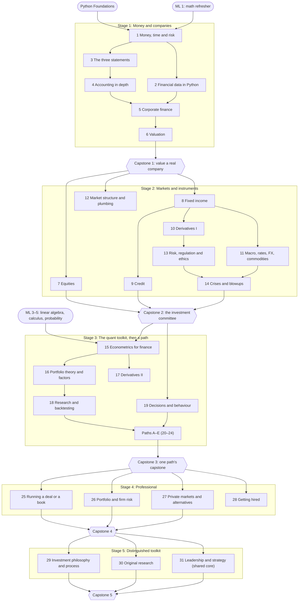

# Finance and Markets track

This track takes a learner from no finance at all to the work done on Wall Street: reading a company from its filings, valuing it, pricing what trades in markets, managing risk, and then going deep in one path (banking and private equity, trading, buy-side investing, quant research, or financial technology). It aims at the same six levels as every other track ("one bar for every track", decided by the owner on 2026-11-15).

**Status: Module 1 is being written (2026-11-17)** from [its plan](../plans/finance-module-1/README.md), ahead of the cloud track's Module 4 at the owner's request. Its topics are on the map as outlines until each is written. Module 1 is designed in full below; every other module is a line in the [module map](#module-map). Per the owner, the track is built **one module at a time**: each module gets a writing plan (`docs/plans/finance-module-<n>/`), then its topics, before the next one is designed in detail.

**Where it came from.** The owner's document _Zero to Wall Street Expert: Complete Roadmap_ (2026-11-17): a 24-month self-study plan in six phases, with resources, build projects and checkpoints. It was reviewed twice for this spec: by a finance expert, for what's right, missing or out of date, and by an education expert, for how to turn a reading list into a track the platform can teach and prove. Both reviews are below; the [module map](#module-map) is what came out of them. The document itself stays on the owner's machine and is not in the repository.

**It assumes nothing about the learner.** No finance, no accounting, no math past [Python Foundations](python-foundations.md) and the ML track's [math refresher](ml-foundations.md#module-1-math-refresher-in-python). A learner who already knows something proves it with "Prove it now" or the placement test and moves on ([ADR-0002](../decisions/0002-mastery-and-gating.md)).

- **Track id** `finance`, order 4 (the order on the map, not the build order). Topic ids `fin.<area>.<name>`; checkpoints `fin.m<n>.checkpoint`; capstones `fin.c<n>.capstone`.
- **Size:** 31 modules in 5 stages, about 260 topics, plus the paths. Every module ends with a checkpoint and every stage with a capstone.
- **Time:** roughly 2,400 to 2,800 hours from zero, including reviews. At 20 hours a week that's about 2.5 to 3 years; at the source document's 30 hours, about two years to Level 4, which is where the document stops.
- **It costs nothing to run.** Every proof runs in the browser's Python. There is no lab in a real cloud, no paid data and no brokerage account.
- **It is not investment advice.** The track teaches how finance works and how professionals reason. It never tells a learner what to buy, never links to a broker, and never asks for real money. Every topic that touches investing says so once, plainly.

## The finance expert's review

_Written as a practitioner who has worked in banking and on the buy side and has hired analysts._

**What the source document gets right.** These carry straight into the track:

- **Accounting before anything else.** Not being able to read a company is the most common reason self-taught candidates fail a technical interview. The track puts accounting in Stage 1 and tests it all the way up.
- **Build something every phase.** A three-statement model, a DCF, a bond pricer, a backtest. Interviewers ask about what you built, and reading alone doesn't make skill.
- **Real filings and real data from the start.** SEC EDGAR filings are public domain and are the real raw material of the job.
- **A shared core, then a specialty.** About 70% of every Wall Street path is the same. The track keeps that shape.
- **The honest caveats.** Self-study builds skill; hiring is gated by schools, internships, networks and a track record. The track says this in the same plain words, at the start and at each level.

**What's missing.** Each is added to the module map:

1. **Credit.** Leveraged finance and private credit are among the largest and fastest-growing parts of the industry, and credit analysis (can this company pay its debts?) is a different skill from equity valuation. The document mentions credit spreads and covenants in passing. The track gives credit its own module (Module 9).
2. **Risk management as a discipline.** VaR (value at risk: a loss figure that should only be exceeded on, say, 1 day in 100), stress tests, liquidity and counterparty risk, and why each failed in 2008. The document has a risk-sizing line under trading. The track gives it a module (Module 13), because every path is judged on it.
3. **Ethics, regulation and compliance.** Insider trading and material non-public information, Reg FD, conflicts of interest, suitability, market abuse. Getting these wrong ends careers, and the CFA exams weight ethics heavily. The document leaves them out. The track teaches them in Module 13 and asks about them in every path's interviews.
4. **The plumbing.** How money and securities actually move: payments, clearing houses, settlement (US stocks moved to T+1 settlement in May 2024), custody, market data. It's thin in the document, and it is exactly where the owner's nine years in IT turn into an advantage.
5. **A fifth path: financial technology.** The document's four paths all start from finance. Banks and funds hire heavily for the people between finance and engineering: trading-system engineers, market-data and risk-platform engineers, cloud architects for regulated firms, ML engineers on financial data. That is where the owner's other two tracks (cloud, then ML) meet this one. It's added as Path E.
6. **Private markets and alternatives.** Venture capital, private-equity fund economics (the "2 and 20", carried interest, J-curve), real estate, hedge-fund structures. Covered only as a book title in the document. The track gives them Module 27.
7. **IFRS beside US GAAP.** Most of the world reports under IFRS, and the differences (leases, development costs, inventory) are interview questions.

**What to change.**

- **Excel can't be skipped, but it can't be the only medium either.** Banking and private-equity work is done in Excel, and modeling tests are timed Excel tests. But the platform's rule is that every exercise is machine-verified ([ADR-0004](../decisions/0004-content-model.md)), and Python is what the platform can check today. So the track teaches every model in Python first, where each number can be tested, and adds a **spreadsheet exercise type** before the modeling modules (Modules 4 to 6): a grid in the browser where the learner writes formulas, checked like code. That needs an ADR before Module 4 (see [What the platform needs](#what-the-platform-needs)).
- **Replace "paper trade for three months".** Three months of one person's trades is noise: a good result proves nothing, and a learner can learn the wrong lesson from luck. The track uses **blind history** instead: a real past period with the date and name hidden, where the learner writes a thesis, sizes a position and states their confidence, then the next months are revealed. Dozens of these can be done in the time one paper-trading quarter takes, and each is scored on the process and on calibration, not on profit.
- **Don't derive Black-Scholes for everyone.** The derivation is right for the quant path and the trading path, and wasted for banking. The core teaches what the model assumes and how to use it; the derivation goes to Module 16 and the quant path.
- **Phases 3 and 4 overlap in the document** (months 9 to 14 and 12 to 20). On the platform the order is set by prerequisites, not months, so that problem goes away.
- **Book prices, editions and exam rules** in the document were written without a web lookup and say so. Each is checked again when its module is written, and the spec doesn't repeat them.

**What a learner can realistically reach.** The finance expert's view, in one line: a learner who finishes Stage 3 and one path, with no finance job history, should expect to be hired at Level 3 (analyst) at a smaller firm or in an adjacent role, and earn Level 4 at work. Levels 5 and 6 are taught as a toolkit; the titles are earned with a record.

## The education expert's review

_Written as a learning designer: how people come to understand finance, and how this platform turns that into lasting skill._

**The document is a good map and a weak course.** It says what to learn and in what order, and points at books. It doesn't say how a beginner gets from a definition to being able to use it under pressure. The platform's job is that middle part. Six changes do it:

1. **Teach in the platform, use books as optional depth.** Every topic is taught by its own lesson, written here. The books and courses in the document become each topic's "go deeper" resources, with their licenses recorded and nothing copied ([ADR-0004](../decisions/0004-content-model.md)).
2. **One running company through Stage 1.** Accounting is abstract until it's about something. Stage 1 follows one fictional company, a small coffee roaster that grows from one shop to a chain that goes public, written by us so it can be used freely. Every journal entry, statement, ratio and valuation in Modules 3 to 6 is about the same company, so each new idea lands on things the learner already knows. Real companies' 10-K filings come in at each checkpoint, to prove the skill transfers.
3. **The four proofs fit finance unusually well** ([ADR-0002](../decisions/0002-mastery-and-gating.md)):
   - _Build it from a blank editor:_ a loan schedule, a statement, a model, a pricer, a backtest.
   - _Fix a broken one:_ broken financial models are the job. A model that doesn't balance, a cash flow with a sign flipped, a growth rate applied to the wrong year, a backtest that peeks at the future. Debug exercises are given as symptoms ("the balance sheet is off by 1,200 in year 3") and a count, never the fault.
   - _Explain it:_ defend an assumption, explain a number. "Why does cash flow differ from net income here?" is graded by the AI grader against a rubric ([ADR-0013](../decisions/0013-explain-grading.md)).
   - _Still do it weeks later:_ spaced reviews, which matter more here than almost anywhere, because finance is a large vocabulary built on a small number of ideas.
4. **Estimate questions and confidence are part of the skill.** Mental math and back-of-the-envelope sizing are tested in trading and banking interviews. Estimate questions ([ADR-0024](../decisions/0024-estimate-questions.md)) ask for a number within a tolerance ("roughly how long does money take to double at 7%?"). Confidence before the answer ([ADR-0028](../decisions/0028-confidence-before-the-answer.md)) is exactly calibration, which is what separates good investors from lucky ones. The blind-history exercises score it.
5. **Don't pick a path early.** The document asks the learner to choose a path at month 12. People choose badly before they've tried the work. Stage 2's capstone asks the learner to do a small piece of each path's real work (a deal, a trade, a pitch, a backtest, a system), so the choice in Stage 3 is made from experience.
6. **Reuse what's built, and don't teach anything twice.** Python is [Python Foundations](python-foundations.md). The math refresher, linear algebra, calculus and probability are the ML track's Modules 1, 3, 4 and 5, already written; this track's topics list them as prerequisites, the way the ML track lists Python topics today. The leadership and strategy modules at the top are the shared core the "Three roads" plan describes.

**Small things that matter for memory:**

- Contrast questions for look-alikes: revenue and cash, profit and cash flow, APR and APY, yield and return, duration and maturity, a forward and a future.
- Glossaries on every topic. Finance has more jargon per page than any other track.
- A real incident in every topic where one exists, with its source: Enron, Lehman, Long-Term Capital Management, the London Whale, Archegos, GameStop's settlement squeeze, Silicon Valley Bank. Stories are remembered; definitions aren't.
- Module 1 starts with money the learner already has an opinion about (a loan, a savings account, a fee) before markets and companies, so the first win is quick and useful.

## Levels

The same six levels as every track, with what they mean in finance.

| Level | Reached at | Roughly the job title | You can… |
| --- | --- | --- | --- |
| 1. Programmer | Python Foundations and the math refresher (shared) | Not yet hireable | write, test and debug real programs; do the arithmetic, algebra and statistics finance rests on |
| 2. Finance-literate builder | Capstone 1 | Intern | read any company's statements, build a three-statement model and a DCF, and say what a stock, a bond and a fund are |
| 3. Analyst | Capstone 2 | Analyst (entry level) | price and explain every major asset class, read an economy, size and talk about risk, and pitch a long and a short |
| 4. Associate | Capstone 3 | Associate, senior analyst, junior quant | use the quantitative toolkit, and do one path's work to an interview-passing professional standard |
| 5. Vice president, portfolio manager, senior quant | Capstone 4 | VP, PM, senior researcher | run a deal process, a book or a research program; manage risk at the level of a portfolio or a desk; steer other people's work |
| 6. Distinguished toolkit | Capstone 5 | Head of research, CIO, partner: earned, never granted | set a firm's investment process, write research fit to publish, and decide through others |

## Module map

Prerequisites shown with arrows. The rounded boxes are modules already written in other tracks.

| Stage | Modules | Topics (about) | Ends with | Rough hours |
| --- | --- | --- | --- | --- |
| 1. Money and companies | 1–6 | 55 | Capstone 1, Level 2 | 400–450 |
| 2. Markets and instruments | 7–14 | 70 | Capstone 2, Level 3 | 550–650 |
| 3. The quant toolkit, then a path | 15–19, one of 20–24 | 45, plus 10–12 a path | Capstone 3, Level 4 | 600–700 |
| 4. Professional | 25–28 | 40 | Capstone 4, Level 5 | 450–550 |
| 5. Distinguished toolkit | 29–31 | 25 | Capstone 5, Level 6 | 350–450 |

### Stage 1: Money and companies

1. **Money, time and risk.** Compounding, present value, loans, rates and inflation, returns, risk, diversification, what's traded and how a trade happens. In full [below](#module-1-money-time-and-risk).
2. **Financial data in Python.** pandas for prices and statements, dates and business days, adjusted prices, SQL on a filings database (`sqlite3`, which the browser's Python already has), reading SEC EDGAR's XBRL facts, plotting returns. _Checkpoint:_ a clean, tested data pipeline from raw filings to a tidy table.
3. **The three statements.** Double-entry bookkeeping from the coffee roaster's first day; the income statement, the balance sheet, the cash flow statement, and how they tie together. _Checkpoint:_ build all three from a year of transactions, and fix a set that doesn't balance.
4. **Accounting in depth.** Accruals and revenue recognition, inventory, depreciation, leases, deferred taxes, stock-based compensation, goodwill and acquisitions, IFRS against US GAAP, and the red flags of _Financial Shenanigans_. _Checkpoint:_ read a real 10-K and write a one-page summary of its economics and risks; find the planted problems in a doctored one.
5. **Corporate finance.** NPV and IRR (and when IRR lies), the cost of capital and WACC, capital structure, dividends and buybacks, working capital, M&A basics. _Checkpoint:_ decide on three projects and a buyback for the roaster, and defend it.
6. **Valuation.** The DCF and its sensitivity tables, comparable companies, precedent transactions, an LBO's basic shape, the football-field chart, and how valuations go wrong. Introduces the spreadsheet exercise type alongside Python. _Checkpoint:_ value the roaster at its IPO three ways and reconcile them.

**Capstone 1: value a real company.** A public company the learner chooses (from a list with prepared EDGAR data): a three-statement model with no plugs, a DCF with sensitivities, a comps table of six to eight peers, and a one-page memo defended in an AI-played question session.

### Stage 2: Markets and instruments

7. **Equities.** What drives a stock price, fundamental analysis, factors (value, momentum, quality), short selling, IPOs, buybacks, expectations investing.
8. **Fixed income.** Bond pricing and yield, duration and convexity, the yield curve, Treasuries, repo, mortgage-backed and asset-backed securities.
9. **Credit.** Credit analysis, ratings, spreads, leveraged loans and high yield, covenants and debt terms, private credit, default and recovery.
10. **Derivatives I.** Forwards, futures, swaps, option payoffs, put-call parity, the binomial tree, and using Black-Scholes (not deriving it), with the Greeks introduced.
11. **Macro, rates, FX and commodities.** Growth, inflation, central banks, reading an FOMC statement, interest-rate parity and carry, contango and backwardation, business cycles.
12. **Market structure and plumbing.** Order books and market making, exchanges and dark pools, high-frequency trading, clearing houses, settlement and T+1, custody, payments, market data.
13. **Risk, regulation and ethics.** VaR and expected shortfall, stress tests, liquidity and counterparty risk, Basel in outline, insider trading and MNPI, conflicts of interest, the CFA code in outline.
14. **Crises and blowups.** 1929, 1987, LTCM, the dot-com bust, 2008, the London Whale, Archegos, SVB: each as a case, taught as which earlier topic failed.

**Capstone 2: the investment committee.** A small piece of each path's real work, so the path is chosen from experience: a long pitch and a short pitch (buy-side), a bond and credit view (credit), a set of blind-history trades with a risk limit (trading), a simple backtest (quant), and a look inside a trade's journey from order to settlement (technology). Defended to an AI-played committee.

### Stage 3: The quant toolkit, then a path

Stage 3 starts with the ML track's Modules 3 to 5 as prerequisites: linear algebra, calculus and probability, already written.

15. **Econometrics for finance.** Regression and its traps, hypothesis tests, time series, stationarity, autocorrelation, GARCH.
16. **Portfolio theory and factors.** Mean-variance, CAPM, Fama-French factor regressions (on Kenneth French's free data, license checked), risk parity, the Kelly criterion.
17. **Derivatives II.** Black-Scholes derived, the volatility surface, hedging and its costs, stochastic calculus in outline (Itô's lemma, risk-neutral pricing), Monte Carlo pricing.
18. **Research and backtesting.** How backtests overfit and how to stop it: out-of-sample tests, transaction costs, survivorship bias, look-ahead bias, multiple testing.
19. **Decisions and behaviour.** Behavioural finance, the decision journal, calibration, position sizing under uncertainty, the investment policy statement.

**The paths.** A learner takes one, and may come back for others. Each has 10 to 12 topics and its own capstone.

- **Path A, investment banking and private equity (Module 20).** Advanced LBO, merger models and accretion/dilution, restructuring, debt terms, the pitch book, timed modeling tests. _Capstone:_ a full LBO and merger model on a real past deal, and a ten-slide pitch.
- **Path B, markets and trading (Module 21).** Market making, options trading, rates and credit products, hedging, risk limits, P&L attribution, the mental-math and probability interview. _Capstone:_ a blind-history book run with a risk limit and weekly P&L attribution.
- **Path C, buy-side investing (Module 22).** Deep research, industry analysis, position sizing, portfolio construction, writing. _Capstone:_ three pitches of publishable quality and a model portfolio tracked against a benchmark over blind history.
- **Path D, quant research (Module 23).** Alpha research, machine learning on financial data, optimization, execution. Builds on the ML track. _Capstone:_ a systematic strategy tested out of sample with costs, and a research note.
- **Path E, financial technology (Module 24).** Trading-system design, market-data feeds, risk and pricing platforms, low latency, regulated cloud (records retention, auditability, resilience rules), ML in production on financial data. Builds on the cloud and ML tracks. _Capstone:_ a small order-matching engine and risk check, built and load-tested.

**Capstone 3:** the path's capstone, plus an eight-question technical interview for that path, played by the AI.

### Stage 4: Professional

25. **Running a deal or a book.** A deal process end to end, or a trading book, or a research process: timelines, people, documents, and what goes wrong.
26. **Portfolio and firm risk.** Risk at the level of a portfolio, a desk and a firm; limits; model risk; the risk committee.
27. **Private markets and alternatives.** Venture capital, private-equity fund economics, real estate, hedge funds, infrastructure; the CAIA's ground in outline.
28. **Getting hired.** The credentials (CFA, FRM, CAIA, the SIE and Series exams, the CQF), what each signals and to whom; the interview sets for each path; networking and outreach; the honest picture of how self-taught people get in.

**Capstone 4:** run a simulated deal or a quarter of a book end to end, with an AI-played team and a risk committee.

### Stage 5: Distinguished toolkit

29. **Investment philosophy and process.** How the best firms decide, write, review and learn; designing a firm's process.
30. **Original research.** A question nobody has answered well, answered with data, written up to a standard fit to publish.
31. **Leadership and strategy.** The shared core of every track: deciding through others, writing for executives, growing people.

**Capstone 5:** a written investment process for a firm, and one piece of original research.

## Module 1: Money, time and risk

The first module is about money the learner already has opinions about: savings, a loan, a fee, a pension. It ends with what a stock, a bond and a fund are and how a trade happens, so that Module 2's data and Module 3's companies have somewhere to land. Every idea is computed in Python, where a wrong idea shows up as a wrong number.

**Prerequisites.** Python Foundations through functions and loops, and three topics of the ML track's math refresher: arithmetic (percentages), exponents and logarithms (growth), and probability and statistics (mean and standard deviation). A learner who placed above those proves them and moves on.

**Data.** Only data the platform may freely ship: series generated by the exercises themselves, with a fixed seed so tests are exact, and US government data, which is in the public domain (for example, the Consumer Price Index from the Bureau of Labor Statistics). Stock-index levels and most vendors' price histories are licensed and are not shipped. Each data file records its source and license.

| # | Topic | ID | Needs | You'll be able to… |
| --- | --- | --- | --- | --- |
| 1 | Compound interest | `fin.money.compounding` | `ml.math.exponents-and-logs`, `py.for-and-range` | grow money year by year with a loop and then with the formula, and check that they agree; estimate doubling time with the rule of 72; say why compounding favours starting early |
| 2 | Present and future value | `fin.money.time-value` | `fin.money.compounding`, `py.return-values` | discount a future amount to today and grow today's amount to the future; compare offers paid at different times; value a list of uneven cash flows |
| 3 | Loans and annuities | `fin.money.annuities` | `fin.money.time-value`, `py.lists` | value a stream of equal payments; work out a loan's monthly payment; build an amortization schedule and say why early payments are mostly interest |
| 4 | Rates, inflation and real returns | `fin.money.rates` | `fin.money.compounding` | turn an APR into an effective annual rate for any compounding frequency; tell nominal from real; measure inflation from the CPI and deflate a price history |
| 5 | Measuring returns | `fin.money.returns` | `fin.money.rates`, `ml.math.probability-and-statistics` | compute simple, log and annualized returns from a price list; say why +50% then −50% loses money; use the geometric mean for growth and the arithmetic mean for one period |
| 6 | Risk | `fin.money.risk` | `fin.money.returns` | compute volatility and annualize it; find the maximum drawdown; read a risk and return chart; say why a higher expected return comes with a wider range of outcomes |
| 7 | Diversification | `fin.money.diversification` | `fin.money.risk` | compute correlation; show with simulated assets how a portfolio's volatility falls as uncorrelated holdings are added and why it stops falling; explain what an index fund buys |
| 8 | Fees, taxes and compounding | `fin.money.costs` | `fin.money.compounding` | show what a 1% yearly fee costs over 30 years; compare a taxed account with a tax-deferred one in outline; say why costs are the one return you can choose |
| 9 | Stocks, bonds and funds | `fin.markets.instruments` | `fin.money.time-value` | say what a share and a bond are claims on; value a simple bond as a set of cash flows; tell a mutual fund, an ETF and an index apart; say what drives a stock price in one paragraph |
| 10 | How a trade happens | `fin.markets.trading` | `fin.markets.instruments`, `py.dictionaries` | follow an order from a broker to an exchange to a clearing house to settlement; tell market, limit and stop orders apart; read a bid, an ask and the spread; match orders in a tiny order book of your own |
| 11 | Reading market data | `fin.markets.prices` | `fin.markets.trading`, `fin.money.returns` | read open, high, low and close; adjust a price history for a split and a dividend; build a price-weighted and a cap-weighted index from three companies and say why they differ |

**Checkpoint 1: the loan and the portfolio** (`fin.m1.checkpoint`).

- **The build.** From a blank editor: a monthly amortization schedule for a loan (the source document's own Phase 0 checkpoint), whose totals are checked to the cent; then, from a price series, its annualized return, volatility and maximum drawdown. The way through for a stuck learner ([ADR-0012](../decisions/0012-checkpoint-support.md)): a solved sibling for a savings plan, the schedule in four steps, and fresh versions with other loans.
- **The debug.** A retirement calculator that a friend wrote, given as symptoms and a count: it promises far too much. Its four planted faults are a yearly rate applied monthly, nominal returns where real ones were needed, an off-by-one in the number of periods, and the arithmetic mean used for growth over many years.
- **The explain.** A friend says their fund "returned +50% one year and −50% the next, so I broke even". Explain what really happened and why, with numbers.

**What each topic carries,** as every ready topic does since 2026-11-16 ([ADR-0025](../decisions/0025-topics-in-parts.md) to [ADR-0028](../decisions/0028-confidence-before-the-answer.md)): parts of about 30 minutes; an opening puzzle; questions inside the lesson; a glossary; two typed questions; estimate questions (doubling time, a loan's total interest, a fee's 30-year cost); contrast questions (APR and APY, nominal and real, arithmetic and geometric mean, price-weighted and cap-weighted); and a real incident with its source where one fits (Enron employees' retirement savings held in Enron stock, for diversification; the January 2021 GameStop trading restrictions, which came from clearing-house deposit demands, for how a trade happens).

**Module 1's writing plan** goes in `docs/plans/finance-module-1/` before any topic is written: each topic's lesson outline, exercises and known-wrong solutions, the checkpoint's faults and checks, the data files and their licenses, the incidents and their sources, and the "go deeper" resources with licenses (Khan Academy's finance course and Aswath Damodaran's free lectures are the likely ones; to check).

## How competency is proven

Every topic gets the platform's four proofs ([ADR-0002](../decisions/0002-mastery-and-gating.md)). Finance adds:

- **Models checked to the number.** A model's tests check its outputs (to the cent where money is exact, within a stated tolerance where it's an estimate) and its structure: it balances, its signs are right, it uses no hard-coded plug.
- **Defend-it sessions.** From Capstone 1 on, the explain becomes a short question session with the AI playing an interviewer, a committee or a client, graded against a rubric shown in advance ([ADR-0013's amendment](../decisions/0013-explain-grading.md#amendment-2026-11-16-how-its-marked-shown-before-writing)).
- **Blind history.** A real past period with names and dates hidden: thesis, size and confidence first, then the reveal. Scored on process and calibration, not profit, and never presented as a way to make money.
- **Timed drills, not timed proofs.** Mental math and modeling speed are trained with optional timed drills; the proofs themselves keep the platform's rule of no countdown timers.

## What the platform needs

In the order the modules need them.

| Need | Needed by | What | Decision |
| --- | --- | --- | --- |
| A fourth track on the map | Module 1 | `content/tracks/finance.yaml` and the topics' outlines | None: the app already supports many tracks |
| Prerequisites across tracks | Module 1 | `fin.*` topics list `ml.math.*` and `py.*` topics | None: the ML track already does this with `py.*` |
| pandas in both runtimes | Module 2 | Declared per topic, as NumPy is | Covered by [ADR-0023](../decisions/0023-packages-in-both-runtimes.md) |
| Spreadsheet exercises | Module 4 | A formula grid in the browser, checked in both runtimes, with an open-source formula engine under a permissive license | A new ADR, _Proposed_, before Module 4 |
| Statement and model checks | Module 3 | Test helpers that check a model balances and has no plugs | Part of the harness; read [harness/README.md](../../harness/README.md) first |
| Blind-history exercises | Module 7 | Hidden-name, hidden-date periods with a reveal, scored on calibration | A new ADR before Module 7, with the data-license question answered |
| Topics shared between tracks | Stage 3 | The shared-core model from the "Three roads" plan | The shared-topic ADR, already planned |

## Resources and licenses

The source document's resources stay as each topic's optional "go deeper" links. A few rules for this track:

- **Free and public domain first.** SEC EDGAR filings and US government statistics (BLS, BEA, the Federal Reserve's own publications) are public domain. FRED is free to read, but some of its series belong to third parties, so each series' license is checked before it's shipped.
- **Licensed data is linked, never shipped.** Index levels, vendors' price histories and Yahoo Finance's data are not copied into the repository.
- **Books are named, never quoted.** Paid courses (Wall Street Prep, Breaking Into Wall Street, CFI) are mentioned as options in Module 28 and nowhere required.
- **Exam bodies' material isn't copied.** The track says which of its topics line up with the CFA, FRM and CAIA curricula, in its own words.

## Building it

One module at a time, as the owner asked on 2026-11-17.

1. **Module 1's writing plan,** then its eleven topics and checkpoint, in the same way the cloud modules were written: capture outputs from CPython, a perturbation check on every exercise, cold review after each batch, `time:content` under 40%.
2. **The track file and Module 1 on the map** (done 2026-11-17, as outlines first). Modules 2 to 6 join the map as outlines when each one's topics are named in its plan.
3. **Then Module 2's plan,** and so on. The spreadsheet ADR is written while Module 3 is being built, so it's settled before Module 4.

The owner put Module 1 first on 2026-11-17, ahead of the cloud track's Module 4. Where later modules go is the owner's call.
