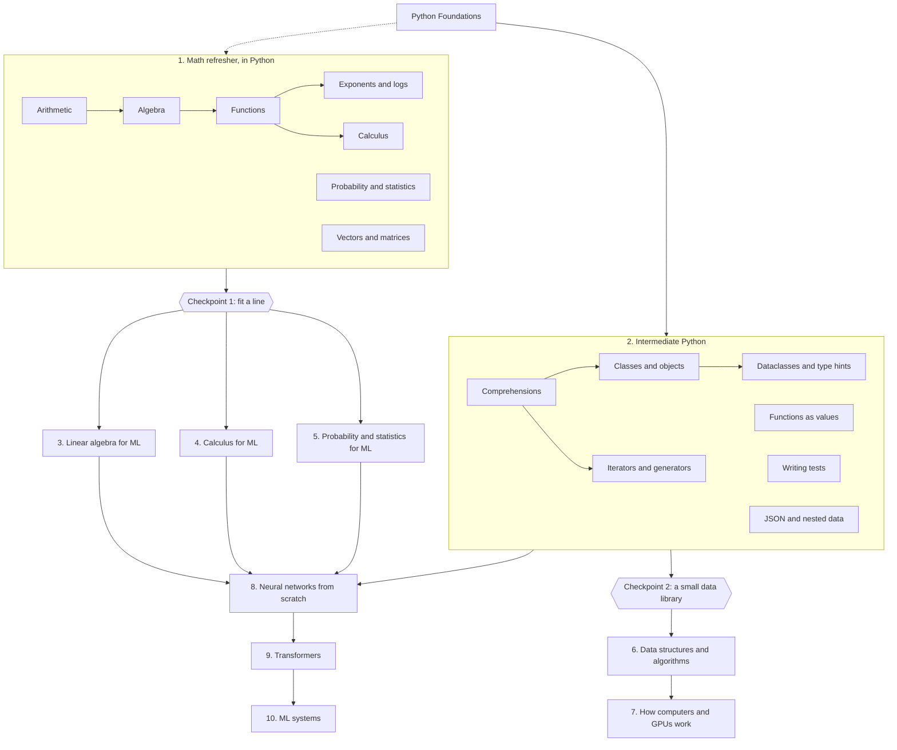

# Machine Learning Foundations track

The third track, and the learning track the vision was written for: from the math and the Python that machine learning is made of, to neural networks built from scratch and the systems that serve them. It starts where [Python Foundations](python-foundations.md) leaves a learner, and its first two modules are Phase 2's content items: **a math refresher** that the placement test's math diagnostic points at ([ADR-0021](../decisions/0021-placement-test.md)), and **intermediate Python**.

- Every topic is proven in Python, like every other topic on the platform ([ADR-0002](../decisions/0002-mastery-and-gating.md)): a blank-editor build, a debug, an explanation, and reviews. The math is _done_, in code, not watched.
- Topics build on Python Foundations topics by name (`prerequisites: [py.strings-and-input]`), so a learner can start the refresher early in the Python track and the later topics unlock as their Python does.
- Main resources are free textbooks under CC BY 4.0 (OpenStax), linked by book with the chapter named, plus a few linked videos; the lessons' own intros and recaps carry the teaching, written here, never copied.
- Track id `ml-foundations`, order 3. Topic ids are `ml.<area>.<name>`; module checkpoints `ml.m<n>.checkpoint`.

## Module map

## Module 1: Math refresher, in Python

The seven levels of the placement test's math ladder, as topics. Each is small (about 45 minutes), teaches the idea and then has the learner compute it in Python, where a wrong idea shows up as a wrong number. A learner who placed well on the ladder proves these with "Prove it now" and moves on.

| #   | Topic                      | ID                                   | Needs                                      | You'll be able to…                                                                                                                                                                                                   |
| --- | -------------------------- | ------------------------------------ | ------------------------------------------ | -------------------------------------------------------------------------------------------------------------------------------------------------------------------------------------------------------------------- |
| 1   | Arithmetic                 | `ml.math.arithmetic`                 | `py.strings-and-input`                     | compute with fractions, decimals and percentages in Python; apply the order of operations and change it with parentheses; work out a percentage of, a percentage change, and round sensibly                          |
| 2   | Algebra                    | `ml.math.algebra`                    | `ml.math.arithmetic`                       | solve a linear equation by undoing what was done to the unknown; check an answer by substituting it back; rearrange a formula to make another variable the subject; apply the rules for multiplying powers           |
| 3   | Functions                  | `ml.math.functions`                  | `ml.math.algebra`, `py.return-values`      | treat a function as a rule from input to output and evaluate it; read a line's slope and intercept and say what each means; put one function inside another; make a table of values with a loop                      |
| 4   | Exponents and logarithms   | `ml.math.exponents-and-logs`         | `ml.math.functions`                        | use powers, roots and negative exponents; say what a logarithm is and compute one; turn products into sums with log rules; model growth and decay in code and say why machine learning adds log-probabilities        |
| 5   | Probability and statistics | `ml.math.probability-and-statistics` | `ml.math.arithmetic`, `py.list-algorithms` | compute mean, median and standard deviation from a list; work out a probability by counting outcomes; multiply for independent events; reason about base rates with a table of 1,000 people                          |
| 6   | Vectors and matrices       | `ml.math.vectors-and-matrices`       | `ml.math.arithmetic`, `py.nested-data`     | add and scale vectors held as lists; compute a dot product and a vector's length; hold a matrix as a list of lists and read its shape; multiply a matrix by a vector and by a matrix with loops, checking the shapes |
| 7   | Calculus                   | `ml.math.calculus`                   | `ml.math.functions`, `py.while-loops`      | estimate a function's slope at a point from two nearby values; check the power rule numerically; read the sign of the derivative as "going up or down"; find a minimum by stepping against the slope                 |

**Checkpoint 1: fit a line** (`ml.m1.checkpoint`). Given lists of x and y values, find the slope and intercept of the line that fits them best by stepping downhill on the error, and print both rounded; debug a statistics report whose mean, median and spread are each wrong in a different way; explain why stepping against the derivative finds the bottom of a valley. The way through for a stuck learner: a solved sibling that fits a constant instead of a line, steps that compute the error, the slope of the error, one step and the loop, and fresh versions on other data.

## Module 2: Intermediate Python

The Python that the rest of the track is written in, each topic proven by building with it.

| #   | Topic                      | ID                               | Needs                                         | You'll be able to…                                                                                                                                                    |
| --- | -------------------------- | -------------------------------- | --------------------------------------------- | --------------------------------------------------------------------------------------------------------------------------------------------------------------------- |
| 8   | Comprehensions             | `ml.py.comprehensions`           | `py.m5.checkpoint`                            | write list, dict and set comprehensions with conditions; say when a loop is clearer; avoid the nested-comprehension trap                                              |
| 9   | Classes and objects        | `ml.py.classes`                  | `py.m6.checkpoint`                            | define a class with `__init__`, attributes and methods; explain `self`; tell a class from an instance; give a class a readable `__repr__`                             |
| 10  | Dataclasses and type hints | `ml.py.dataclasses-and-typing`   | `ml.py.classes`                               | declare a record with `@dataclass`; annotate parameters and return values; read a type error from a checker; say what hints do and don't do at run time               |
| 11  | Iterators and generators   | `ml.py.iterators-and-generators` | `ml.py.comprehensions`                        | explain what `for` really calls; write a generator with `yield`; read a file or a stream lazily; say why a generator can be used once                                 |
| 12  | Functions as values        | `ml.py.functions-as-values`      | `ml.py.comprehensions`                        | pass a function to another; sort with a `key`; use `lambda` where it's clearer and name the function where it isn't; write a decorator that counts or times calls     |
| 13  | Writing tests              | `ml.py.writing-tests`            | `py.m6.checkpoint`                            | write pytest-style tests for a function, including its edge cases; share set-up with a helper and say what a fixture is for; say what a test proves and what it can't |
| 14  | JSON and nested data       | `ml.py.json-and-nested-data`     | `ml.py.dataclasses-and-typing`, `py.csv-data` | read and write JSON; walk nested lists and dicts safely; turn records into dataclasses and back; validate what came in before using it                                |

**Checkpoint 2: a small data library** (`ml.m2.checkpoint`). Build a `Dataset` class from a spec: it loads JSON records, iterates lazily, summarizes a numeric column and writes a report, with tests; debug a version with three bugs across its methods; explain the difference between a class, an instance and a generator.

## Module 3: Linear algebra for ML

The language every model is written in. Vectors and matrices come back from Module 1, now in NumPy, which the browser's Python ships; the pictures (a grid under a transformation, data along its principal axes) are drawn as text where a picture is the point. Every topic is proven in code.

| #   | Topic                                  | ID                       | Needs                                                                      | You'll be able to…                                                                                                                                                                                                                         |
| --- | -------------------------------------- | ------------------------ | -------------------------------------------------------------------------- | ------------------------------------------------------------------------------------------------------------------------------------------------------------------------------------------------------------------------------------------ |
| 15  | NumPy arrays                           | `ml.la.numpy-arrays`     | `ml.py.comprehensions`, `ml.math.vectors-and-matrices`                     | make arrays from lists and ranges and read their shape and dtype; index and slice in one and two dimensions; do arithmetic on whole arrays and say what broadcasting does; replace a loop with one array operation and say why it's faster |
| 16  | Vectors: length, angle and dot product | `ml.la.vectors`          | `ml.la.numpy-arrays`, `ml.math.exponents-and-logs`                         | compute a length and a unit vector; read a dot product as a similarity; find the angle between two vectors and say what a dot product of zero means; project one vector onto another                                                       |
| 17  | Matrices as transformations            | `ml.la.matrices-as-maps` | `ml.la.vectors`                                                            | apply a matrix to a vector and draw where the grid goes; build rotations, scalings and shears and compose them by multiplying; say what the identity and the inverse do and when there is no inverse; read the determinant as area scaling |
| 18  | Systems of linear equations            | `ml.la.systems`          | `ml.la.matrices-as-maps`, `ml.math.algebra`                                | write a system as Ax = b; solve a small one by elimination, by hand and in code; solve a large one with `np.linalg.solve` and check it; say from the rank when there is no solution or infinitely many                                     |
| 19  | Projections and least squares          | `ml.la.least-squares`    | `ml.la.systems`, `ml.m1.checkpoint`                                        | project onto a line and a plane; write and solve the normal equations; fit a line and a plane with `np.linalg.lstsq` and check it against gradient descent; say what least squares minimizes and why the answer is a projection            |
| 20  | Eigenvalues and eigenvectors           | `ml.la.eigen`            | `ml.la.matrices-as-maps`                                                   | say what an eigenvector and its eigenvalue are and check a pair; find them with `np.linalg.eig` and read complex ones as rotation; predict what applying a matrix many times does; diagonalize a matrix and say what that buys             |
| 21  | PCA: what eigenvalues mean for data    | `ml.la.pca`              | `ml.la.eigen`, `ml.la.least-squares`, `ml.math.probability-and-statistics` | center data and compute its covariance matrix; take the principal components as its eigenvectors; project onto the top components and read the variance explained; say when PCA helps and what it throws away                              |

**Checkpoint 3: fit and compress** (`ml.m3.checkpoint`). Fit a plane to points with the normal equations and check it against `np.linalg.lstsq`; reduce the same points to their top principal components and report the variance kept; debug a matrix program with three bugs (a shape mismatch, a transposed multiply, an uncentered covariance); explain why the normal equations give the least-squares fit and what the top eigenvector of a covariance matrix means. The way through for a stuck learner, as in the earlier checkpoints: a solved sibling, steps, fresh versions.

## Module 4: Calculus for ML

Module 1 estimated slopes and stepped downhill on one knob; Checkpoint 1 did it on two. This module is the calculus that training is made of: the derivatives of the few functions every model uses, the gradient in many dimensions, the chain rule as the backward pass, and the optimizers that make descent practical. Every derivative is checked numerically, in NumPy, before it's trusted.

| #   | Topic                                    | ID                                   | Needs                                                                                                          | You'll be able to…                                                                                                                                                                                                                              |
| --- | ---------------------------------------- | ------------------------------------ | -------------------------------------------------------------------------------------------------------------- | ----------------------------------------------------------------------------------------------------------------------------------------------------------------------------------------------------------------------------------------------- |
| 22  | Derivatives of the functions ML uses     | `ml.calc.derivatives`                | `ml.math.calculus`, `ml.math.exponents-and-logs`, `ml.la.numpy-arrays`                                         | differentiate powers, exp, log, the sigmoid and ReLU by rule and check each numerically; say why the sigmoid's derivative is small far from zero; apply a derivative to a whole array; read a derivative's sign and size as direction and speed |
| 23  | Partial derivatives and the gradient     | `ml.calc.partials-and-gradient`      | `ml.calc.derivatives`, `ml.la.vectors`                                                                         | take a partial derivative by holding the rest fixed; assemble the gradient and check it against finite differences; say why it points uphill fastest and what its length means; read it as perpendicular to the contours                        |
| 24  | Gradient descent in many dimensions      | `ml.calc.descent-in-many-dimensions` | `ml.calc.partials-and-gradient`, `ml.la.least-squares`                                                         | write descent for several variables with a learning rate and a stopping rule; fit a plane by descent and compare with the normal equations; recognise a learning rate too large or too small from the loss curve                                |
| 25  | The chain rule                           | `ml.calc.chain-rule`                 | `ml.calc.derivatives`                                                                                          | differentiate a composition by hand and in code; chain three or more functions keeping the intermediate values; check it numerically; say why it makes training a layered model possible                                                        |
| 26  | Loss functions and their gradients       | `ml.calc.loss-functions`             | `ml.calc.derivatives`, `ml.math.probability-and-statistics`                                                    | compute mean squared error and cross-entropy; say why a probability model uses log loss; differentiate each loss with respect to the prediction; read a loss curve                                                                              |
| 27  | Backpropagation                          | `ml.calc.backpropagation`            | `ml.calc.chain-rule`, `ml.calc.descent-in-many-dimensions`, `ml.calc.loss-functions`, `ml.la.matrices-as-maps` | write a one-hidden-layer network as a forward pass; compute every gradient with the chain rule from the loss backwards; check them against finite differences; train it and watch the loss fall                                                 |
| 28  | Optimizers beyond plain gradient descent | `ml.calc.optimizers`                 | `ml.calc.descent-in-many-dimensions`, `ml.calc.backpropagation`                                                | add momentum and say what it does in a long narrow valley; decay the learning rate on a schedule; write Adam in a few lines and compare it with plain descent; choose an optimizer and rate from a loss curve                                   |

**Checkpoint 4: train a tiny network** (`ml.m4.checkpoint`). Build a two-layer network from scratch, train it with backpropagation and an optimizer on a small dataset, and report its loss and accuracy; debug a training loop with three bugs (a chain-rule step out of order, an update with the wrong sign, a shape mistake); explain the chain rule as backpropagation and what the learning rate trades off. The way through for a stuck learner, as in the earlier checkpoints: a solved sibling, steps, fresh versions.

## Module 5: Probability and statistics for ML

Module 1 counted chances with a table of 1,000 people, and Module 4 took cross-entropy on trust. This module is the probability and statistics that make a model's numbers mean something: distributions and their expectations, Bayes' rule with base rates, maximum likelihood as where the losses come from, sampling and confidence, entropy as cross-entropy's name, and the statistics of judging a model. Every topic is proven in code, with NumPy's random generator seeded so every run agrees.

| # | Topic | ID | Needs | You'll be able to… |
| --- | --- | --- | --- | --- |
| 29 | Random variables and distributions | `ml.prob.distributions` | `ml.math.probability-and-statistics`, `ml.la.numpy-arrays` | name the Bernoulli, binomial, uniform and normal distributions and what each models; simulate draws with a seeded generator; turn a sample into a histogram and compare it with the formula; read a probability as an area under a density |
| 30 | Expectation and variance | `ml.prob.expectation-and-variance` | `ml.prob.distributions` | compute an expected value and a variance from a distribution's table; use linearity of expectation and the variance of an independent sum; watch sample means settle on the expectation and say what the law of large numbers promises; standardize a value and read it |
| 31 | Bayes' rule, properly | `ml.prob.bayes` | `ml.prob.distributions` | compute a conditional probability from a joint table; apply Bayes' rule to a test result with a base rate and say why the answer surprises people; update a belief step by step as evidence arrives; build a naive Bayes classifier and say what "naive" assumes |
| 32 | Maximum likelihood | `ml.prob.maximum-likelihood` | `ml.prob.expectation-and-variance`, `ml.calc.loss-functions` | write the likelihood of data under a model with a parameter; take the log and find the maximum by calculus and by descent; fit a coin's bias and a normal's mean and spread; say why least squares and cross-entropy are maximum-likelihood losses |
| 33 | Sampling and confidence | `ml.prob.sampling-and-confidence` | `ml.prob.expectation-and-variance` | simulate many samples and watch their means form a normal shape; compute a standard error and say what shrinks it; build a confidence interval and say what it does and doesn't promise; bootstrap an interval for a statistic with no formula |
| 34 | Entropy, cross-entropy and KL divergence | `ml.prob.entropy` | `ml.prob.expectation-and-variance`, `ml.calc.loss-functions` | compute the surprise of an outcome and the entropy of a distribution; compute a cross-entropy and say why it is never below the entropy; compute the KL divergence as the gap; connect Module 4's cross-entropy loss to its name |
| 35 | Evaluating a model with statistics | `ml.prob.evaluating-models` | `ml.prob.sampling-and-confidence`, `ml.calc.loss-functions` | split data into train, validation and test and say what each is for; build a confusion matrix and compute accuracy, precision, recall and F1; put a confidence interval on an accuracy; compare two models on one test set and say whether the difference is real |

**Checkpoint 5: is the model better?** (`ml.m5.checkpoint`). Judge two classifiers' predictions on a held-out set: a confusion matrix and the metrics for each, a bootstrap interval on the difference in accuracy, and a recommendation; debug an evaluation report with three bugs (a threshold chosen on the test set, precision and recall swapped, an interval built from the wrong resamples); explain Bayes' rule with a base rate and what a confidence interval does and doesn't promise. The way through for a stuck learner, as in the earlier checkpoints: a solved sibling, steps, fresh versions.

## Module 6: Data structures and algorithms

Module 2 gave the learner Python; this module gives them the cost of what they write. Counting steps and timing as the input doubles; the structures Python hands over (lists, dicts, sets, deques, heaps) and what each costs; recursion; sorting and searching; trees, and graphs including the computation graph that backpropagation walks; dynamic programming; and a checkpoint that builds the algorithms behind a data pipeline. Every topic is proven in code. Timings appear in the worked examples, read as ratios; the checks count steps, because a browser and CI don't share a clock.

| # | Topic | ID | Needs | You'll be able to… |
| --- | --- | --- | --- | --- |
| 36 | Counting steps and big-O | `ml.dsa.complexity` | `ml.m2.checkpoint` | count a function's operations and name its order of growth; time a function as its input doubles and read the growth; predict which of two approaches scales and say when the slower one is fine; say what vectorizing with NumPy changes and what it doesn't |
| 37 | Arrays, hash tables and sets | `ml.dsa.arrays-and-hashing` | `ml.dsa.complexity` | say what each list operation costs and why; explain how a hash table finds a key and why dict and set lookups are constant time on average; replace a quadratic search with a dict or a set and measure it; count, deduplicate, group and join with dictionaries |
| 38 | Stacks, queues and recursion | `ml.dsa.stacks-queues-recursion` | `ml.dsa.arrays-and-hashing` | use a list as a stack and a deque as a queue, and say why popping from the front of a list is slow; solve bracket matching and undo with a stack; write and trace a recursive function and turn it into a loop with an explicit stack; say what a linked list is and where the idea appears |
| 39 | Sorting and searching | `ml.dsa.sorting-and-searching` | `ml.dsa.stacks-queues-recursion` | write binary search and say why it takes log n steps; write insertion sort and merge sort and time n² against n log n; sort by one or several keys and say why a stable sort matters; order one array by another with argsort and search a sorted list with bisect |
| 40 | Trees and heaps | `ml.dsa.trees-and-heaps` | `ml.dsa.stacks-queues-recursion` | build and traverse a tree depth-first and breadth-first; insert into and search a binary search tree and say when it degrades; keep the top k of a stream with a heap; read a decision tree as a tree of questions |
| 41 | Graphs | `ml.dsa.graphs` | `ml.dsa.trees-and-heaps` | represent a graph as adjacency lists; find reachability and shortest paths in hops with breadth-first search and detect a cycle with depth-first search; find the cheapest path with Dijkstra's algorithm; order a directed acyclic graph topologically and say why computation graphs and pipelines need it |
| 42 | Dynamic programming | `ml.dsa.dynamic-programming` | `ml.dsa.stacks-queues-recursion`, `ml.dsa.arrays-and-hashing` | spot overlapping subproblems and say why plain recursion repeats work; memoize with a dict and with lru_cache and count the calls saved; compute the edit distance between two strings bottom-up and read the edits back; solve the knapsack with a table and say what makes a problem dynamic programming |

**Checkpoint 6: the algorithms behind a pipeline** (`ml.m6.checkpoint`). Build the pieces of a small data pipeline from the module's tools: deduplicate and join records with hashing, keep the top k with a heap, match near-duplicate names by edit distance, and order the pipeline's steps by topological sort, each shown by counting steps to scale as its order says; debug three bugs that each make a step quadratic or wrong (a nested-loop lookup where a set belongs, a queue popped from the front of a list, a table filled in the wrong order); explain why a dictionary lookup is constant time on average and what a topological order guarantees. The way through for a stuck learner, as in the earlier checkpoints: a solved sibling, steps, fresh versions.

## Module 7: How computers and GPUs work

Module 6 counted steps; this module asks what a step costs and why. Bits, bytes and the integers that wrap; floating point and the rounding every loss carries; the memory hierarchy and why nearby bytes are cheap; why vectorized code is fast and when a loop can't be; parallelism, Amdahl's law and what a GPU is good at; counting a model's parameters, FLOPs and bytes; and reading a profiler. Every topic is proven in code where the browser can run it: the checks count operations, bytes and calls, and timings stay in prose, because Pyodide is 32-bit and its clock and object sizes differ from CPython's.

| # | Topic | ID | Needs | You'll be able to… |
| --- | --- | --- | --- | --- |
| 43 | Bits, bytes and integers | `ml.hw.bits-and-integers` | `ml.m6.checkpoint` | convert between binary, decimal and hexadecimal; explain why an int8 wraps from 127 to -128 and a Python int doesn't; size a NumPy array from its dtype and shape and choose a dtype for a column; pack and read flags with bit operations |
| 44 | Floating point | `ml.hw.floating-point` | `ml.hw.bits-and-integers` | explain sign, exponent and mantissa and why 0.1 is stored approximately; compare floats with a tolerance and state machine epsilon for float32 and float64; show rounding accumulating in a sum and reduce it; say where inf and NaN come from and use log-sum-exp |
| 45 | Memory, caches and locality | `ml.hw.memory-and-caches` | `ml.hw.bits-and-integers` | name the memory hierarchy's levels and rough costs and say what a cache line is; read a NumPy array's strides and tell a view from a copy; predict which loop order is cache-friendly and show it by counting cache lines; say why bytes moved matter as much as operations |
| 46 | Why vectorized code is fast | `ml.hw.vectorization` | `ml.hw.memory-and-caches`, `ml.dsa.complexity` | explain what a Python loop pays per element and what SIMD adds; vectorize a loop with broadcasting and check it agrees; measure both forms with the doubling test; recognize a sequential dependence and say what to do instead |
| 47 | Parallelism and what a GPU is good at | `ml.hw.parallelism-and-gpus` | `ml.hw.vectorization` | tell data parallelism from a sequential dependence and apply Amdahl's law; explain what a GPU is; count the operations and bytes of a matrix multiply and say why it suits a GPU; say what bandwidth limits, why batches help and what the CPU-GPU transfer costs |
| 48 | Counting a model's cost | `ml.hw.cost-of-a-model` | `ml.hw.parallelism-and-gpus`, `ml.hw.floating-point` | count a network's parameters from its layer sizes; count the FLOPs of a forward pass and estimate the backward; compute memory for weights and activations at float32 and float16; estimate time from FLOPs and throughput and say why it is optimistic |
| 49 | Reading a profiler | `ml.hw.profiling` | `ml.hw.vectorization` | profile with cProfile and read pstats to find the hot spot; measure memory with tracemalloc; choose what to change first from a profile and show the result; say why measuring beats guessing |

**Checkpoint 7: make it fast** (`ml.m7.checkpoint`). Profile a slow, numerically shaky feature pipeline, find its hot loop and vectorize it, showing the gain with the doubling test and the profile; fix three numeric bugs (an int8 column that wraps, a float32 sum that drifts, a softmax that overflows to NaN); estimate the parameters, FLOPs and memory of the model the pipeline feeds; and explain floating point and why vectorized code is fast. The way through for a stuck learner, as in the earlier checkpoints: a solved sibling, steps, fresh versions.

## Module 8: Neural networks from scratch

Module 4 built a two-layer network by hand to learn the calculus; this module builds networks the way libraries do, as layers that each know their forward and backward pass, and trains them properly: starting weights that keep the signal alive, mini-batches and shuffling, a validation set, regularization, a convolutional layer for images, and a checklist for when training fails. Everything runs in the browser in NumPy with a seed; the checks gradient-check the pieces and hold a network to an accuracy bar on data it hasn't seen, rather than to exact numbers after many steps.

| # | Topic | ID | Needs | You'll be able to… |
| --- | --- | --- | --- | --- |
| 50 | Neurons, layers and a network's shape | `ml.nn.neurons-and-layers` | `ml.m4.checkpoint`, `ml.m7.checkpoint` | write a neuron and a dense layer in NumPy; compose layers into a network with a forward pass and track shapes through it; count parameters; explain why the hidden activations are what make depth matter |
| 51 | Layers that carry their gradient | `ml.nn.backward-layers` | `ml.nn.neurons-and-layers` | implement backward for dense and activation layers; implement MSE and softmax cross-entropy with their gradients; chain backward calls and gradient-check them; explain the chain rule at a layer boundary |
| 52 | Starting weights and activation functions | `ml.nn.initialization-and-activations` | `ml.nn.backward-layers` | show why zero weights can't learn; measure activation and gradient scale through depth under different starting weights; choose an activation and its He or Xavier scale; explain saturation and dead ReLUs |
| 53 | The training loop | `ml.nn.training-loop` | `ml.nn.backward-layers` | write a mini-batch training loop with shuffling; split data and evaluate on a validation set; read a loss curve; say what batch size and learning rate trade |
| 54 | Regularization: learning what generalizes | `ml.nn.regularization` | `ml.nn.training-loop` | recognize overfitting from the two curves; implement weight decay and dropout with train and eval modes; implement early stopping; say what each regularizer assumes |
| 55 | Convolutions: a layer that reads images | `ml.nn.convolution` | `ml.nn.backward-layers` | compute a 2-D cross-correlation and explain an edge kernel; count a conv layer's parameters against a dense layer's; implement and gradient-check a conv layer; say what pooling and stride do |
| 56 | When training goes wrong | `ml.nn.debugging-training` | `ml.nn.training-loop`, `ml.nn.initialization-and-activations` | diagnose and fix a bad learning rate from the curve; use overfit-one-batch and the gradient check; detect dead ReLUs and exploding gradients; find a data bug from how training behaves |

**Checkpoint 8: a network that reads digits** (`ml.m8.checkpoint`). Build dense and convolutional layers with their backward passes, softmax cross-entropy, and a mini-batch training loop with Adam, weight decay and dropout; gradient-check the pieces; train on the module's digit images (a pixel font for the ten digits, shifted and noised with a seed, so no dataset has to be downloaded) to the accuracy bar on a held-out set; find three bugs in a training script that won't learn; and explain backpropagation and regularization. The way through for a stuck learner, as in the earlier checkpoints: a solved sibling, steps, fresh versions.

## Later modules

Planned in prose until Phase 3 plans them in detail; then they get outlines like the cloud track's, as Modules 3 to 8 had before they were written (all six on 2026-11-10).

- **9. Transformers:** embeddings, attention, the transformer block; training a tiny language model; tokenizers; what scaling changes.
- **10. ML systems:** data pipelines, experiment tracking, evaluation, serving, monitoring, and the engineering judgement around them.

## Resources and licences

- OpenStax textbooks (Rice University), CC BY 4.0: Prealgebra 2e, Elementary Algebra 2e, Intermediate Algebra 2e, Precalculus 2e, Introductory Statistics 2e, Calculus Volume 1. Linked by book, with the chapter named in the lesson.
- 3Blue1Brown's _Essence of linear algebra_ and _Essence of calculus_ (Grant Sanderson): standard YouTube licence, linked, never copied or embedded.
- Khan Academy (CC BY-NC-SA 3.0 US): linked from the placement test's math ladder as refreshers.
