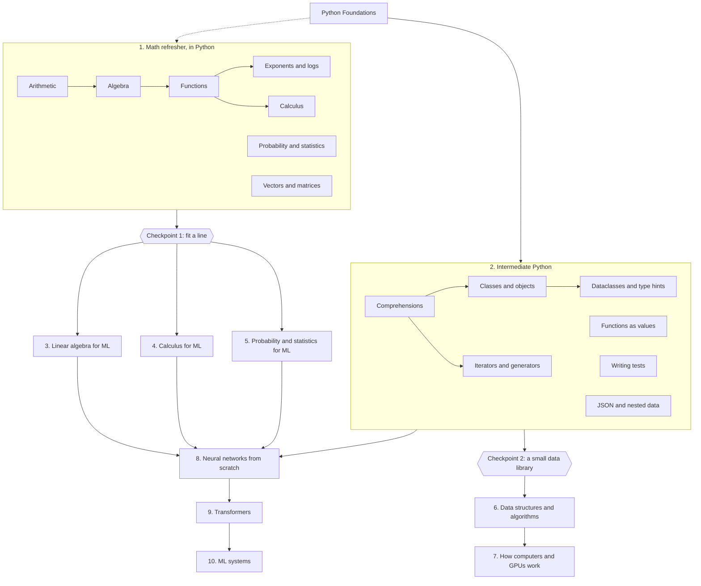

# Machine Learning Foundations track

The third track, and the learning track the vision was written for: from the math and the Python that machine learning is made of, to neural networks built from scratch and the systems that serve them. It starts where [Python Foundations](python-foundations.md) leaves a learner, and its first two modules are Phase 2's content items: **a math refresher** that the placement test's math diagnostic points at ([ADR-0021](../decisions/0021-placement-test.md)), and **intermediate Python**.

- Every topic is proven in Python, like every other topic on the platform ([ADR-0002](../decisions/0002-mastery-and-gating.md)): a blank-editor build, a debug, an explanation, and reviews. The math is _done_, in code, not watched.
- Topics build on Python Foundations topics by name (`prerequisites: [py.strings-and-input]`), so a learner can start the refresher early in the Python track and the later topics unlock as their Python does.
- Main resources are free textbooks under CC BY 4.0 (OpenStax), linked by book with the chapter named, plus a few linked videos; the lessons' own intros and recaps carry the teaching, written here, never copied.
- Track id `ml-foundations`, order 3. Topic ids are `ml.<area>.<name>`; module checkpoints `ml.m<n>.checkpoint`.

## Module map

## Module 1: Math refresher, in Python

The seven levels of the placement test's math ladder, as topics. Each is small (about 45 minutes), teaches the idea and then has the learner compute it in Python, where a wrong idea shows up as a wrong number. A learner who placed well on the ladder proves these with "Prove it now" and moves on.

| #   | Topic                      | ID                                   | Needs                                      | You'll be able to…                                                                                                                                                                                                   |
| --- | -------------------------- | ------------------------------------ | ------------------------------------------ | -------------------------------------------------------------------------------------------------------------------------------------------------------------------------------------------------------------------- |
| 1   | Arithmetic                 | `ml.math.arithmetic`                 | `py.strings-and-input`                     | compute with fractions, decimals and percentages in Python; apply the order of operations and change it with parentheses; work out a percentage of, a percentage change, and round sensibly                          |
| 2   | Algebra                    | `ml.math.algebra`                    | `ml.math.arithmetic`                       | solve a linear equation by undoing what was done to the unknown; check an answer by substituting it back; rearrange a formula to make another variable the subject; apply the rules for multiplying powers           |
| 3   | Functions                  | `ml.math.functions`                  | `ml.math.algebra`, `py.return-values`      | treat a function as a rule from input to output and evaluate it; read a line's slope and intercept and say what each means; put one function inside another; make a table of values with a loop                      |
| 4   | Exponents and logarithms   | `ml.math.exponents-and-logs`         | `ml.math.functions`                        | use powers, roots and negative exponents; say what a logarithm is and compute one; turn products into sums with log rules; model growth and decay in code and say why machine learning adds log-probabilities        |
| 5   | Probability and statistics | `ml.math.probability-and-statistics` | `ml.math.arithmetic`, `py.list-algorithms` | compute mean, median and standard deviation from a list; work out a probability by counting outcomes; multiply for independent events; reason about base rates with a table of 1,000 people                          |
| 6   | Vectors and matrices       | `ml.math.vectors-and-matrices`       | `ml.math.arithmetic`, `py.nested-data`     | add and scale vectors held as lists; compute a dot product and a vector's length; hold a matrix as a list of lists and read its shape; multiply a matrix by a vector and by a matrix with loops, checking the shapes |
| 7   | Calculus                   | `ml.math.calculus`                   | `ml.math.functions`, `py.while-loops`      | estimate a function's slope at a point from two nearby values; check the power rule numerically; read the sign of the derivative as "going up or down"; find a minimum by stepping against the slope                 |

**Checkpoint 1: fit a line** (`ml.m1.checkpoint`). Given lists of x and y values, find the slope and intercept of the line that fits them best by stepping downhill on the error, and print both rounded; debug a statistics report whose mean, median and spread are each wrong in a different way; explain why stepping against the derivative finds the bottom of a valley. The way through for a stuck learner: a solved sibling that fits a constant instead of a line, steps that compute the error, the slope of the error, one step and the loop, and fresh versions on other data.

## Module 2: Intermediate Python

The Python that the rest of the track is written in, each topic proven by building with it.

| #   | Topic                      | ID                               | Needs                                         | You'll be able to…                                                                                                                                                    |
| --- | -------------------------- | -------------------------------- | --------------------------------------------- | --------------------------------------------------------------------------------------------------------------------------------------------------------------------- |
| 8   | Comprehensions             | `ml.py.comprehensions`           | `py.m5.checkpoint`                            | write list, dict and set comprehensions with conditions; say when a loop is clearer; avoid the nested-comprehension trap                                              |
| 9   | Classes and objects        | `ml.py.classes`                  | `py.m6.checkpoint`                            | define a class with `__init__`, attributes and methods; explain `self`; tell a class from an instance; give a class a readable `__repr__`                             |
| 10  | Dataclasses and type hints | `ml.py.dataclasses-and-typing`   | `ml.py.classes`                               | declare a record with `@dataclass`; annotate parameters and return values; read a type error from a checker; say what hints do and don't do at run time               |
| 11  | Iterators and generators   | `ml.py.iterators-and-generators` | `ml.py.comprehensions`                        | explain what `for` really calls; write a generator with `yield`; read a file or a stream lazily; say why a generator can be used once                                 |
| 12  | Functions as values        | `ml.py.functions-as-values`      | `ml.py.comprehensions`                        | pass a function to another; sort with a `key`; use `lambda` where it's clearer and name the function where it isn't; write a decorator that counts or times calls     |
| 13  | Writing tests              | `ml.py.writing-tests`            | `py.m6.checkpoint`                            | write pytest-style tests for a function, including its edge cases; share set-up with a helper and say what a fixture is for; say what a test proves and what it can't |
| 14  | JSON and nested data       | `ml.py.json-and-nested-data`     | `ml.py.dataclasses-and-typing`, `py.csv-data` | read and write JSON; walk nested lists and dicts safely; turn records into dataclasses and back; validate what came in before using it                                |

**Checkpoint 2: a small data library** (`ml.m2.checkpoint`). Build a `Dataset` class from a spec: it loads JSON records, iterates lazily, summarizes a numeric column and writes a report, with tests; debug a version with three bugs across its methods; explain the difference between a class, an instance and a generator.

## Module 3: Linear algebra for ML

The language every model is written in. Vectors and matrices come back from Module 1, now in NumPy, which the browser's Python ships; the pictures (a grid under a transformation, data along its principal axes) are drawn as text where a picture is the point. Every topic is proven in code.

| #   | Topic                                  | ID                       | Needs                                                                      | You'll be able to…                                                                                                                                                                                                                         |
| --- | -------------------------------------- | ------------------------ | -------------------------------------------------------------------------- | ------------------------------------------------------------------------------------------------------------------------------------------------------------------------------------------------------------------------------------------ |
| 15  | NumPy arrays                           | `ml.la.numpy-arrays`     | `ml.py.comprehensions`, `ml.math.vectors-and-matrices`                     | make arrays from lists and ranges and read their shape and dtype; index and slice in one and two dimensions; do arithmetic on whole arrays and say what broadcasting does; replace a loop with one array operation and say why it's faster |
| 16  | Vectors: length, angle and dot product | `ml.la.vectors`          | `ml.la.numpy-arrays`, `ml.math.exponents-and-logs`                         | compute a length and a unit vector; read a dot product as a similarity; find the angle between two vectors and say what a dot product of zero means; project one vector onto another                                                       |
| 17  | Matrices as transformations            | `ml.la.matrices-as-maps` | `ml.la.vectors`                                                            | apply a matrix to a vector and draw where the grid goes; build rotations, scalings and shears and compose them by multiplying; say what the identity and the inverse do and when there is no inverse; read the determinant as area scaling |
| 18  | Systems of linear equations            | `ml.la.systems`          | `ml.la.matrices-as-maps`, `ml.math.algebra`                                | write a system as Ax = b; solve a small one by elimination, by hand and in code; solve a large one with `np.linalg.solve` and check it; say from the rank when there is no solution or infinitely many                                     |
| 19  | Projections and least squares          | `ml.la.least-squares`    | `ml.la.systems`, `ml.m1.checkpoint`                                        | project onto a line and a plane; write and solve the normal equations; fit a line and a plane with `np.linalg.lstsq` and check it against gradient descent; say what least squares minimizes and why the answer is a projection            |
| 20  | Eigenvalues and eigenvectors           | `ml.la.eigen`            | `ml.la.matrices-as-maps`                                                   | say what an eigenvector and its eigenvalue are and check a pair; find them with `np.linalg.eig` and read complex ones as rotation; predict what applying a matrix many times does; diagonalize a matrix and say what that buys             |
| 21  | PCA: what eigenvalues mean for data    | `ml.la.pca`              | `ml.la.eigen`, `ml.la.least-squares`, `ml.math.probability-and-statistics` | center data and compute its covariance matrix; take the principal components as its eigenvectors; project onto the top components and read the variance explained; say when PCA helps and what it throws away                              |

**Checkpoint 3: fit and compress** (`ml.m3.checkpoint`). Fit a plane to points with the normal equations and check it against `np.linalg.lstsq`; reduce the same points to their top principal components and report the variance kept; debug a matrix program with three bugs (a shape mismatch, a transposed multiply, an uncentered covariance); explain why the normal equations give the least-squares fit and what the top eigenvector of a covariance matrix means. The way through for a stuck learner, as in the earlier checkpoints: a solved sibling, steps, fresh versions.

## Later modules

Planned in prose until Phase 3 plans them in detail; then they get outlines like the cloud track's, as Module 3 has.

- **3. Linear algebra for ML:** vectors and matrices with NumPy; linear transformations as pictures; systems of equations; projections and least squares; eigenvalues and what they mean for data.
- **4. Calculus for ML:** derivatives of the functions ML uses; partial derivatives and the gradient; the chain rule as backpropagation; optimizers beyond plain gradient descent.
- **5. Probability and statistics for ML:** distributions; expectation and variance; Bayes' rule properly; maximum likelihood; sampling and confidence; the statistics of evaluating a model.
- **6. Data structures and algorithms:** complexity; arrays, hashing, trees, graphs; sorting and searching; dynamic programming; the algorithms behind data pipelines.
- **7. How computers and GPUs work:** memory and caches; why vectorized code is fast; floating point; what a GPU is good at; reading a profiler.
- **8. Neural networks from scratch:** a neuron, a layer, a loss; backpropagation by hand and in code; training loops; regularization; a small network that reads digits.
- **9. Transformers:** embeddings, attention, the transformer block; training a tiny language model; tokenizers; what scaling changes.
- **10. ML systems:** data pipelines, experiment tracking, evaluation, serving, monitoring, and the engineering judgement around them.

## Resources and licences

- OpenStax textbooks (Rice University), CC BY 4.0: Prealgebra 2e, Elementary Algebra 2e, Intermediate Algebra 2e, Precalculus 2e, Introductory Statistics 2e, Calculus Volume 1. Linked by book, with the chapter named in the lesson.
- 3Blue1Brown's _Essence of linear algebra_ and _Essence of calculus_ (Grant Sanderson): standard YouTube licence, linked, never copied or embedded.
- Khan Academy (CC BY-NC-SA 3.0 US): linked from the placement test's math ladder as refreshers.
