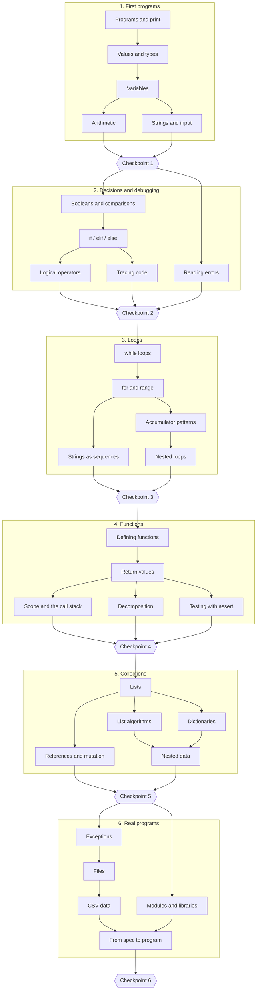

# Python Foundations track: the first 30 topics

The first track takes a total beginner from their first line of code to small, real programs they can build from a blank file. It's the base for everything after it, including core CS and the ML path.

- 6 modules of 5 topics, each module ending with a checkpoint.
- Roughly 25–30 hours of focused work, plus reviews.
- The main resource is Harvard's **CS50P** lectures, embedded as timestamped segments. They're licensed CC BY-NC-SA 4.0, so we embed and link and never copy. Other sources fill the gaps CS50P doesn't cover.
- Skills that matter later for ML get extra weight: tracing code, functions, lists of lists, dictionaries, and files and CSV data.

## Topic map

Some topics within a module can be done in either order. That gives the Today page real choices, and mixing topics helps retention.

## Topics

### Module 1: First programs

| # | Topic | ID | You'll be able to… | Main resource |
|---|---|---|---|---|
| 1 | Programs and print | `py.programs-and-print` | write and run a program that prints; read your first error | CS50P Lecture 0 |
| 2 | Values and types | `py.values-and-types` | tell ints, floats and strings apart; check a value's type | CS50P Lecture 0 |
| 3 | Variables | `py.variables` | explain assignment as names referring to values; trace and swap | CS50P Lecture 0, Python Tutor |
| 4 | Arithmetic | `py.arithmetic` | use `+ - * / // % **` correctly, including precedence | CS50P Lecture 0 |
| 5 | Strings and input | `py.strings-and-input` | read input, convert types, format output with f-strings | CS50P Lecture 0 |

**Checkpoint 1: receipt calculator** (`py.m1.checkpoint`). Read prices and a tip percentage, then print a formatted receipt.

### Module 2: Decisions and debugging

| # | Topic | ID | You'll be able to… | Main resource |
|---|---|---|---|---|
| 6 | Booleans and comparisons | `py.booleans-and-comparisons` | compare values and predict True or False | CS50P Lecture 1 |
| 7 | if / elif / else | `py.if-elif-else` | choose between paths; indent blocks correctly | CS50P Lecture 1 |
| 8 | Logical operators | `py.logical-operators` | combine conditions with `and`, `or`, `not`; avoid `x == 1 or 2` | CS50P Lecture 1 |
| 9 | Tracing code | `py.tracing-code` | predict a program's output with a trace table | Python Tutor, AI-written lesson |
| 10 | Reading errors | `py.reading-errors` | read a traceback; fix common errors with a repeatable debugging routine | AI-written lesson, Python Tutor |

**Checkpoint 2: ticket pricing** (`py.m2.checkpoint`). A rules-based price calculator, plus a buggy version to fix.

### Module 3: Loops

| # | Topic | ID | You'll be able to… | Main resource |
|---|---|---|---|---|
| 11 | while loops | `py.while-loops` | repeat until a condition changes; stop an infinite loop | CS50P Lecture 2 |
| 12 | for and range | `py.for-and-range` | loop a set number of times; avoid off-by-one errors | CS50P Lecture 2 |
| 13 | Accumulator patterns | `py.accumulator-patterns` | sum, count, find the max or min, search; use `break` and `continue` | CS50P Lecture 2 |
| 14 | Strings as sequences | `py.strings-as-sequences` | index, slice and loop over strings | Python tutorial: "An Informal Introduction" (Text) |
| 15 | Nested loops | `py.nested-loops` | put loops inside loops for grids and patterns | CS50P Lecture 2 |

**Checkpoint 3: text statistics** (`py.m3.checkpoint`). Count words and characters, find the longest word, and print simple patterns.

### Module 4: Functions

| # | Topic | ID | You'll be able to… | Main resource |
|---|---|---|---|---|
| 16 | Defining functions | `py.defining-functions` | write functions with parameters and call them | CS50P Lecture 0 |
| 17 | Return values | `py.return-values` | tell `return` from `print`; understand `None` | CS50P Lecture 0 |
| 18 | Scope and the call stack | `py.scope-and-call-stack` | tell local from global; trace calls on the stack | Python Tutor, CS50P Lecture 9 |
| 19 | Decomposition | `py.decomposition` | break a problem into small functions; write docstrings | AI-written lesson |
| 20 | Testing with assert | `py.testing-with-assert` | test your own functions, including edge cases | CS50P Lecture 5 |

**Checkpoint 4: password checker** (`py.m4.checkpoint`). Built from small functions, each with tests.

### Module 5: Collections

| # | Topic | ID | You'll be able to… | Main resource |
|---|---|---|---|---|
| 21 | Lists | `py.lists` | create, index, change and grow lists | CS50P Lecture 2 |
| 22 | List algorithms | `py.list-algorithms` | filter, transform, search, sort and slice lists | Python tutorial: "More on Lists" |
| 23 | References and mutation | `py.references-and-mutation` | predict aliasing; copy lists; spot functions that change their arguments | Ned Batchelder, "Facts and Myths about Python Names and Values" (PyCon 2015) |
| 24 | Dictionaries | `py.dictionaries` | look up, update and loop over dicts; count things with one | CS50P Lecture 2 |
| 25 | Nested data | `py.nested-data` | work with lists of lists (grids, matrices) and lists of dicts (records) | CS50P Lecture 2, AI-written lesson |

**Checkpoint 5: gradebook** (`py.m5.checkpoint`). Turn student records into a report.

### Module 6: Real programs

| # | Topic | ID | You'll be able to… | Main resource |
|---|---|---|---|---|
| 26 | Exceptions | `py.exceptions` | handle errors with `try`/`except`; validate input; raise your own | CS50P Lecture 3 |
| 27 | Files | `py.files` | read and write text files using `with` | CS50P Lecture 6 |
| 28 | CSV data | `py.csv-data` | read a CSV into records and summarize it | CS50P Lecture 6 |
| 29 | Modules and libraries | `py.modules-and-libraries` | import from the standard library; write your own module | CS50P Lecture 4 |
| 30 | From spec to program | `py.spec-to-program` | plan before coding: examples, then decomposition, then tests, then small steps | Own lesson, with Think Python's "Incremental development" as the reading |

**Checkpoint 6: CSV report tool** (`py.m6.checkpoint`), the track capstone. Starting from a blank file, read a CSV, handle bad rows, and write a summary report.

## Why this order

- **Tracing and debugging come early (Module 2).** Novices who can't read and trace code rarely write it well (Lister et al., 2004), and debugging is a skill to practice, not a side effect.
- **Defining functions waits until Module 4.** Built-in functions are used from day one, but writing your own makes more sense once there are decisions and loops to put inside them. Modules 1–3 test whole programs through their input and output.
- **References and mutation get their own topic.** The "variables are boxes" misconception causes confusing bugs later, especially with NumPy arrays in ML.
- **The track ends with "From spec to program".** It makes the core promise explicit: a repeatable way to start from a blank file.

## Before authoring

- Find exact timestamps for each CS50P segment, and confirm the videos allow embedding.
- Confirm the license and access of every non-CS50P resource.

## What comes next

Intermediate Python (comprehensions, classes, recursion), then core CS and the math refresher for the ML track. See the [roadmap](../roadmap.md).
