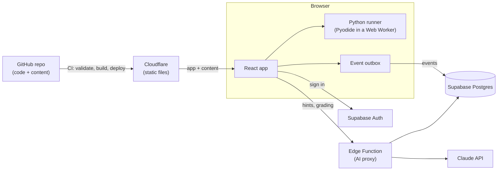

# v1 spec: an audience of one

- **Status:** Approved by the owner, 2026-11-05
- **Phase:** 1 ([roadmap](../roadmap.md))
- **Related:** [data model](data-model.md) · [Python Foundations track](python-foundations.md) · ADR-0002, 0003, 0004, 0007, 0008, 0009

## Goal

The owner can learn Python on the platform every morning, from their first line of code to small real programs, with every proof and review captured.

v1 is done when the owner can:

1. sign in, open the topic map, and see what to do today;
2. learn a topic, practice it with hints, and prove it (build, debug, explain);
3. have proven topics come back for review on a schedule;
4. trust that every answer is saved and can be exported.

## Who it's for

One learner, the owner. Sign-ups are closed. Everything is still built per user, with row-level security, so more learners can be added later without a rewrite.

## How the pieces fit

## In scope

| # | Feature | Milestone |
|---|---|---|
| F1 | Sign-in (GitHub, invite-only) | A |
| F2 | Content pipeline and validator | A |
| F3 | Topic page: Learn | A |
| F4 | Code runner (Python in the browser) | A |
| F5 | Practice ladder | A–C |
| F6 | Event log and sync | A |
| F7 | Prove it: build, debug, explain | B |
| F8 | Topic states, gating, "prove it now" | B |
| F9 | Topic map | B |
| F10 | Module checkpoints | B |
| F11 | Reviews (FSRS) | C |
| F12 | Today page | C |
| F13 | Hint-only AI tutor | D |
| F14 | AI proxy and budget cap | B, D |
| F15 | Report a problem | D |
| F16 | Export my data | D |

## Out of scope for v1

- Adaptive placement test. v1 has "prove it now" instead.
- Parsons problems.
- A built-in step-through visualizer. v1 links to Python Tutor instead.
- The fading-map visuals. v1 shows a "due" badge.
- AI-generated practice variants and AI code review.
- Gamification, other tracks, mobile apps, payments, multiple users.

## User journeys

**Morning session.** Open the app. Today shows due reviews first, then the next topic. Do the reviews, then start the topic:

1. **Learn:** intro, video segment, recap.
2. **Practice:** worked example → predict → fill in → write.
3. **Prove it:** build, debug, explain.

The topic becomes Learned, the map updates and the next topic unlocks.

**Already know it.** On an Available topic, choose "Prove it now", pass the three checks, and the topic is Learned without the lesson.

**Stuck in practice.** Ask the tutor and get a nudge. Ask again for a more specific hint. It never gives the full answer. After passing, the reference solution is shown for comparison.

**Review.** A due topic shows up on Today. Answer 2 short items (at least one is code or predict-the-output); they're graded automatically and the next review is scheduled. A failed review marks the topic Relearning and adds practice to Today.

## Features and acceptance criteria

### F1 Sign-in

- Sign in with GitHub through Supabase Auth (PKCE flow) on the live site. Local development signs in with email links instead, because the local Supabase has no GitHub app; they land in the local test inbox (Mailpit).
- New sign-ups are switched off once the owner's account exists. The AI proxy also checks an `allowed` flag on the profile.
- ✅ A second GitHub account can't sign up or call the AI.

### F2 Content pipeline and validator

- Content lives in `content/` in the formats in the [data model](data-model.md#content-files).
- A build step turns content into data the app loads, one topic at a time.
- `tools/` contains a Python validator that runs in CI on every pull request. It checks:
  - every file matches its schema; IDs are unique; every prerequisite exists; the topic graph has no cycles;
  - every exercise: the reference solution passes; the starter fails (for fill-in and debug); every file in `wrong/` fails at least one test;
  - every predict-the-output item: running the code really produces the expected output;
  - every resource records its license and whether we embed or link it;
  - every topic meets the [content definition of done](#content-definition-of-done).
- ✅ A pull request that adds a broken exercise fails CI with a message naming the file and the problem.

### F3 Topic page: Learn

- Shows the intro, the main resource, and the recap, with supporting links below. The main resource is a privacy-enhanced YouTube embed with start and end times, or a reading link.
- The intro and recap are written by AI ahead of time and committed to the repo. They're not generated live.
- Locked topics can be previewed (Learn only). Practice and Prove it are disabled.
- ✅ Opening a topic logs a `lesson_view` event.

### F4 Code runner

- A CodeMirror 6 editor with Python highlighting and two buttons:
  - **Run:** shows output and errors like a terminal. When the program calls `input()`, the learner types the answer right in the output and presses Enter. Behind the scenes the program re-runs from the start with every line typed so far, using the same random seed, so it behaves identically up to the new input.
  - **Check:** runs the tests.
- Pyodide runs in a Web Worker and starts loading in the background when the app opens.
- Code that runs longer than its limit (default 5 seconds) is stopped by restarting the worker, with a friendly "Your code took too long. Infinite loop?" message.
- Test results list each check by its description. Hidden tests show the description, never the code.
- ✅ `while True: pass` is stopped within the limit, and the next run works.
- ✅ The same tests give the same results in the browser and in CI.

### F5 Practice ladder

Each topic's practice follows PRIMM (predict, run, investigate, modify, make):

1. A worked example with labeled steps, which the learner runs.
2. 2–3 predict-the-output or multiple-choice items, including one from an earlier topic when there is one (interleaving).
3. Fill in: starter code with gaps.
4. Write: a short spec with visible tests.

- The reference solution is shown only after the learner passes.
- ✅ Every graded attempt is logged with correctness, duration and hints used.

### F6 Event log and sync

- Every meaningful action is an append-only event ([ADR-0008](../decisions/0008-event-log.md)).
- Each event gets an ID in the browser and goes into a local outbox first, then syncs. Retries never create duplicates.
- ✅ Going offline mid-session loses nothing; events sync when the connection returns.

### F7 Prove it

- **Build:** a blank editor, a short spec and hidden tests. Tutor off.
- **Debug:** code with planted bugs and failing tests. Tutor off.
- **Explain:** a prompt, and the learner writes a short answer. AI grades it against the rubric and returns pass or "needs work", with guiding questions about anything missing. It never reveals the model answer.
- Unlimited attempts; every attempt is logged.
- ✅ A topic becomes Learned only when all three have passed.

### F8 Topic states, gating, "prove it now"

- States as defined in [ADR-0002](../decisions/0002-mastery-and-gating.md), computed exactly as in the [data model](data-model.md#derived-progress).
- "Prove it now" is available on every Available topic.
- ✅ Unit tests cover every state transition.

### F9 Topic map

- The track's graph, grouped by module. Each node shows its state with an icon and a label, never color alone, plus a "due" badge.
- Clicking a node opens the topic. On narrow screens, an ordered list replaces the graph.
- ✅ The map shows a newly Learned topic without a page reload.

### F10 Module checkpoints

- Each module ends with a checkpoint: a bigger build (a small program), a debug with several bugs, and a module-level explain.
- Checkpoints are nodes in the graph, and the next module's topics depend on them.
- Checkpoints don't get review cards.

### F11 Reviews

- One FSRS card per Learned topic ([ADR-0009](../decisions/0009-reviews.md)).
- A review is 2 items from the topic's review pool, at least one of them code or predict-the-output. It's graded automatically as Again, Hard or Good.
- Tutor off during reviews.
- ✅ When a topic becomes Learned, its first review is scheduled automatically. A failed review moves the topic to Relearning.

### F12 Today page

- Shows, in this order:
  1. due reviews, most-forgotten first, up to 20;
  2. relearning practice;
  3. the topic in progress;
  4. the next Available topic in track order.
- Shows rough time estimates.
- ✅ With nothing due and nothing left to learn, Today says so.

### F13 Hint-only tutor

- Available in practice only.
- A hint ladder: a nudge, then a pointer to the concept, then a specific hint, then the next small step. Never a full solution, and never more than a couple of lines of code.
- The tutor sees the exercise, the learner's code, the test results and the author's hints.
- Defense in depth: a reply that contains too much of the reference solution is blocked and replaced with a safer hint.
- A small set of "just give me the answer" test conversations must pass before the tutor ships.
- ✅ No tutor reply in the test set reveals a working solution.

### F14 AI proxy and budget cap

- A Supabase Edge Function is the only place the Claude API key exists.
- v1 actions: `tutor_hint` and `grade_explanation`.
- Each call is logged with token counts and estimated cost.
- When the month's spending reaches the cap, AI calls stop and the app says the AI is paused.
- Models are chosen per action at implementation time, from the current docs. Start with the cheapest model that passes the tutor and grading test sets.

### F15 Report a problem

- A "Report a problem" button on every lesson, exercise and item. Reports are stored with the item ID and revision.

### F16 Export my data

- Download all events and progress as JSON, for backups and the ML capstone.

## Non-functional requirements

- **Cost:** $0 for hosting. AI spending is capped at $10 a month to start.
- **Browsers:** current Chrome, Edge, Firefox and Safari on desktop. Lessons and reviews work on phones; coding on a phone works but isn't optimized.
- **Accessibility:**
  - everything works by keyboard, with visible focus;
  - states are never shown by color alone;
  - videos keep YouTube's captions.
- **Security:**
  - row-level security on every table;
  - no secrets in the browser;
  - the AI proxy only serves a signed-in, allowed user.
- **Privacy:** no third-party analytics; privacy-enhanced YouTube embeds.
- **Performance:**
  - the app loads in under 2 seconds on broadband;
  - Python is ready within about 10 seconds of first opening an exercise.

## Milestones

| Milestone | Target | Contents | The owner can… |
|---|---|---|---|
| A. Walking skeleton | end of week 1 | F1–F4, F6, a basic F5, the deploy pipeline; Module 1 content | learn and practice Module 1, with progress saved |
| B. Prove it | week 2 | F7–F10, F14 (grading); Module 2 content | prove topics and watch the map unlock |
| C. Keep it | week 3 | F11, F12, the rest of F5; Module 3 content | get scheduled reviews |
| D. Tutor and polish | week 4 | F13, F14 (tutor), F15, F16; Modules 4–6 content | get hints, report problems, export data |

Targets are estimates. Content for the next module must be ready before the owner finishes the current one.

## Content definition of done

A topic is ready when it has:

- `topic.yaml` with objectives, prerequisites, resources (with licenses), and the explain prompt and rubric;
- `lesson.mdx` with the intro and recap;
- practice: 1 worked example, 2–3 predict or multiple-choice items, 1 fill-in and 1 write exercise;
- proof: 1 build, 1 debug, 1 explain;
- a review pool of at least 3 items, at least 1 of them code or predict-the-output.

It also needs the validator to pass, and the owner to have gone through it once as a learner.

## Decisions from review

1. **Monthly AI budget cap:** $10 a month to start, adjusted once we've measured real usage.
2. **Topic list:** the [Python Foundations track](python-foundations.md) is approved as written.
