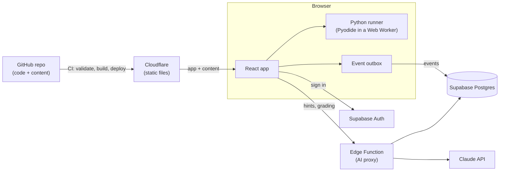

# v1 spec: an audience of one

- **Status:** Approved by the owner, 2026-11-05
- **Phase:** 1 ([roadmap](../roadmap.md))
- **Related:** [data model](data-model.md) · [Python Foundations track](python-foundations.md) · ADR-0002, 0003, 0004, 0007, 0008, 0009

## Goal

The owner can learn Python on the platform every morning, from their first line of code to small real programs, with every proof and review captured.

v1 is done when the owner can:

1. sign in, open the topic map, and see what to do today;
2. learn a topic, practice it with hints, and prove it (build, debug, explain);
3. have proven topics come back for review on a schedule;
4. trust that every answer is saved and can be exported.

## Who it's for

One learner, the owner. Sign-ups are closed. Everything is still built per user, with row-level security, so more learners can be added later without a rewrite.

## How the pieces fit

## In scope

| #   | Feature                              | Milestone |
| --- | ------------------------------------ | --------- |
| F1  | Sign-in (GitHub, invite-only)        | A         |
| F2  | Content pipeline and validator       | A         |
| F3  | Topic page: Learn                    | A         |
| F4  | Code runner (Python in the browser)  | A         |
| F5  | Practice ladder                      | A–C       |
| F6  | Event log and sync                   | A         |
| F7  | Prove it: build, debug, explain      | B         |
| F8  | Topic states, gating, "prove it now" | B         |
| F9  | Topic map                            | B         |
| F10 | Module checkpoints                   | B         |
| F11 | Reviews (FSRS)                       | C         |
| F12 | Today page                           | C         |
| F13 | Hint-only AI tutor                   | D         |
| F14 | AI proxy and budget cap              | B, D      |
| F15 | Report a problem                     | D         |
| F16 | Export my data                       | D         |

## Out of scope for v1

- ~~Adaptive placement test. v1 has "prove it now" instead.~~ Built 2026-11-09 ([ADR-0021](../decisions/0021-placement-test.md)): a walk by halving through a track's topics, and a math ladder; it estimates and plans, and "prove it now" still does the proving.
- ~~Parsons problems.~~ Added early, 2026-11-09 ([ADR-0016](../decisions/0016-parsons-problems.md)): a third recall item type, in the practice ladder right after the worked example.
- ~~A built-in step-through visualizer. v1 links to Python Tutor instead.~~ Built 2026-11-09 ([ADR-0022](../decisions/0022-step-through.md)): a Step through button beside Run, and under predict-the-output questions once answered, playing the program back line by line with its variables.
- ~~The fading-map visuals. v1 shows a "due" badge.~~ A first version arrived early, 2026-11-09: every Learned topic on the map shows its predicted memory strength ("Memory: 86%", with a small bar), from the review scheduler's own numbers.
- AI-generated practice variants and AI code review.
- Gamification, mobile apps, payments, multiple users.
- ~~Other tracks.~~ Two more have been started since: [Machine Learning Foundations](ml-foundations.md) and [Cloud Solutions Architect](cloud-solutions-architect.md). The map and the Today page show every track ([ADR-0019](../decisions/0019-today-across-tracks.md)); how much of each is written is in the [roadmap](../roadmap.md#where-the-project-stands).

## User journeys

**Morning session.** Open the app. Today shows due reviews first, then the next topic. Do the reviews, then start the topic:

1. **Learn:** intro, video segment, recap.
2. **Practice:** worked example → predict → fill in → write.
3. **Prove it:** build, debug, explain.

The topic becomes Learned, the map updates and the next topic unlocks.

**Already know it.** On an Available topic, choose "Prove it now", pass the three checks, and the topic is Learned without the lesson.

**Stuck in practice.** Ask the tutor and get a nudge. Ask again for a more specific hint. It never gives the full answer. After passing, the reference solution is shown for comparison.

**Review.** A due topic shows up on Today. Answer 2 short items (at least one is code or predict-the-output); they're graded automatically and the next review is scheduled. A failed review marks the topic Relearning and adds practice to Today.

## Features and acceptance criteria

### F1 Sign-in

- Sign in with GitHub through Supabase Auth (PKCE flow) on the live site. Local development signs in with email links instead, because the local Supabase has no GitHub app; they land in the local test inbox (Mailpit).
- New sign-ups are switched off once the owner's account exists. The AI proxy also checks an `allowed` flag on the profile.
- ✅ A second GitHub account can't sign up or call the AI.

### F2 Content pipeline and validator

- Content lives in `content/` in the formats in the [data model](data-model.md#content-files).
- A build step turns content into data the app loads, one topic at a time.
- `tools/` contains a Python validator that runs in CI on every pull request. It checks:
  - every file matches its schema; IDs are unique; every prerequisite exists; the topic graph has no cycles;
  - every exercise: the reference solution passes; the starter fails (for fill-in and debug); every file in `wrong/` fails at least one test;
  - every predict-the-output item: running the code really produces the expected output;
  - every resource records its license and whether we embed or link it;
  - every topic meets the [content definition of done](#content-definition-of-done).
- ✅ A pull request that adds a broken exercise fails CI with a message naming the file and the problem.
- _Added_ (2026-11-11): the validator also works out every estimate item's sums and proves that its tolerance accepts the answer and none of its known mistakes ([ADR-0024](../decisions/0024-estimate-questions.md)); fails a multiple-choice item whose right answer is more than 1.5 times as long as its longest wrong choice, and a topic where the right answer is the longest in more than half its items, with the older Python and ML items that break those rules listed on a baseline that can only shrink; and checks each lab check's `timeout` ([ADR-0018](../decisions/0018-lab-checker-local-mode.md), amended).

### F3 Topic page: Learn

- Shows the intro, the main resource, and the recap, with supporting links below. The main resource is a privacy-enhanced YouTube embed with start and end times, or a reading link.
- The intro and recap are written by AI ahead of time and committed to the repo. They're not generated live.
- Locked topics can be previewed (Learn only). Practice and Prove it are disabled.
- ✅ Opening a topic logs a `lesson_view` event.

### F4 Code runner

- A CodeMirror 6 editor with Python highlighting and two buttons:
  - **Run:** shows output and errors like a terminal. When the program calls `input()`, the learner types the answer right in the output and presses Enter. Behind the scenes the program re-runs from the start with every line typed so far, using the same random seed, so it behaves identically up to the new input.
  - **Check:** runs the tests.
- Pyodide runs in a Web Worker and starts loading in the background when the app opens.
- Code that runs longer than its limit (default 5 seconds) is stopped by restarting the worker, with a friendly "Your code took too long. Infinite loop?" message.
- Test results list each check by its description. Hidden tests show the description, never the code.
- ✅ `while True: pass` is stopped within the limit, and the next run works.
- ✅ The same tests give the same results in the browser and in CI.
- _Updated_ (2026-11-10): an exercise whose correct answer honestly needs longer sets its own limit, `time_limit_ms` in its `exercise.yaml`, up to 30 seconds. CI times every ready exercise's reference solution in the browser's Python (its Check, and a worked example's Run) and fails when one runs past its limit, so an exercise that can't be passed in the app can't reach a learner ([content/README.md](../../content/README.md), _Time limits_).
- _Added_ (2026-11-11): code typed in an exercise, and the text of an explain-it-back answer, are kept as a draft on this device until the item passes, so a reload, a link or "Prove it now" no longer throws them away. A note says when they're from last time, and Start over (it asks first) brings back the starting code. Reviews, the placement test and worked examples keep no drafts and always start fresh. A draft is never sent to the server and never counts as an answer.

### F5 Practice ladder

Each topic's practice follows PRIMM (predict, run, investigate, modify, make):

1. A worked example with labeled steps, which the learner runs.
2. 2–3 predict-the-output or multiple-choice items, including one from an earlier topic when there is one (interleaving).
3. Fill in: starter code with gaps.
4. Write: a short spec with visible tests.

- The reference solution is shown only after the learner passes.
- ✅ Every graded attempt is logged with correctness, duration and hints used.
- _Built_ (2026-11-08): the ladder as described, and the interleaved question: one recall item from the topic's most recent prerequisite (looking through a checkpoint to the topic before it), placed after the topic's own recall items, a different one each day. Its answer is saved under the earlier topic, so it counts there.
- _Added_ (2026-11-09): an outline beside every topic page, for long ladders: the lesson's parts with the one being read marked, every item with whether it's done (from the saved answers) or tried, the proof checks, and "Continue where you left off" (remembered per device). Items already done when the page opens are folded away until asked for.
- _Added_ (2026-11-11, [ADR-0024](../decisions/0024-estimate-questions.md), proposed): estimate questions, a fifth kind of recall item. The learner types a number they worked out, and it's right within the item's tolerance; a wrong answer that matches a known slip is told what went wrong. In reviews an estimate counts as an answer the learner produces, like a prediction. Cloud Module 2 is the first to use them.

### F6 Event log and sync

- Every meaningful action is an append-only event ([ADR-0008](../decisions/0008-event-log.md)).
- Each event gets an ID in the browser and goes into a local outbox first, then syncs. Retries never create duplicates. An event the server refuses is kept on the device and tried again at most every 12 hours; the learner is told while any are waiting ([data model](data-model.md#events-the-server-refuses)).
- ✅ Going offline mid-session loses nothing; events sync when the connection returns.
- _Fixed_ (2026-11-11, [ADR-0008](../decisions/0008-event-log.md), amendments of that date): when the browser can't store an event (its storage is full or switched off), the event waits in the page's memory and is sent from there, and the header warns that closing the page would lose it. Every event records the learner's own calendar day and time zone (`local_day`, `utc_offset_minutes`), which the follow-ups and the daily review count go by. A Check that couldn't run (Python didn't start, a package didn't load, the exercise's own tests couldn't load, or it has no tests) is saved with no verdict and counts nowhere; older ones that were saved as wrong are left out when the history is read. Code that runs past its time limit still counts as wrong.
- _Changed_ (2026-11-11): Run and Check events keep the learner's code whole up to 20,000 characters (it was cut at 6,000), and the database takes up to 128 KB of details per event instead of 16 KB. The live database gets the new limit when the owner applies migration `20261111164541_raise_event_data_limit.sql`; until then a long program's event is refused, kept on the device and sent again later.

### F7 Prove it

- **Build:** a blank editor, a short spec and hidden tests. Tutor off.
- **Debug:** code with planted bugs and failing tests. Tutor off.
- **Explain:** a prompt, and the learner writes a short answer. AI grades it against the rubric and returns pass or "needs work", with guiding questions about anything missing. It never reveals the model answer.
- Unlimited attempts; every attempt is logged.
- ✅ A topic becomes Learned only when all three have passed.
- _Built:_ explain it back, graded by Claude Haiku 5.5 through the AI proxy ([ADR-0013](../decisions/0013-explain-grading.md)). It chose the model by getting all 30 samples of the test set right, twice. A pass counts toward progress straight away.
- _Changed_ (2026-11-11): a debug's prompt gives what the program should do, the symptom and how many bugs there are, never what or where they are, and the earlier prompts that named their bugs were rewritten in all three tracks. Hints aren't shown on a debug, since every debug is a proof, so each rewritten one was checked to be findable from its symptom, a Run and its Check messages alone.

### F8 Topic states, gating, "prove it now"

- States as defined in [ADR-0002](../decisions/0002-mastery-and-gating.md), computed exactly as in the [data model](data-model.md#derived-progress).
- "Prove it now" is available on every Available topic.
- ✅ Unit tests cover every state transition.
- _Built_ (2026-11-08): every topic page shows its state and is gated by it. A Locked topic shows its lesson only, with a note saying what opens it; an Available topic offers "Prove it now", which hides the lesson and practice and moves straight to the three checks. Signed-out visitors see everything, since nothing of theirs is saved anyway. Each page lists which proof checks have passed, and when.

- _Updated_ (2026-11-09, [ADR-0021](../decisions/0021-placement-test.md)): **the placement test** at `/placement`, offered from Today and the map. It probes the middle of a track's unlearned topics with up to three review questions and halves what's left, so thirty topics take about five probes; the result names where to start and lists the topics before it to prove, in order, through "Prove it now". A math diagnostic walks a seven-level ladder the same way and says where to refresh. Nothing is marked learned by it.
- _Fixed_ (2026-11-11, [ADR-0002](../decisions/0002-mastery-and-gating.md), amended): **Mastered** needs a review rated Good at least 7 days after the later of becoming Learned and the most recent review rated Again, so a failed review starts the week over. A topic also isn't Mastered while any of its skills is being relearned (F17).
- _Fixed_ (2026-11-11, [ADR-0021](../decisions/0021-placement-test.md), amended): a placement probe passes on a tie, as the ADR says: one right and one wrong out of two questions used to fail the topic. Placement answers no longer mark practice questions "Done" or "Tried, not right yet" on topic pages.

### F9 Topic map

- The track's graph, grouped by module. Each node shows its state with an icon and a label, never color alone, plus a "due" badge.
- Clicking a node opens the topic. On narrow screens, an ordered list replaces the graph.
- ✅ The map shows a newly Learned topic without a page reload.
- _Built so far:_ the map lists every track's topics by module. For a signed-in learner each shows its state with an icon and a word (Locked, Available, In progress, Learned, Passed), and which proof checks have passed on a topic not yet learned. The graph view is still to come; the list is what narrow screens get anyway.

### F10 Module checkpoints

- Each module ends with a checkpoint: a bigger build (a small program), a debug with several bugs, and a module-level explain. On the page, the explain check stays closed, prompt and all, until the build has passed (the main build or a fresh version), so its prompt can't give the build away ([ADR-0012](../decisions/0012-checkpoint-support.md), amendment of 2026-11-10).
- Checkpoints are nodes in the graph, and the next module's topics depend on them.
- Checkpoints don't get review cards.
- **Getting unstuck** ([ADR-0012](../decisions/0012-checkpoint-support.md)):
  - Every test of a checkpoint's builds and debug names the skills it checks. A failed test brings those skills back on Today, as in F17.
  - A "Stuck?" section offers a way through: study a solved sibling project, build the checkpoint's program in 3 or 4 steps with hints, then prove it on a fresh version.
  - The way through is always one click away, and the page suggests it after 2 failing Checks on the build.
  - The fresh version is one the learner hasn't tried, or else the one tried longest ago. Passing any version counts as passing the build.
- _Fixed_ (2026-11-11, [ADR-0012](../decisions/0012-checkpoint-support.md), amended): the steps show most of the build's own program, so once the learner opens them, a pass of the main build no longer counts as the build proof; a fresh version proves it. A pass from before the first opening still counts, and so does all history from before 2026-11-11. A checkpoint without fresh versions would keep counting its main build, so a build can't become impossible to prove. The page says this before the steps are opened, in the suggestion after 2 failing Checks, and above the build once they're open.
- _Added_ (2026-11-11, [ADR-0012](../decisions/0012-checkpoint-support.md), amendment of that date, proposed): a checkpoint can have further parts (`prove.more`), further builds or debugs shown as Part 3 and on after the debug, each with its own fresh versions. It's Passed only once every part has passed. The explain still opens once the Part 1 build passes, and the rule about opened steps is the main build's alone. Cloud Checkpoint 2 is the first to need it.

### F11 Reviews

- One FSRS card per Learned topic ([ADR-0009](../decisions/0009-reviews.md)).
- A review is 2 items from the topic's review pool, at least one of them code or predict-the-output. It's graded automatically as Again, Hard or Good.
- Tutor off during reviews.
- ✅ When a topic becomes Learned, its first review is scheduled automatically. A failed review moves the topic to Relearning.
- _Built_ (2026-11-08): the scheduler (`web/src/reviews/fsrs.ts`, FSRS-4.5 formulas and defaults), review sessions on the Today page rated from first attempts and saved as `review` events, and the states Mastered, Fading and Relearning on every topic page and the map.
- _Fixed_ (2026-11-11, [ADR-0009](../decisions/0009-reviews.md), amendments of that date): the scheduler matches FSRS-4.5 exactly, checked against py-fsrs 2.5.1; a session left half-way is rated from its first answers since the topic fell due, so leaving after a wrong answer doesn't drop it; and the limit of 20 a day counts the reviews already finished that day.

### F12 Today page

- Shows, in this order:
  1. due reviews, most-forgotten first, up to 20;
  2. relearning practice;
  3. the topic in progress;
  4. the next Available topic in track order.
- Shows rough time estimates.
- ✅ With nothing due and nothing left to learn, Today says so.
- _Built_ (2026-11-08): all four slots, in order: due reviews (most forgotten first, up to 20), "Mistakes to revisit" (F17), and "Next up", the topic in progress or else the next Available topic in track order, with its time estimate. With nothing due, each slot says so. With nothing left to learn, it says so.
- _Added_ (2026-11-09): **Practice hours**, below the plan: deliberate practice so far and in the last 7 days, with the next milestone on the way to 10,000 hours (1, 5, 10, 25, 50, 100, 250, 500, 1,000, 2,500, 5,000, 10,000). It adds up the durations of graded attempts, Checks, explanations and reviews, each capped at 30 minutes, so time with the site open doesn't count (`web/src/progress/practiceTime.ts`). Pulled forward from Phase 2.
- _Updated_ (2026-11-09, [ADR-0019](../decisions/0019-today-across-tracks.md)): **Next up shows one entry per track**, with how many of the track's topics are learned and its topic in progress or next Available; and **practice hours are counted per track**, each track on its own milestone ladder under one sentence for the total, because the 10,000 hours are about mastering one domain. Reviews and mistakes to revisit already drew on every bundled track.
- _Fixed_ (2026-11-11): the page reads the learner's history once for all its sections, and downloads in full only the topics of the reviews and questions it shows. When one of those downloads, or the progress itself, can't load, the page says so and offers Try again. The 20 reviews a day are a calendar day's: those finished earlier that day count, and when they're used up while topics are still due, the page says "That's today's reviews done. The rest come back tomorrow, the most forgotten first."

### F13 Hint-only tutor

- Available in practice only.
- A hint ladder: a nudge, then a pointer to the concept, then a specific hint, then the next small step. Never a full solution, and never more than a couple of lines of code.
- The tutor sees the exercise, the learner's code, the test results and the author's hints.
- Defense in depth: a reply that contains too much of the reference solution is blocked and replaced with a safer hint.
- A small set of "just give me the answer" test conversations must pass before the tutor ships.
- ✅ No tutor reply in the test set reveals a working solution.
- _Built_ (2026-11-08, [ADR-0015](../decisions/0015-hint-only-tutor.md)): "Ask the tutor" under every fill-in and write exercise in practice, including a checkpoint's steps; off in proof checks and reviews. Four rungs (a nudge, the idea, a closer look, the next step), six asks per exercise, replies kept safe by the proxy (at most two lines of code, no copied solution lines), every hint logged and saved as a `hint` event. The proxy's `tutor_hint` action has been on the live site since 2026-11-09, when the owner deployed it.
- _Fixed_ (2026-11-11, [ADR-0015](../decisions/0015-hint-only-tutor.md), amended): the tutor reads programs, the learner's and the reference solution, of up to 20,000 characters. It used to fail on anything over 6,000 and blame the learner's connection, which ruled it out on Module 8's longest. A longer program isn't sent, and the box says it's too long for the tutor and that the written hints still work. Live once the owner deploys the function.

### F14 AI proxy and budget cap

- A Supabase Edge Function is the only place the Claude API key exists.
- v1 actions: `tutor_hint` and `grade_explanation`.
- Each call is logged with token counts and estimated cost.
- When the month's spending reaches the cap, AI calls stop and the app says the AI is paused.
- Models are chosen per action at implementation time, from the current docs. Start with the cheapest model that passes the tutor and grading test sets.
- _Built:_ both actions, through one Edge Function with one log and one cap ([ADR-0013](../decisions/0013-explain-grading.md), [ADR-0015](../decisions/0015-hint-only-tutor.md)). Each has its own test set and its own model and effort settings.
- _Fixed_ (2026-11-11, [ADR-0015](../decisions/0015-hint-only-tutor.md), amended): the cap counts every call. When a call's log row can't be written, its spend is written alone; if even that fails, the app says the AI is unavailable and no call reaches Claude until the spend is written (fail closed). Every `<` and `>` in the text placed inside the prompts is escaped, so a learner's text can't end its block. Live once the owner deploys the function.

### F15 Report a problem

- A "Report a problem" button on every lesson, exercise and item. Reports are stored with the item ID and revision.
- _Built_ (2026-11-08): a small "Report a problem" link under the lesson, under every practice, proof and review item, and under the explain check. It opens a box for what's wrong and saves the report in `problem_reports` with the topic, the item and its `rev`. Hidden when signed out. The owner reads and resolves reports in the Supabase dashboard ([supabase/README.md](../../supabase/README.md)).

### F16 Export my data

- Download all events and progress as JSON, for backups and the ML capstone.
- _Built early, at the start of Milestone B:_ "Download my data" on the account page, which opens from the learner's name in the header. The file holds the profile and every event, including any still waiting in the outbox. Progress isn't in the file: it's recalculated from the events, so nothing is lost by leaving it out. Since 2026-11-10 the file also lists any events the server has refused, under a key of their own, `refused_events`. The layout is in the [data model](data-model.md#the-export-file).
- _Complemented_ (2026-11-09, [ADR-0020](../decisions/0020-automated-backups.md)): the platform's own nightly encrypted dump of the whole database is built but not switched on yet ([roadmap](../roadmap.md#where-the-project-stands)); the export stays as the learner's copy and the capstone's input.

### F17 Mistakes come back

Added at the owner's request and built in Milestone A ([ADR-0011](../decisions/0011-mistakes-come-back.md)).

- A miss opens a follow-up for each skill the item tests. A question is missed if any answer to it that day is wrong; code only if none of that day's Checks passed.
- The follow-up comes back on Today the next day, as a **different question on the same skill**: never-answered questions first, then the one answered longest ago.
- After a correct day it comes back 3 days later, then 7. Correct answers on 3 different days relearn it; another miss starts over. Those numbers come from successive-relearning research ([learning science](../learning-science.md)).
- One miss can open follow-ups for several skills. Each gets its own question where possible, and a shared question is asked only once.
- Answers there are saved as reviews, with hints off.
- ✅ A miss recorded before this feature existed still comes back. It's worked out from the event log.
- _Fixed_ (2026-11-11, [ADR-0011](../decisions/0011-mistakes-come-back.md), amended): a correct day counts only on or after the day the follow-up is due, so the gaps of 1, 3 and 7 days hold, and only when one of its right answers is on a question other than the one missed (the missed one counts only if the skill has no other). A worked example, such as a lab walkthrough, neither opens nor closes a follow-up. An event's day is the calendar day the learner recorded with it, where it has one. While a skill's follow-up is open, its topic can't be Mastered (F8).

## Non-functional requirements

- **Cost:** $0 for hosting. AI spending is capped at $10 a month to start.
- **Browsers:** current Chrome, Edge, Firefox and Safari on desktop. Lessons and reviews work on phones; coding on a phone works but isn't optimized.
- **Accessibility:**
  - everything works by keyboard, with visible focus;
  - states are never shown by color alone;
  - videos keep YouTube's captions.
- **Security:**
  - row-level security on every table;
  - no secrets in the browser;
  - the AI proxy only serves a signed-in, allowed user.
- **Privacy:** no third-party analytics; privacy-enhanced YouTube embeds.
- **Performance:**
  - the app loads in under 2 seconds on broadband;
  - Python is ready within about 10 seconds of first opening an exercise.

## Milestones

| Milestone           | Target        | Contents                                                          | The owner can…                                                               |
| ------------------- | ------------- | ----------------------------------------------------------------- | ---------------------------------------------------------------------------- |
| A. Walking skeleton | end of week 1 | F1–F4, F6, a basic F5, F17, the deploy pipeline; Module 1 content | learn and practice Module 1, with progress saved, and see mistakes come back |
| B. Prove it         | week 2        | F7–F10, F14 (grading); Module 2 content                           | prove topics and watch the map unlock                                        |
| C. Keep it          | week 3        | F11, F12, the rest of F5; Module 3 content                        | get scheduled reviews                                                        |
| D. Tutor and polish | week 4        | F13, F14 (tutor), F15, F16; Modules 4–6 content                   | get hints, report problems, export data                                      |

Targets are estimates. Content for the next module must be ready before the owner finishes the current one. (All four milestones are done. Since 2026-11-10 content is no longer tied to the owner's place in a track: the build runs ahead on its own, in the order the [roadmap](../roadmap.md#where-the-project-stands) gives.)

## Content definition of done

A topic is ready when it has:

- `topic.yaml` with objectives, prerequisites, resources (with licenses), and the explain prompt and rubric;
- `lesson.mdx` with the intro and recap;
- practice: 1 worked example, 2–3 predict or multiple-choice items, 1 fill-in and 1 write exercise;
- proof: 1 build, 1 debug, 1 explain;
- a review pool of at least 3 items, at least 1 of them code or predict-the-output.

A checkpoint is ready when every topic in its module is, and it has:

- proof: 1 build, 1 debug, 1 explain, with every test of the build and debug naming the skills it checks;
- a way through for a learner who's stuck ([ADR-0012](../decisions/0012-checkpoint-support.md)): a solved sibling (a worked example), 3 or 4 steps (fill-in exercises with hints), and at least 2 fresh versions of the build, whose tests name their skills too.

Either one also needs the validator to pass, and the owner to have gone through it once as a learner. While the owner is the only learner, that first pass happens on the live site, as real learning. Anything they find is fixed in a follow-up change, which bumps the `rev` of any item whose meaning changes.

## Decisions from review

1. **Monthly AI budget cap:** $10 a month to start, adjusted once we've measured real usage.
2. **Topic list:** the [Python Foundations track](python-foundations.md) is approved as written.
